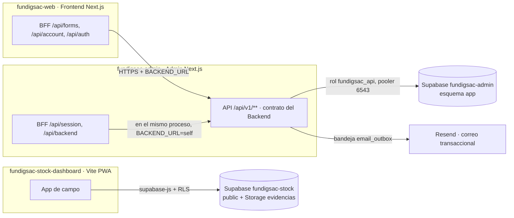

# 06 · Arquitectura vigente

Actualizado el 10 de noviembre de 2026.

## Decisiones

| Decisión | Motivo | Alternativa descartada |
| --- | --- | --- |
| La API vive dentro del proyecto Vercel `fundigsac-admin` | El Backend Java nunca tuvo servidor. El responsable eligió Supabase + Vercel (costo USD 0). Un solo despliegue más, sin un cuarto sitio. | Publicar el Backend Java en Render/Fly (costo mensual o servidor que se duerme) |
| Mismo contrato `/api/v1` que el Backend Java | Frontend y Admin ya hablaban ese contrato. No se tocó el código de los clientes y el Backend Java puede volver a ocupar `BACKEND_URL` más adelante. | Rediseñar la API |
| Esquema `app` fuera de la API REST de Supabase | Nadie con la clave pública de Supabase puede leer reclamos ni cuentas. | Tablas en `public` con políticas RLS |
| Rol `fundigsac_api` con solo DML y sin `DELETE` en registros legales | La base impide borrar hojas de reclamación o reescribir historiales aunque la aplicación falle. | Usar el rol `postgres` |
| Contraseña del rol generada en el equipo; a Postgres solo viajó el verificador SCRAM | El secreto no pasó por ninguna herramienta externa. | Contraseña en texto en una consulta |
| `postgres` 4.1.0 con `max_pipeline: 1` | Supavisor en modo transacción se cuelga con consultas en pipeline (documentación del driver, vía Context7). Se reprodujo: 10 s por petición antes, 0,8 s para seis en paralelo después. | Pool en modo sesión (pocas conexiones en plan gratis) |
| Correos por bandeja `email_outbox` + Resend | Un correo nunca se da por enviado si falló; se reintenta hasta ~1 día. | Envío directo dentro de la petición |
| Stock sigue en su Supabase propio | Tiene datos reales (187 productos, 113 movimientos, 38 fotos) y funciona. Mezclarlo con la API nueva no aportaba nada y agregaba riesgo. | Migrar Stock al esquema `app` |

## Entidades del esquema `app`

`user_accounts`, `user_roles`, `refresh_tokens`, `one_time_tokens`, `staff_login_codes`, `account_notes`, `quote_requests`, `quote_items`, `quote_status_events`, `quote_carts`, `quote_cart_items`, `inquiries`, `inquiry_events`, `complaints`, `complaint_events`, `data_subject_requests`, `legal_notices`, `consent_records`, `email_outbox`, `audit_events`, `folio_sequences`, `idempotency_records`, `rate_limits`.
