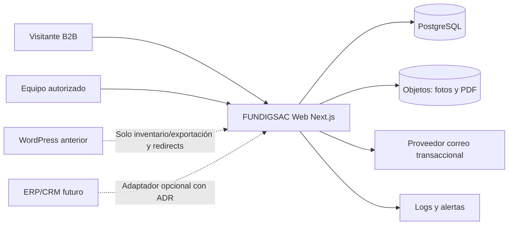
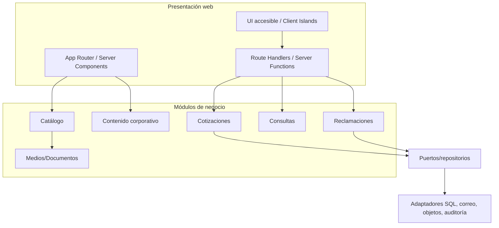
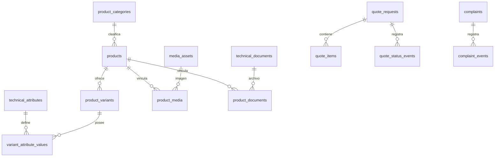
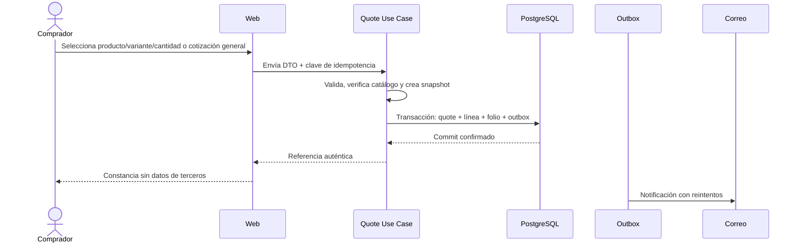
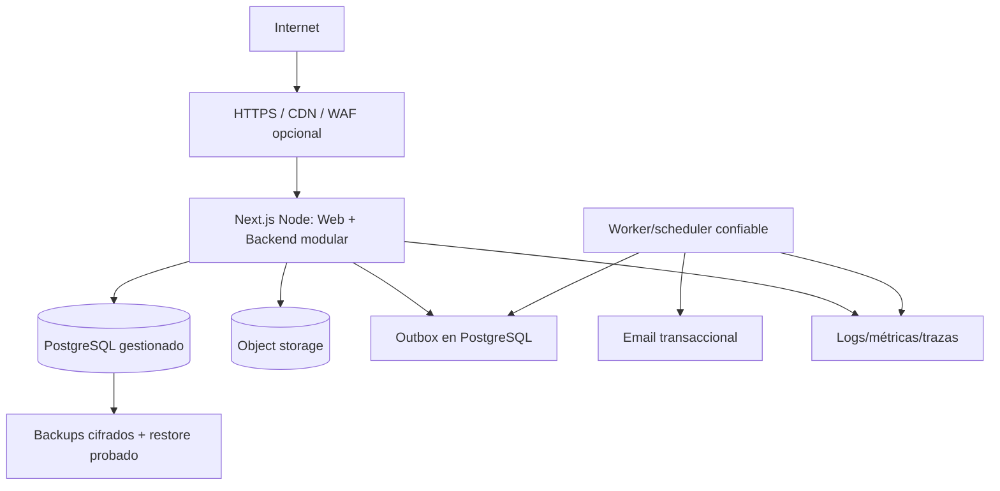

# FUNDIGSAC — Arquitectura maestra y especificación técnica integral del sistema web

> **Documento de implementación · Edición de consolidación 1.0 · 13 de octubre de 2026**  
> **Estado:** arquitectura de referencia para construir; no es evidencia de sistemas ya desarrollados ni aprobación comercial/legal.  
> **Producto:** plataforma web corporativa industrial B2B, catálogo técnico verificable y captación/gestión de cotizaciones.  
> **Decisión vigente:** desarrollo completamente en código; **WordPress queda excluido de la nueva solución**.  
> **Referencias:** `FUNDIGSAC_ADR-001_Arquitectura_Web.md`, `DESIGN.md`, Product Backlog original/extendido y sus anexos técnicos (véase §35).  
> **Responsables por confirmar:** Desarrollo/TI, Dirección, Ventas, Ingeniería/Producto, Marketing, Legal y Operaciones.

---

## Índice de navegación

- [0. Propósito, alcance de este archivo y cómo utilizarlo](#sec-0)
- [1. Visión del producto, negocio y usuario](#sec-1)
- [2. Límites de alcance y prioridades de entrega](#sec-2)
- [3. Principios de arquitectura y decisiones técnicas](#sec-3)
- [4. Stack tecnológico y políticas de versiones](#sec-4)
- [5. Repositorio recomendado y límites de módulos](#sec-5)
- [6. Renderizado, páginas públicas y estrategia de caché](#sec-6)
- [7. Catálogo B2B y taxonomía técnica](#sec-7)
- [8. Fichas técnicas y documentación de ingeniería (módulo crítico)](#sec-8)
- [9. Modelo de datos, integridad y persistencia](#sec-9)
- [10. Backend, casos de uso y API HTTP](#sec-10)
- [11. Procesos completos, estados y garantías](#sec-11)
- [12. Autenticación, autorización y administración](#sec-12)
- [13. Assets, archivos, PDFs y modelo 3D](#sec-13)
- [14. Sistema visual, componentes y UX](#sec-14)
- [15. SEO técnico, estructura editorial y migración de URLs](#sec-15)
- [16. Accesibilidad y calidad de interacción](#sec-16)
- [17. Seguridad y análisis de amenazas](#sec-17)
- [18. Privacidad, cookies y Libro de Reclamaciones (Perú)](#sec-18)
- [19. Despliegue, infraestructura y operación](#sec-19)
- [20. Observabilidad, analítica y gobernanza de eventos](#sec-20)
- [21. Pruebas de calidad y estrategia de aceptación](#sec-21)
- [22. Performance, métricas y presupuestos](#sec-22)
- [23. GitHub, CI/CD y flujo de ingeniería](#sec-23)
- [24. Desarrollo asistido por IA y gobernanza visual](#sec-24)
- [25. Plan de implementación por dependencias (sin nuevas fechas ficticias)](#sec-25)
- [26. Riesgos y mitigaciones](#sec-26)
- [27. Aprobaciones, gates y responsables](#sec-27)
- [28. Definition of Ready y Definition of Done](#sec-28)
- [29. Matriz de cobertura de flujos y arquitectura](#sec-29)
- [30. Escalabilidad prevista: decisiones basadas en métricas](#sec-30)
- [31. Primeros pasos concretos de programación](#sec-31)
- [32. Plantilla de Architecture Decision Record](#sec-32)
- [33. Decisiones de FUNDIGSAC todavía por cerrar](#sec-33)
- [34. Fuentes externas verificables](#sec-34)
- [35. Fuentes internas y conciliación de versiones](#sec-35)

**Anexos de trazabilidad:** [A — 40 entidades](#anexo-a) · [B — 54 API](#anexo-b) · [C — 62 pantallas](#anexo-c) · [D — 86 frames](#anexo-d) · [E — 18 gates](#anexo-e) · [F — 85 HU](#anexo-f) · [G — 242 tareas](#anexo-g) · [H — 124 pruebas](#anexo-h) · [I — Guía final](#anexo-i).

---

<a id="sec-0"></a>
## 0. Propósito, alcance de este archivo y cómo utilizarlo

Esta especificación es la **guía técnica de construcción** del sistema web FUNDIGSAC. Busca que cualquier desarrollador o agente de programación pueda comprender qué se va a construir, en qué orden, con qué límites arquitectónicos, cómo comprobar su funcionamiento y qué queda sujeto a autorización de la empresa. No sustituye los IDs, prioridades y criterios Gherkin de las historias de usuario del Product Backlog.

### 0.1 Orden de autoridad

1. **Decisiones explícitas y más recientes del proyecto**: prevalecen sobre propuestas antiguas; particularmente *no WordPress*, *web B2B y no tienda inicialmente*, *información técnica real*, *tres sectores empresariales*.
2. **Product Backlog**: requisitos, IDs FG-HU, alcance P0/P1/P2, trazabilidad, dependencias y aceptación; considerar obsoletas las suposiciones técnicas contradichas por decisiones posteriores.
3. **ADR-001 y nuevos ADR aprobados**: decisiones tecnológicas, compromisos, riesgos y contexto de cada elección.
4. **Este documento**: arquitectura de referencia unificada y procedimientos de implementación.
5. **DESIGN.md y diseños aprobados**: sistema visual, accesibilidad, estados de UI, activos y componentes.
6. **Catálogos/fichas oficiales validados por Ingeniería/Ventas**: verdad técnica de los productos.
7. **Código fuente, migraciones, contratos OpenAPI, pruebas y evidencia de CI**: verdad de lo efectivamente implementado, sin convertirlo automáticamente en decisión comercial.

Si dos documentos discrepan, **registrar el conflicto** y emitir un ADR o corrección del backlog. No copiar automáticamente una premisa antigua.

### 0.2 Distinción obligatoria de estados

- **CONFIRMADO por decisión de proyecto:** sitio 100 % código; sin WordPress; B2B industrial; enfoque en Saneamiento, Agricultura y Minería; catálogo real, fichas documentadas, solicitud de cotización, estética limpia; el producto y su evidencia prevalecen sobre decoración.
- **REFERENCIA TÉCNICA EXISTENTE:** Next.js 16 / React 19 / TypeScript estricto / Tailwind 4, App Router y monolito modular; documento ADR-001. Alinear versiones exactas con el proyecto real antes de instalar.
- **RECOMENDACIÓN PARA DESARROLLAR:** PostgreSQL transaccional, contratos REST cuando convengan, almacenamiento versionado, outbox, mínima administración privada, CI/CD, observabilidad y backups. Su selección final de proveedor/ORM exige ADR.
- **PENDIENTE DE APROBACIÓN:** datos de productos y normas por fabricante; paleta oficial; editoriales; condiciones de cotización; textos jurídicos; hosting; proveedor de correo; CRM/ERP; mecanismos de staff login y responsables de publicación.
- **FUERA DEL MVP / P1–P2:** tienda, carrito, stock y precios de compra, Izipay, cuentas de clientes, acceso social, dashboards complejos, asistente IA, 3D de catálogo masivo. Se preserva extensibilidad sin construir funciones incompletas o fingidas.

### 0.3 Cifras de trazabilidad documental, NO estado de software

| Elemento | Cantidad histórica | Interpretación |
|---|---:|---|
| Historias originales | 85 FG-HU | No duplicar ni reescribir los IDs originales |
| Épicas | 13 | Taxonomía de planificación histórica |
| Pantallas maestras | 62 | Alcance UX propuesto, **no 62 páginas obligatorias en P0** |
| Frames de diseño | 86 | 62 escritorio + 18 móvil + 6 oscuro |
| Historias UX adicionales | 62 FG-UX | Complemento de diseño, no 62 nuevas obligaciones de backend |
| Entidades de base de datos | 40 | **Modelo lógico propuesto**, incluyendo futuro P1/P2 |
| Campos / relaciones e índices | 293 / 70 | Inventario teórico a normalizar antes de migraciones |
| Contratos API | 54 | Rutas lógicas previstas; no todas necesarias/publicadas |
| Tareas técnicas | 242 | Desglose de implementación previsto, no tareas ejecutadas |
| Casos QA técnicos | 124 | Inventario de pruebas propuesto, no resultados ejecutados |

**Advertencia de planificación:** la estimación original de P0 (**41 HU, 368 h y fecha objetivo 31/12/2026**) suponía reaprovechamiento de WordPress. Ya no puede tratarse como compromiso vigente sin reestimación del desarrollo íntegro en código. P1/P2 carecen de fechas aprobadas.

---

<a id="sec-1"></a>
## 1. Visión del producto, negocio y usuario

### 1.1 Posicionamiento

FUNDIGSAC necesita un **sitio corporativo B2B y catálogo técnico orientado a ingenieros, proyectistas, responsables de compras, abastecimiento, logística y equipos comerciales**. No debe comportarse como marketplace ni publicitar descuentos, entrega inmediata o stock no acreditado. Debe ofrecer exposición y ventas asistidas, navegación técnica y una vía fiable para solicitar cotizaciones.

### 1.2 Ejes de navegación

1. **Saneamiento:** mostrar solo productos, aplicaciones, documentación, garantías y marcas comprobadas para este sector.
2. **Agricultura:** igual regla de evidencia, con productos pertinentes y atributos aplicables.
3. **Minería:** contenidos verificados y sin afirmar certificaciones ni usos en minería que no estén respaldados.

**Regla de modelado:** *sector* no es sinónimo de *categoría de producto*. Una familia, por ejemplo válvulas, puede relacionarse con varios sectores; se normaliza una relación muchos-a-muchos aprobada. No triplicar las mismas fichas ni crear tres catálogos desincronizados.

### 1.3 Familias técnicas que requieren inventario y aprobación

Como punto de trabajo se han mencionado válvulas, tuberías y accesorios de hierro dúctil, HDPE/termofusión, equipos de fusión/electrofusión, acoples, adaptadores, juntas, bridas, conexiones, marcos/tapas, medición y control. **Esto es un inventario orientativo, no un catálogo oficial ni prueba de disponibilidad.** Cada familia, marca y SKU publicable debe conciliarse contra archivos/fichas aprobados.

### 1.4 Recorridos prioritarios

- **Ingeniero:** Inicio → sector/categoría → filtro técnico aplicable → ficha → tabla y PDF vigente → consulta/cotización.
- **Comprador:** Inicio/Catálogo → producto y variante real → cantidad/unidad → datos mínimos → registro de solicitud → constancia genuina.
- **Visitante corporativo:** Inicio → Nosotros/Soluciones verificadas → canales de contacto reales.
- **Responsable comercial:** recepción privada de solicitud → consulta del producto/snapshot → asignación → actualización de estado con auditoría.
- **Reclamante:** Libro de Reclamaciones público → validación legal → registro duradero → constancia auténtica → gestión con permisos específicos.

### 1.5 Métricas propuestas de éxito

Encontrar una ficha sin ayuda; descargas válidas de PDFs; solicitudes registradas sin pérdida ni duplicados; porcentaje de formularios válidos; búsquedas sin resultado; tiempo hasta primera respuesta comercial (solo si se empieza a medir); rendimiento real y ausencia de defectos críticos. Eventos de analítica **sin datos identificables** ni activación de trackers opcionales antes de su validación legal.

---

<a id="sec-2"></a>
## 2. Límites de alcance y prioridades de entrega

| Módulo | P0: construir tras sus gates | P1: evolución condicionada | P2: investigación/piloto |
|---|---|---|---|
| Corporativo | Inicio, identidad real, Nosotros, navegación, contacto | Páginas y contenidos adicionales aprobados | — |
| Catálogo | Familias, sectores, filtros relevantes, ficha, variantes y documentos verificados | Importación/edición avanzada y cambios editoriales | Visualización especializada |
| Solicitudes | Cotización sencilla, consulta general, persistencia, constancia, notificación fiable | Área del cliente e historial si se aprueba | — |
| Legal | Privacidad, condiciones y Libro de Reclamaciones revisados | Herramientas internas más completas | — |
| Equipo interno | Solo acceso y operación **mínimos imprescindibles** para atender información/solicitudes/reclamos | 7 vistas administrativas complejas y permisos granulares | — |
| Identidad cliente | No crear login público artificial | Registro, recuperación, OAuth si existen reglas y contratos | — |
| Comercio y pagos | **No** comprar, checkout ni cobros en MVP | Solo si existen SKU habilitados, impuestos, stock, flete, contrato y pruebas Izipay | — |
| Analítica, i18n | SEO y español Perú; privacidad desde el inicio | ES/EN real, medición ampliada validada | IA/FAQ de asistencia |
| 3D | Galería 2D real y robusta | — | Piloto de una referencia validada |

**Política de release:** diseñar y pensar en el ciclo completo no equivale a desplegarlo. La web debe ser útil sin cuentas, pagos, ERP, 3D ni chatbot. Evitar tablas y pantallas especulativas que retrasen P0.

---

<a id="sec-3"></a>
## 3. Principios de arquitectura y decisiones técnicas

### 3.1 Decisión estructural

**Arquitectura elegida como referencia:** **monolito modular desplegable con Next.js App Router** y capacidad servidor en el mismo producto. Dentro de módulos con reglas reales se aplica **DDD pragmático + arquitectura limpia/hexagonal (puertos/adaptadores)**. Es viable escalar el backend más tarde sin empezar con una red de microservicios, API Gateway, Kubernetes o buses de eventos innecesarios.

Se entiende **backend propio** como código servidor controlado por FUNDIGSAC: Route Handlers/Server Functions, casos de uso y adaptadores, persistencia PostgreSQL, jobs y autenticación del equipo; **no requiere empezar con un servidor NestJS separado**. Extraer una API independiente se reserva para un ADR impulsado por necesidades medibles (integración ERP, consumidor externo, volumen u organización).

### 3.2 Decisiones de referencia

| ADR | Área | Dirección propuesta | Estado |
|---|---|---|---|
| ADR-001 | Arquitectura general | Next.js/TS, monolito modular, dominio aislado, SSR/HTML | Base documentada 08/10 |
| ADR-002 | Hosting | Runtime Node compatible, CDN/medios, staging y rollback | Elegir proveedor después de pruebas |
| ADR-003 | Persistencia | PostgreSQL, migraciones, backup/restore, ORM evaluado | Pendiente aprobación física |
| ADR-004 | Formularios/email | Validación de servidor, rate-limit, outbox, correo transaccional | Seleccionar proveedor/configuración |
| ADR-005 | Idiomas | `es-PE` inicial; rutas ES/EN solo con traducción revisada | P1 |
| ADR-006 | 3D | GLB autorizado, visor lazy con fallback; pilotos | P2 |
| ADR-007 | Gestión editorial | Code-first inicialmente; panel propio si el negocio lo exige | Definir operación mínima |
| ADR-008 | Comercio | Carrito/checkout/Izipay solo después de gates comerciales | P1 bloqueado |
| ADR-009 | Seguridad staff | Sesiones, MFA cuando proceda, RBAC de servidor, auditoría | Pendiente mecanismo elegido |
| ADR-010 | Catálogo técnico | Modelo de datos y protocolo de evidencia de especificaciones | Por validar con Ingeniería |
| ADR-011 | Archivos y versiones | Almacenamiento objeto portable, checksum y revisiones | Por elegir proveedor |
| ADR-012 | Estrategia caché | Política explícita de invalidación por publicación | Al seleccionar versión/configuración |

### 3.3 Reglas innegociables

- **Dependencia hacia adentro:** `domain` no importa Next.js/React/ORM/proveedor; `application` no importa implementaciones; `infrastructure` implementa puertos; `presentation` consume casos de uso/consultas.
- **No SQL en componentes React** ni acceso a secretos desde navegador.
- **API modular pública** por `index.ts`/contracts; prohibidos imports al interior de otro módulo salvo contrato declarado.
- **No CMS externo obligatorio** ni duplicidad entre un catálogo estático, panel y base de datos: una única fuente de verdad por entidad en cada fase.
- **No inventar campos de negocio** o constantes normativas: los datos sin soporte quedan no publicables.
- **Arquitectura adaptativa:** DDD solo donde hay invariantes y ciclo de vida; páginas de marketing, botones y menús no necesitan repositorios ni entidades.
- **Versiones fijadas y auditadas**: `package.json`/`pnpm-lock.yaml` son la fuente real; actualizar documentación al migrar paquetes.

### 3.4 Diagramas C4 simplificados





**Importante:** la línea `WordPress anterior` del diagrama no implica CMS, plugin, API ni backend activo del nuevo sitio; únicamente migración y auditoría del legado.

---

<a id="sec-4"></a>
## 4. Stack tecnológico y políticas de versiones

| Capa | Tecnología de referencia | Criterio de selección y límites |
|---|---|---|
| Runtime | Node.js LTS soportado | Fijar versión en CI y documentación; evitar versiones sin soporte |
| Frontend/servidor | Next.js 16.x estable, App Router | SSR/SSG/prerendering y Route Handlers; comprobar patch/API contra docs |
| UI | React 19 y TypeScript strict | Componentes servidor por defecto, cliente cuando requiere interactividad |
| Estilos | Tailwind CSS 4 + variables CSS | Tokens semánticos; no estilos acoplados a pantallas específicas |
| Componentes | Propios; Radix/shadcn selectivos | Solo cuando ayudan a accesibilidad y mantenimiento |
| Iconos | Lucide | Trazo consistente; nunca iconos/certificaciones ficticias |
| Formularios | Zod y React Hook Form cuando convenga | **Validación de servidor siempre**, cliente para UX |
| BD | PostgreSQL | Propuesta fuerte: integridad, índices, consultas relacionales y transacciones |
| Acceso DB | Drizzle **o** Prisma | Selección pendiente ADR-003, **elegir uno**, no ambos |
| Correo | Adaptador `NotificationSender` | Proveedor transaccional y DNS SPF/DKIM/DMARC por validar |
| Storage | S3-compatible o servicio equivalente | Abstracción, revisiones, checksum, permisos, TTL adecuados |
| Logging | Estructurado + request/correlation ID | Redactar PII; capturar errores e indicadores operativos |
| Tests | Vitest, Testing Library, Playwright, axe | Unit, integración, E2E, accesibilidad y visual |
| CI/CD | GitHub Actions o pipeline equivalente | PR, checks, aprobación manual a producción |
| Versionado | GitHub + pnpm | Lockfile, ramas cortas y PR revisadas |
| Diseño | DESIGN.md + Figma/Stitch aprobados | Diseño visual no es fuente de verdad de especificaciones |
| 3D futuro | `<model-viewer>` + GLB aprobado | Piloto opt-in; Three.js solo si se justifica |

**No instalar por costumbre:** NestJS, Redis, Docker Compose, Kubernetes, message broker, GraphQL, Elasticsearch, Payload, Auth0, GSAP, Three.js o un CMS, solo porque “parezcan escalables”. Son herramientas posibles para problemas observados, no entregables obligatorios.

**Actualización de Next.js:** verificar *Caching*, *Cache Components* y *revalidation* de la **versión y configuración realmente instaladas**; no extrapolar instrucciones de Next 13/14 a Next 16. En multiinstancia considerar caché compartida e invalidación consistente.

---

<a id="sec-5"></a>
## 5. Repositorio recomendado y límites de módulos

### 5.1 Estructura objetivo

```text
fundigsac-web/
├── src/
│   ├── app/
│   │   ├── (public)/
│   │   │   ├── page.tsx                  # Inicio
│   │   │   ├── productos/
│   │   │   │   ├── page.tsx
│   │   │   │   └── [categoria]/
│   │   │   │       ├── page.tsx
│   │   │   │       └── [producto]/page.tsx
│   │   │   ├── sectores/[sector]/page.tsx
│   │   │   ├── soluciones/[slug]/page.tsx
│   │   │   ├── nosotros/page.tsx
│   │   │   ├── recursos/[slug]/page.tsx
│   │   │   ├── contacto/page.tsx
│   │   │   ├── cotizar/page.tsx
│   │   │   ├── libro-de-reclamaciones/page.tsx
│   │   │   └── politicas/[slug]/page.tsx
│   │   ├── (staff)/staff/              # Solo si se implementa gestión mínima
│   │   ├── api/v1/                    # Route Handlers del backend
│   │   ├── layout.tsx
│   │   ├── error.tsx
│   │   ├── not-found.tsx
│   │   ├── robots.ts
│   │   └── sitemap.ts
│   ├── modules/
│   │   ├── catalog/
│   │   │   ├── domain/
│   │   │   ├── application/{use-cases,ports,dtos}/
│   │   │   ├── infrastructure/{repositories,mappers}/
│   │   │   ├── presentation/{components,queries}/
│   │   │   └── index.ts
│   │   ├── quotations/{domain,application,infrastructure,presentation}/
│   │   ├── inquiries/{domain,application,infrastructure,presentation}/
│   │   ├── complaints/{domain,application,infrastructure,presentation}/
│   │   ├── documents/{domain,application,infrastructure,presentation}/
│   │   ├── corporate/{application,presentation}/
│   │   └── staff/{application,infrastructure,presentation}/
│   ├── shared/
│   │   ├── ui/                         # Componentes genéricos
│   │   ├── layout/
│   │   ├── seo/
│   │   ├── styles/                     # Tokens semánticos
│   │   ├── config/
│   │   ├── server/                     # Infra común solo servidor
│   │   └── utils/                      # Utilidades realmente compartidas
│   └── content/                        # Seed aprobado temporal, no segundo CMS
├── public/{brand,images,documents,models}/
├── tests/{unit,integration,e2e,visual,fixtures}/
├── database/{migrations,seeds}/
├── docs/{adr,contracts,runbooks,content,security,seo,qa}/
├── .github/workflows/
├── scripts/
├── DESIGN.md
├── FUNDIGSAC_ARQUITECTURA_MAESTRA_2026.md
├── package.json
└── pnpm-lock.yaml
```

**Notas de implementación:** los grupos `(public)` y `(staff)` de Next.js no se convierten en segmentos URL. No crear carpetas sin un caso de uso real; si el producto ya tiene un `frontend/` organizado, migrar incrementalmente mediante PR, no sobrescribir el repositorio sin auditoría. `database/` es recomendación al activar PostgreSQL.

### 5.2 Convenciones

- Código y nombres internos en inglés; contenido de interfaz en español Perú inicialmente.
- Archivos públicos/slugs `kebab-case`; componentes `PascalCase`; funciones `camelCase`; tablas SQL `snake_case` si se acuerda.
- TypeScript `strict: true`, evitar `any`; usar tipos discriminados y validadores para datos de frontera.
- Códigos de producto/SKU preservan mayúsculas, guiones y ceros significativos; **no** inferir SKU desde nombre o slug.
- Importaciones entre módulos **solo mediante superficie pública**; lint/regla de boundaries impide acoplamiento entre internals.
- Dependencias de infraestructura registradas en composición o DI simple, no importadas directamente por reglas del dominio.
- Timezones: persistir instantes UTC; mostrar fecha/hora según `America/Lima` cuando corresponda; convertir con manejo explícito de zona.
- Extensibilidad: añadir un módulo nuevo sin tocar todos los existentes; romper un contrato exige migración, versión y pruebas.

### 5.3 Plantilla de caso de uso

```ts
// Ejemplo conceptual: ajustar a los tipos aprobados en el catálogo.
export interface QuoteRepository {
  save(request: QuoteRequest, idempotencyKey: string): Promise<{ reference: string }>;
}

export class CreateQuoteRequest {
  constructor(
    private readonly quotes: QuoteRepository,
    private readonly products: ProductReader,
    private readonly notifications: NotificationOutbox,
  ) {}

  async execute(command: CreateQuoteCommand): Promise<{ reference: string }> {
    // 1) validar DTO ya parseado y reglas de dominio
    // 2) leer producto/variante publicable si se identificó uno
    // 3) construir snapshot para conservar contexto técnico
    // 4) transacción: solicitud + idempotencia + evento outbox
    // 5) devolver referencia persistida; email se envía fuera del commit
    throw new Error('Ejemplo arquitectónico; no es implementación');
  }
}
```

No interpretar ese ejemplo como API funcional; su objetivo es **establecer dependencias y garantías**.

---

<a id="sec-6"></a>
## 6. Renderizado, páginas públicas y estrategia de caché

### 6.1 Pautas

- Páginas con contenido no sensible: HTML de servidor/prerenderizado según patrón de actualización; calidad SEO aunque no se ejecute JS.
- Catálogo: renderizado inicial indexable, filtros con estado en URL y consultas validadas; nunca exponer contenido no publicado.
- Ficha técnica: servidor lee dato aprobado; galería/filtros/tablas pueden usar pequeñas islas cliente sin hidratar toda la página.
- Formularios: validación en servidor, protección antiabuso, estado de envío accesible y persistencia de verdad.
- `/staff`: autenticación y autorización de servidor en cada ruta/acción; **no** prerenderizar datos privados ni cachearlos públicamente.
- Respuestas sensibles: `Cache-Control: no-store`; no incluir PII en URLs, metadatos ni analítica.
- Fecha/cambio de ficha: publicar revisión e invalidar rutas y tags pertinentes; generar nuevo sitemap cuando correspondan URLs nuevas.

### 6.2 Matriz de caché

| Recurso | Política | Invalidar cuando |
|---|---|---|
| Inicio | Prerender/cache con revisión | Cambian CTA, portada o productos destacados aprobados |
| Listado y categorías | Cache de lectura, URLs controladas | Publicación/retiro/sector/categoría/atributo |
| Ficha pública | Cache por producto/versión | Especificación, PDF, imagen o estado aprobados |
| Descarga pública | Archivo immutable versionado + URL canónica estable controlada | Se revoca o sustituye una versión |
| Cotización/formulario | **Sin cache de datos privados** | No aplica |
| Área interna | **No cache compartida** | No aplica |
| Consentimiento | Datos bajo contexto legal | Cambio de texto o elección |

**Precaución:** los mecanismos `revalidatePath`, `revalidateTag`, `cacheLife`, `use cache` y configuración varían según Next.js; implementarlos solo conforme a la documentación de la versión instalada y pruebas de integración. No mezclar dos modelos de caché sin entender sus consecuencias.

### 6.3 Inventario mínimo de rutas visibles P0

`/`, `/productos`, `/productos/[categoria]`, `/productos/[categoria]/[producto]`, `/sectores/[slug]` (si los contenidos sectoriales están aprobados), `/nosotros`, `/soluciones` (si respaldado), `/recursos`, `/contacto`, `/cotizar`, `/libro-de-reclamaciones`, `/politicas/[slug]`, confirmación segura sin índice, 404/errores. Las **62 pantallas UX** figuran en el anexo, pero muchas son plantillas/estados y no exigen nuevas URLs.

---

<a id="sec-7"></a>
## 7. Catálogo B2B y taxonomía técnica

### 7.1 Modelo conceptual

- `Sector`: Saneamiento, Agricultura y Minería, con landing opcional, descripción verificada y productos asociados.
- `ProductCategory`: familia técnica jerárquica (válvulas, tuberías, etc.) independiente del sector.
- `Product`: ficha comercial/técnica y estatus editorial (borrador, en revisión, aprobado, publicado, retirado).
- `ProductVariant`: opción físicamente comercializable/consultable, con identificador real o código de variante validado.
- `TechnicalAttribute`: definición tipada de atributo por familia: DN, PN, SDR, material, unión/conexión, dimensión, norma, rango, aplicación; **no asumir que todos aplican a todos**.
- `VariantAttributeValue`: valor tipado, unidad y fuente de verificación; no concatenar libremente mediciones incompatibles.
- `TechnicalDocument`: archivo, edición/fecha, idioma, procedencia, checksum y estado.
- `MediaAsset`: fotografías/render reales autorizados, orden, tipo, créditos/licencia, alt y revisión.
- `Brand/Manufacturer`: solo si existe documentación y autorización de exhibición; diferenciar fabricante, línea, comercializador y marca propia.

**Ajuste recomendado al modelo lógico de 40 entidades:** la clasificación transversal por sector necesita `industry_sectors` + `product_sectors` (o asociación equivalente) si no están contempladas. Tratarlo como **cambio de esquema propuesto**, no afirmar que estas tablas ya existen. La lista original del anexo mantiene intacto su conteo histórico.

### 7.2 Reglas de publicación

1. No publicar un producto si está en borrador, retirado o carece de aprobación responsable.
2. Cada afirmación técnica debe tener fuente (PDF, hoja fabricante, ensayo o especificación interna aprobada).
3. No inventar DN, PN, SDR, materiales, medidas, bridas, normas, certificaciones, ISO, homologaciones ni usos.
4. Filtros se crean **solo para atributos aplicables con datos reales suficientes**.
5. La ficha puede mostrar catálogo de variantes con valores heterogéneos; no rellenar faltantes con cero ni “universal”.
6. Precios y disponibilidad **no** se muestran en P0 salvo aprobación explícita; `commercial_mode=quote_only` por defecto.
7. Un producto puede vincularse a varios sectores; una categoría no duplica fichas bajo nuevos slugs innecesarios.
8. Si una familia no tiene productos/documentación validados, no se publica como si estuviera lista.
9. Revisión de textos SEO, fotos y PDF antes de publicar; mantener quién aprobó, cuándo y evidencia.
10. URLs estables y redirecciones correctas si se cambia un slug.

### 7.3 Filtros y búsqueda

Implementar de forma incremental: categoría → texto → atributos realmente disponibles (DN/PN/material/conexión). Usar una lista de campos permitidos; coerción y rangos validados; paginación limitada en servidor; conteos calculados a partir de productos publicados. Primer nivel con índices PostgreSQL adecuados; introducir búsqueda especializada externa solo si el rendimiento/relevancia lo requieren.

---

<a id="sec-8"></a>
## 8. Fichas técnicas y documentación de ingeniería (módulo crítico)

### 8.1 Principio

La ficha es una **herramienta profesional para especificar, comparar y solicitar un producto físico real**, no un afiche decorativo ni una imagen generada sin fidelidad. Debe presentar suficiente información técnica para decisión preliminar del ingeniero y mostrar claramente la fuente oficial.

### 8.2 Estructura de ficha web

1. **Identidad:** nombre comercial y técnico, familia, código/SKU/modelo real cuando exista, marca/fabricante con aprobación.
2. **Fotografía principal auténtica:** producto exacto, geometría y acabado fieles; galería de ángulos disponibles, sin repetir la misma imagen fingiendo perspectivas.
3. **Síntesis:** función, contexto de aplicación y principales ventajas documentadas en texto breve, no prosa genérica.
4. **Selección de variante:** DN/PN y atributos propios de la familia; cantidad/unidad cuando corresponda.
5. **Tabla estructurada:** materiales por componente, dimensiones con unidades, conexiones, presión, temperatura, compatibilidad, normas y ensayos **solo si comprobados**.
6. **Planos/cortes técnicos:** cotas, leyendas y número de figura verificables; distinguir dimensiones nominales de medidas reales.
7. **Documentos:** PDF actual, fecha/edición, fabricante/origen y botón de descarga que funcione.
8. **Aplicaciones/sectores:** relación sustentada; nada de promesas de uso sin evidencia.
9. **Estados honestos:** atributo no acreditado se omite o se presenta como pendiente interno, **nunca se simula con un valor plausible**.
10. **CTA:** `Solicitar cotización` vinculada a la variante real y cantidad; no botón de compra sin autorización.
11. **SEO y accesibilidad:** semántica, breadcrumbs, alt, tabla con encabezados y metadata propia.
12. **3D opcional:** solo un piloto validado, diferido y con fallback a foto real.

### 8.3 Matriz sugerida de evidencia por dato

| Campo técnico | Validación indispensable | Acción ante ausencia |
|---|---|---|
| DN, PN, SDR, clase | Catálogo/hoja oficial del modelo y versión | No mostrar como afirmación |
| Material de cuerpo/cuñas/juntas | Especificación exacta del fabricante | Omitir, no asumir |
| Diámetros, distancia entre bridas, cotas | Plano real con norma y tolerancias, unidades | Bloquear tabla de cotas |
| Norma de producto, bridas, pruebas | Documento aplicable al SKU/modelo concreto | No exhibir escudo/ISO |
| Certificaciones ISO | Certificado actual, alcance, titular y vigencia | **No mostrar iconos/sellos ISO** |
| Temperatura, presión, aplicación | Datasheet aprobada para variante, no similar | No afirmar |
| Marca y logotipo del fabricante | Derechos y vinculación real | Omitir |
| Fotos / geometría de tornillos/pernos | Foto auténtica del mismo modelo, aprobación de Ingeniería | Corregir edición/3D antes de publicar |
| Disponibilidad/stock | Fuente operativa de stock y política de actualización | No mostrar en P0 |

### 8.4 Cadena editorial de contenido técnico

`Recepción de PDF/fotos → inventario/huella SHA-256 → extracción manual asistida → normalización por variante → contraste 2 fuentes si existe discrepancia → revisión Ingeniería/Ventas → aprobación editorial → publicación versión → QA web/PDF → historial y reversión.`

Los dibujos y fotografías de piezas específicas deben respetar cantidades/posiciones físicas (bridas, volantes, pernos, tuercas, tapas, bocas, accesorios), medidas y color reales. En FUNDIGSAC ya se exigió precisión visual de productos en múltiples ángulos: **un render atractivo pero físicamente incorrecto se rechaza**. No incrustar logos digitales que aparenten grabados reales a menos que el producto lo tenga o exista aprobación explícita y señalización correcta.

### 8.5 Documento PDF descargable

Una ficha PDF debe tener control de revisión, producto identificable, fotografías autorizadas, esquema/cotas con leyendas, tabla de características con unidades, certificaciones únicamente respaldadas por documentos y datos de contacto oficiales. Debe poder leerse/descargarse correctamente en móvil y escritorio. Al actualizar un PDF, preservar historial interno, actualizar referencia vigente y comprobar todos los enlaces web.

### 8.6 Controles de calidad de documentos

- [ ] Modelo exacto, no otra válvula parecida.
- [ ] Cada cota y especificación tiene unidad y fuente.
- [ ] Toda imagen representa fielmente el producto real.
- [ ] Certificados, sellos, claims y logos poseen respaldo válido.
- [ ] Versiones vigente e histórica distinguibles.
- [ ] Descarga, preview, impresión y enlaces probados.
- [ ] Alt/lectura de tabla y contraste adecuados.
- [ ] Aprobación Ingeniería/Ventas registrada antes de publicar.

---
<a id="sec-9"></a>
## 9. Modelo de datos, integridad y persistencia

### 9.1 Arquitectura de datos propuesta

**PostgreSQL** será el candidato de persistencia transaccional cuando se implanten las operaciones reales; proveedor, versión exacta y ORM requieren ADR-003. En el anexo técnico anterior se definieron **40 entidades lógicas y 293 campos de referencia**, no 40 tablas creadas. Las entidades de P1/P2 no deben migrarse anticipadamente porque agregan responsabilidades de comercio que aún no son producto aprobado.

**Estrategia P0 recomendada:** persistir de manera fiable `inquiries`, `quote_requests`, `quote_items`, `quote_status_events`, `complaints`, `complaint_events`, `notification_outbox`, `audit_events`, `legal_notices` (según requisito) y estructuras catalográficas cuando haya edición real. La lectura editorial puede iniciar con un **manifiesto tipado y aprobado** si facilita un slice rápido; cuando se migra catálogo a PostgreSQL, apagar ese manifiesto como fuente de verdad. No mantener dos catálogos “maestros”.

### 9.2 Módulos de persistencia previstos

| Dominio | Entidades lógicas principales | Reglas |
|---|---|---|
| Corporativo | `site_pages` | Publicación explícita, revisiones y atribución |
| Catálogo | `product_categories`, `products`, `product_variants`, `technical_attributes`, `variant_attribute_values` | Slug único, estatus verificable, variantes válidas |
| Activos/documentos | `media_assets`, `product_media`, `technical_documents`, `product_documents` | Relación many-to-many y checksum/versionado |
| Atención | `inquiries` | Datos mínimos y separación de motivos |
| Cotizaciones | `quote_requests`, `quote_items`, `quote_status_events` | Folio, estado, snapshots, consistencia |
| Reclamaciones | `complaints`, `complaint_events` | Constancia legal, retención y trazabilidad |
| Legal | `legal_notices`, `consent_evidence` | Evidencia/versiones según validación jurídica |
| Operación | `notification_outbox`, `audit_events` | Reintentos, logs transaccionales y permisos |
| Identidad/comercio/pagos | Entidades P1 del anexo | Solo cuando negocio autorice |
| Ayuda | `faq_entries` P2 | Contenido trazable, IA no obligatoria |

### 9.3 Esquema relacional conceptual



**Extensión sectorial (revisión de modelo, no parte de las 40 originales):** `industry_sectors` y `product_sectors` con PK compuesta `(product_id, sector_id)` y FK. No inferir que toda categoría pertenece automáticamente a todos los sectores.

### 9.4 Políticas físicas recomendadas

- ID interno UUID/UUIDv7 o equivalente **solo si se elige y se documenta**. Para referencias comerciales externas usar identificadores separados (SKU, código visible, folio).
- FK y constraints estrictos en campos relacionales; índices en FK, `(status, published_at)`, slugs únicos, `(category_id, status)`, claves de idempotencia y timestamps de bandejas.
- `created_at`, `updated_at` controlados en servidor; trazabilidad de aprobación (`approved_by`, `approved_at`) y publicación si existen roles autorizados.
- Modelar **unidades físicas explícitamente**: valores numéricos adecuados, unidad normalizada, tolerancia si procede y tipo de atributo. No guardar todo en descripciones concatenadas sin estructura.
- Propiedades particulares por familia: columnas normalizadas para claves comunes y extensión controlada (`JSONB` validado por esquema) **solo** si está justificada; no sustituir relaciones críticas por JSON arbitrario.
- Usar `numeric/decimal`, nunca `float` como representación definitiva de dinero cuando se active P1.
- Constraints de estado válidas; transiciones complejas validadas en dominio **y** chequeos básicos en DB.
- **No borrar en cascada** cotizaciones, históricos de documento ni reclamaciones por retirar un producto. Conservar snapshot inmutable mínimo conforme a reglas legales.
- Definir política de `soft delete` por entidad según negocio/Legal; no ocultar problemas con `deleted_at` universal.
- Índices y query plans medidos, no añadir índices indiscriminados; revisar cardinalidad e impacto en escrituras.

### 9.5 Transacciones e idempotencia

`CreateQuote` y `CreateComplaint` deben efectuar en **una transacción** al menos registro, referencia única, evento/outbox y marca de idempotencia. El envío del correo no forma parte de la transacción: un trabajador reintenta hasta éxito o alarma. Solicitudes concurrentes con la misma clave y payload no producen folios diferentes.

**Contrato de idempotencia sugerido:** `Idempotency-Key` emitido por cliente o generado en contexto controlado; hash del cuerpo, alcance por endpoint/actor, TTL por política, constraint única y respuesta original almacenada. Si llega la misma key con distinto payload, retornar conflicto. La duración exacta necesita decisión operativa.

### 9.6 Migraciones y semillas

- Migraciones **versionadas en Git**, una por cambio lógico; registrar razón y riesgo.
- Separar migración de estructura, migración de contenido y publicación en prod.
- Para cambios de alto tráfico usar patrón **expand → migrate/backfill → contract**; compatibilidad de versiones durante rollout.
- `seed` solo con datos aprobados o claramente sintéticos en entornos no productivos.
- Respaldo antes de migraciones riesgosas; restauración probada y plan de rollback (rollback de código ≠ deshacer siempre datos).
- No ejecutar `push` destructivo automático a producción; PR y revisión de SQL generado.

### 9.7 Procedencia y calidad de datos

A cada fuente técnica asignar `source_id`, nombre, emisor, URL o archivo, revisión, fecha de revisión, revisor y autorización; relacionarla con los campos/variantes que respalda. Establecer workflow de `draft → needs_review → approved → published → archived` y evitar prometer historial editorial completo si P0 usa publicación vía PR. Documentar cómo se reemplazan PDFs obsoletos y se revocan enlaces públicos.

---

<a id="sec-10"></a>
## 10. Backend, casos de uso y API HTTP

### 10.1 Frontera de infraestructura

El backend resuelve autenticación del staff, publicaciones, lectura de catálogo aprobado, consultas, cotizaciones, reclamaciones, documentos, notificaciones y auditoría. Exponer API HTTP solo donde aporta acceso a cliente, integración o pruebas; los Server Components pueden invocar casos de uso del mismo proceso **sin hacer HTTP a sí mismos**. Las rutas del anexo son **contratos lógicos**, no endpoints implementados.

### 10.2 Estrategia de versionado

Prefijo de referencia para endpoints HTTP públicos nuevos: `/api/v1`. Sin embargo, una ruta se implementa únicamente si hay consumidor real. Documentarla mediante OpenAPI 3.1, ejemplos, autorización, Zod de entrada, tipos DTO de salida y códigos de error. No acoplar el dominio a los detalles de JSON ni a los códigos HTTP.

### 10.3 Contratos P0 prioritarios (inventario de referencia)

| Operación lógica | Acceso | Finalidad | Condición |
|---|---|---|---|
| `GET /catalog/categories` | Público | Familias publicadas | G03 |
| `GET /catalog/products` | Público | Filtros/paginación sobre publicados | G03/G04 |
| `GET /catalog/products/{slug}` | Público | Datos de ficha verificados | G04 |
| `GET /catalog/filters` | Público | Facetas reales | G03 |
| `GET /resources` | Público | Documentos aprobados | G04 |
| `GET /resources/{id}/download` | Público | PDF vigente/autorizado | G04 |
| `POST /inquiries` | Público con límite | Consulta general | G11 |
| `POST /quotes` | Público con límite | Solicitud simple con folio | G02/G11 |
| `GET /quotes/{reference}/receipt` | Token seguro | Constancia mínima | G11 |
| `POST /complaints` | Público con límite | Reclamo/queja formal | G12 |
| `GET /complaints/{reference}/receipt` | Token seguro | Constancia | G12 |
| `GET/PATCH /staff/quotes` | Staff permitido | Atención de solicitudes | G09 |
| `GET/PATCH /staff/complaints` | Staff permitido | Gestión legal con auditoría | G09/G12 |
| `GET /legal/{type}` | Público | Aviso vigente | G11 |
| `GET /health/ready` | Monitor restringido | Estado de dependencias | G17 |

Estos ejemplos conservan los nombres lógicos originales; al construir en Next.js definir si se consumen como `/api/v1/...` o como llamada directa a caso de uso del servidor. **Nunca** publicar una API para cumplir un número de inventario.

### 10.4 Contrato de entrada de cotización — esquema conceptual

```json
{
  "contact": {
    "name": "Nombre del solicitante",
    "email": "compras@empresa.example",
    "company": "Empresa opcional"
  },
  "requestedProduct": {
    "productId": "ID validado si aplica",
    "variantId": "ID validado si aplica",
    "quantity": "cantidad positiva",
    "unit": "unidad aprobada"
  },
  "message": "Consulta técnica opcional",
  "privacyNoticeVersion": "versión real del aviso mostrado"
}
```

**No es un JSON Schema de producción**: placeholders semánticos y campos finales sujetos a G02/G11. Permitir cotización general **sin SKU** cuando el usuario solo conozca su necesidad. No forzar listas BOM, uploads, órdenes de compra, asignaciones multiárea o códigos comerciales automáticos complejos sin validación de Ventas.

### 10.5 Respuesta y errores

Ejemplo de éxito veraz (conceptual):

```json
{
  "reference": "folio generado por backend",
  "status": "received",
  "receivedAt": "instante UTC confirmado",
  "message": "Solicitud registrada"
}
```

Ejemplo de error normalizado (contrato a formalizar):

```json
{
  "error": {
    "code": "VALIDATION_ERROR",
    "message": "Revisa los campos indicados",
    "fields": [{ "field": "quantity", "code": "INVALID_VALUE" }],
    "requestId": "correlación sin datos sensibles"
  }
}
```

- `400/422`: parámetros/formulario inválidos; `401`: sin sesión; `403`: sin permiso; `404`: no existe/no publicable; `409`: conflicto de versión/idempotencia; `413`: archivo excesivo; `429`: rate limiting; `500/503`: error o dependencia caída.
- Mensajes públicos no revelan usuarios, secretos, rutas internas, esquema BD o información de terceros.
- Paginación con límite servidor y orden determinista; tamaño por defecto documentado, no sin límite.
- Error de correo posterior al commit **no** convierte registro persistido en “fallo de cotización”; queda notificación pendiente con alerta.
- Error de BD **sí** impide afirmar éxito y obliga a acción de recuperación.

### 10.6 Seguridad de la API

Validar siempre en servidor; permitir solo keys/campos conocidos; normalizar emails/URLs sin romper datos; prohibir mass assignment. Restringir CORS a orígenes específicos solo donde sea necesario (mismo origen de preferencia). Validar `Origin`/CSRF para mutaciones con cookies según arquitectura. Limitar tamaños, adjuntos (si se aprueban), frecuencia e intentos. `GET` no debe alterar estado de negocio. Operaciones PATCH con control de versión; comprobación de permisos **por objeto**.

---

<a id="sec-11"></a>
## 11. Procesos completos, estados y garantías

### 11.1 Lectura de catálogo

`Request → ruta pública → query servicio catálogo → repositorio fuente autorizada → filtro status=published → DTO de lectura → render SEO → navegación/descarga → evento agregado opcional.`

**Fallos:** producto eliminado/no publicado → 404; familia vacía → no publicar la categoría vacía o mostrar estado aprobado; filtro inválido → 400/UX de recuperación; PDF vencido → no enlazarlo; imagen ausente → placeholder neutro en staging y bloquear aprobación de ficha final si es imprescindible.

### 11.2 Solicitud de cotización



**Estados sugeridos** (validar con Ventas): `received → assigned → in_review → responded → closed` y cancelación/duplicado bajo política. Guardar actor, fecha, motivo y versión en cada cambio; no permitir transiciones arbitrarias desde la UI. **La recepción de solicitud no promete una cotización económica automática**.

### 11.3 Formulario de contacto

Separar **consulta general** de cotización y reclamación. `POST /inquiries`: validación, antispam, persistencia, confirmación solo tras commit, outbox y bandeja operativa. No exigir cuenta. Cuando el mensaje contiene información sensible, aplicar retención/acceso conforme a Legal.

### 11.4 Libro de Reclamaciones

`Abrir formulario público → validar campos legalmente exigidos → informar tratamiento → persistir reclamo → referencia y constancia auténticas → notificar → bandeja restringida → respuesta y trazabilidad.`

**Importante:** la Ley, reglamentos, formato, campos mínimos, plazos, notificación, retención, atención de menores, reclamo/queja y canal de constancia deben revisarse con asesoría jurídica peruana vigente antes del lanzamiento. **No inventar folio de cliente, plazo legal ni mensaje “presentado” si hubo error al guardar.** El Libro no puede depender de crear usuario/contraseña.

### 11.5 Publicación de productos y PDFs

`Documento fuente → extracción/registro → validación de Ingeniería → aprobación editorial → persistencia → invalidación de caché → sitemap → QA pública → historial.`

Si el contenido vive inicialmente en archivos tipados, la aprobación se da por PR con revisor de negocio; al abrir editor privado, preservar estados y auditoría. El backoffice completo no es prerrequisito para tener catálogo correcto.

### 11.6 Operación interna P0 mínima

La bandeja interna de cotizaciones/reclamaciones requiere autenticación segura y permisos de servidor aunque no existan las 7 pantallas completas de P1. Implementar **el mínimo funcional real** o usar un flujo operativo autorizado alternativo (p. ej., recepción segura y tablero privado) sin afirmar que los emails sustituyen la persistencia. Resolver mediante ADR-009 la anomalía documental: `role_assignments` estaba clasificado P1, pero P0 necesita control de acceso del staff; puede implementarse una estrategia de roles mínima antes de P1 sin activar cuentas de clientes.

---

<a id="sec-12"></a>
## 12. Autenticación, autorización y administración

### 12.1 Separación fundamental

- **Visitantes públicos**: navegan, descargan documentos públicos, consultan/cotizan y acceden al Libro sin cuenta.
- **Equipo interno P0**: se autentica para operar solicitudes, contenido o reclamos según autorización; no necesariamente usa el mismo modelo de las cuentas públicas futuras.
- **Cuentas cliente P1**: no se construyen ni publican hasta que existan objetivos, política y aprobación.

### 12.2 Principios técnicos para staff

- Elegir una solución de identidad mantenida/validada; no desarrollar criptografía o OAuth desde cero.
- Sesiones cortas y rotación/expiración apropiada; cookies `Secure`, `HttpOnly`, `SameSite` según flujo.
- MFA para privilegios administrativos cuando sea compatible con proveedor/política.
- Autorización RBAC en **cada use case del backend y sobre cada registro**, nunca solo con ocultamiento de botones.
- Roles iniciales sugeridos (revisar con Dirección): `administrator`, `sales`, `catalog_editor`, `catalog_reviewer`, `legal_support`, `read_only`.
- Permiso **separa** `catalog.draft.write`, `catalog.publish`, `quote.staff.read`, `quote.assign`, `complaint.staff.read`, `complaint.respond`, `staff.users.manage`, `audit.read`.
- Registrar acciones administrativas significativas sin secretos ni datos innecesarios.
- Protección contra IDOR, fuerza bruta, enumeración de usuarios y elevación horizontal/vertical.
- Roles y personal dados de baja deben perder acceso efectivo; revocación/rotación probadas.

### 12.3 Matriz condensada de ejemplo

| Acción | Público | Ventas | Editor catálogo | Revisor | Atención legal | Admin |
|---|---:|---:|---:|---:|---:|---:|
| Ver catálogo publicado | Sí | Sí | Sí | Sí | Sí | Sí |
| Enviar solicitud | Sí | Según canal | No necesaria | No necesaria | No necesaria | Según canal |
| Ver solicitudes internas | No | Sí | No | No | No | Sí |
| Cambiar estado comercial | No | Sí | No | No | No | Sí |
| Editar borrador técnico | No | No | Sí | No | No | Sí |
| Publicar ficha aprobada | No | No | No | Sí | No | Sí |
| Ver/gestionar reclamaciones | No | No | No | No | Sí | Sí |
| Cambiar permisos | No | No | No | No | No | Sí con controles |

**No tratar esta tabla como política final de FUNDIGSAC:** requiere aprobación G09 y prueba automatizada de autorización. Menor privilegio por defecto.

### 12.4 Administración avanzada P1

Las **7 pantallas M01–M07** del backlog abarcan administración de usuarios, catálogo, cotizaciones, pedidos, pagos, consultas y reclamaciones; no implica activar pedidos/pagos. Diseñar módulos independientes y condicionados por flags de despliegue/aprobación; no mostrar menús que no tengan una función real.

---

<a id="sec-13"></a>
## 13. Assets, archivos, PDFs y modelo 3D

### 13.1 Organización y seguridad

Separar originales maestros, derivados web, documentos vigentes, archivados y privados. En P0 pequeño puede usarse `public/` para media aprobada y estable; al necesitar uploads, ediciones frecuentes o control granular, introducir objeto storage con rutas/keys opacas y adaptador `DocumentStorage`. Nunca confiar en un nombre de archivo provisto por usuario; generar key interna, preservar nombre visible seguro y validar archivo.

### 13.2 Políticas por tipo

| Recurso | Recomendación |
|---|---|
| Logo | Usar archivo FUNDIGSAC auténtico aprobado; no reconstrucción generativa |
| Fotografía producto | Mantener original, producir derivadas responsivas; fidelidad 1:1 |
| Foto de fabricante | Autorización/licencia y atribución según acuerdo |
| PDF técnico | MIME/tamaño/firma cuando proceda, hash, versión, fecha, estado y procedencia |
| ISO/certificado | Verificar titular, producto cubierto y vigencia antes de usar el sello |
| GLB/glTF | Modelado fiel, licencias, tamaño, fallback 2D, carga a demanda |
| Archivo privado | Control de autorización y URLs firmadas con caducidad cuando proceda |

### 13.3 Performance media

Formatos modernos con fallback; `next/image`, dimensiones conocidas, `sizes`, hero específico desktop/móvil cuando justificado, lazy load bajo pliegue, preload solo para verdadero LCP. PDFs servidos con tipo y cabeceras correctos; no mostrar enlaces rotos ni descarga con nombre ilegible.

### 13.4 3D opcional

No generar 3D masivo “de la imaginación”. En un piloto, foto como primera experiencia; activar `<model-viewer>` tras clic; modelo GLB técnico validado; sin autoplay giratorio; controles accesibles y restablecer cámara; no interceptar scroll táctil; fallback a fotos si no hay WebGL o falla. Medir impacto real antes de extender.

---

<a id="sec-14"></a>
## 14. Sistema visual, componentes y UX

### 14.1 Línea visual confirmada

B2B industrial **sobrio, premium, claro, compacto, accesible, profesional**, sin apariencia de plantilla genérica de IA. Imágenes reales de productos como protagonistas; hero limpio y con profundidad visual controlada; repetir Saneamiento/Agricultura/Minería solo donde tenga sentido, **no duplicar secciones ni iconos**. Evitar gradientes neón, cards saturadas, estadísticas comerciales no verificadas, parallax pesado y banners rotativos constantes.

### 14.2 Design tokens

Un solo origen para `--color-*`, `--surface-*`, `--border-*`, `--text-*`, `--font-*`, `--space-*`, `--radius-*`, `--shadow-*`, `--motion-*`. Colores **a derivar del logotipo original y aprobar**; `DESIGN.md` contiene propuestas provisionales, **no identidad oficial confirmada**. El acento rojo solo si coincide con validación de marca; no aplicar colores arbitrarios a todo. Tema claro/oscuro sobre tokens, no duplicación manual de páginas.

### 14.3 Componentes reutilizables

`SiteHeader`, `MegaMenu/ProductsMenu` (solo si mejora navegación), `MobileNav`, `SiteFooter`, `Breadcrumbs`, `Button`, `Input`, `Select`, `Textarea`, `FieldError`, `ProductCard`, `CategoryCard`, `TechnicalSpecsTable`, `DocumentDownload`, `MediaGallery`, `QuoteForm`, `Search/Filters`, `EmptyState`, `LoadingSkeleton`, `ErrorState`, `ConsentPreferences` (solo si aplica), `ThemeToggle`, `StaffDataTable` (si existe backoffice).

Para cada uno probar base/hover/active/focus-visible/disabled/loading/invalid, responsive, teclado y claro/oscuro. **No instalar toda una librería de componentes** por una sola vista.

### 14.4 Motion

Animación preferentemente CSS `transform` y `opacity`, transiciones útiles aproximadas entre 120–280 ms; apertura de menú y galerías discretas, sin retrasar texto ni CTA. Respetar `prefers-reduced-motion`; no animación infinita, scroll controlado forzadamente ni scroll-jacking. GSAP/Framer Motion solo en una interacción con justificación de UX/performance.

### 14.5 Responsive

QA en 320, 375, 768, 1024, 1440 y cuando sea posible 1920 px. La galería de ficha, tabla técnica y CTA deben ser usables con una mano; tablas con scroll propio etiquetado o transformación semántica, sin overflow horizontal del documento. Evitar menús móviles excesivos, header gigante y CTA fijo que tape contenido.

### 14.6 Idioma

Contenido inicial `es-PE`; preparar capa de textos si simplifica migración, pero **sin switch EN ficticio**. P1 requiere traducción especializada de terminología y fichas, URLs localizadas, `hreflang`, `lang` y QA SEO; no traducción automática publicada sin revisión.

---

<a id="sec-15"></a>
## 15. SEO técnico, estructura editorial y migración de URLs

### 15.1 Principios por pantalla

Título único, descripción útil, H1 real, jerarquía H2/H3, breadcrumbs, enlaces semánticos, canonical absoluto, alt descriptivo, imágenes autorizadas, Open Graph validado y HTML accesible. `sitemap.xml` solo incluye URLs publicadas/canónicas; `robots.txt` configura rastreo adecuado; no indexar confirmaciones ni perfiles ni páginas staff. No generar miles de URLs de filtros SEO sin valor.

### 15.2 Datos estructurados

`Organization` y `LocalBusiness` únicamente con datos empresariales validados; `BreadcrumbList` cuando existe navegación jerárquica; `Product` solo con propiedades reales y pertinentes. **No añadir** `Offer` con precios inventados, `AggregateRating` falso ni disponibilidad supuesta.

### 15.3 Transición desde sitio anterior

WordPress es fuente de **inventario legado**, no motor nuevo: exportar URLs/productos/PDF/metadatos/medios, normalizar, verificar contra fuente técnica y migrar de manera controlada. Crear matriz de `old_url`, `new_url`, `HTTP status`, `contenido equivalente`, `dueño`, `QA`. Usar 301/308 permanentes cuando hay equivalencia; evitar cadenas y loops; no redirigir todo indiscriminadamente al Inicio.

Antes del corte: comprobar titularidad de DNS, certificados, host canónico (www/no-www), enlaces históricos, backup verificable y Search Console. Después: monitorizar 404, cobertura/indexación, sitemaps, conversiones y enlaces rotos. Mantener plan de rollback del tráfico sin perder solicitudes nuevas.

---

<a id="sec-16"></a>
## 16. Accesibilidad y calidad de interacción

**Objetivo WCAG 2.2 nivel AA** en la experiencia publicada, con auditoría manual; no declarar certificación/conformidad integral sin evidencia.

- Navegación con teclado; foco visible y retorno al activador tras cerrar modal/drawer.
- Skip-link hacia `<main>`, landmarks correctos, títulos estructurados, mensajes de error conectados a inputs.
- Etiquetas visibles, texto de ayuda, estados de carga y confirmación accesibles (`aria-live` cuando conviene).
- Contrastes AA de texto y controles en ambos temas; no depender solo de color/hover.
- Controles táctiles de tamaño suficiente, orden visual/lógico coherente y zoom al 200/400 %.
- Imágenes con `alt` factual; iconos decorativos ocultos a tecnologías asistivas; botón icon-only etiquetado.
- Respeto a reducción de movimiento y manejo sin motion obligatorio.
- Mensajes de error orientados a resolver el problema; no borrar campos del formulario ante un fallo.
- Pruebas con axe y teclado + al menos un lector de pantalla y navegador móvil representativo.

---

<a id="sec-17"></a>
## 17. Seguridad y análisis de amenazas

### 17.1 Objetivo

Tomar OWASP ASVS 5.0.0 como referencia de controles y priorizar por riesgo. No se afirma certificación ASVS. Realizar threat modeling ligero antes de publicar formularios, área staff y uploads.

### 17.2 Riesgos por superficie

| Superficie | Riesgo | Control mínimo |
|---|---|---|
| Formulario público | Spam, enumeración, pérdida/doble envío | Rate limit, idempotencia, validación servidor, DB+outbox |
| Admin | Sesión robada, escalamiento, IDOR | Sesiones seguras, RBAC por objeto, MFA, auditoría |
| Catálogo | XSS/HTML maligno, publicación falsa | Sanitización contextual, revisión, CSP, estados aprobados |
| SQL/API | Inyección, mass assignment | Queries parametrizadas/ORM, allowlist de campos, DTO |
| PDFs/medios | Malware, traversal, exposición privada | MIME+firma si aplica, tamaño, key opaca, permisos, scanner según flujo |
| Archivo/integración | Duplicados, carreras, stale data | Constraints, versionado, checksums, idempotencia |
| Entorno/CI | Secretos expuestos, supply-chain | Scans, lockfile, permisos mínimos, protección de rama |
| Logs/analytics | Filtración PII o tokens | Redacción, mínima retención, acceso restringido |
| Futuro Izipay | Fraude y pagos falsamente aprobados | Firma webhook, idempotencia, fuente servidor, conciliación |

### 17.3 Controles operativos

HTTPS, gestión de certificados, HSTS solo después de validar subdominios; CSP efectiva con pruebas de compatibilidad; `X-Content-Type-Options`, `Referrer-Policy`, `Permissions-Policy`, `frame-ancestors` y cabeceras apropiadas; secretos en entorno seguro, nunca `NEXT_PUBLIC_` si son secretos. Backups cifrados y restauración; retención definida. Ajustar SameSite/CSRF al método de autenticar sesiones; bloquear intentos de fuerza bruta y abuso sin impedir uso legítimo.

### 17.4 Autorización sin atajos

Las páginas protegidas **y** cada acción del servidor verifican actor y permiso. La UI es solamente una representación de permisos, nunca la fuente de control. Probar usuarios con IDs ajenos, roles sin autorización y bypass directo de URL. Escanear dependencias y secretos antes de cada release; ninguna vulnerabilidad crítica conocida explotable puede aprobarse como normal sin tratamiento explícito.

---

<a id="sec-18"></a>
## 18. Privacidad, cookies y Libro de Reclamaciones (Perú)

Aplicar minimización y finalidad de datos. Normativa relevante que debe verificar el área legal: **Ley N.º 29733**, su reglamento aplicable (**D.S. N.º 016-2024-JUS**) y disposiciones peruanas del Libro de Reclamaciones y protección al consumidor vigentes a la fecha de implementación. **Esta sección no constituye una interpretación jurídica ni define plazos legales.**

- Mantener Aviso de Privacidad verificado, con finalidades específicas y canales para derechos del titular.
- Separar consentimiento publicitario/analítico de base jurídica necesaria para atender solicitud; no hacer casillas engañosas.
- Inventariar cookies por tecnología, proveedor, duración y finalidad; si no hay cookies opcionales, **no crear un banner cosmético**.
- No enviar email, teléfono, texto de formularios, DNI/RUC ni tokens a herramientas de analítica.
- Definir políticas y responsables de acceso, retención, eliminación y backups de datos personales; no inventar duración.
- Permitir solicitud de reclamo pública; acuse, constancia, campos y ciclo legal requieren validación jurídica real.
- No reutilizar automáticamente la base de datos de consultas para el Libro: son procesos con finalidades y requisitos distintos.
- Versionar textos legales y conservar prueba de versión informada cuando el contexto jurídico lo exija.

---

<a id="sec-19"></a>
## 19. Despliegue, infraestructura y operación

### 19.1 Entornos

- **local:** datos sintéticos, secretos separados, pruebas rápidas.
- **preview/PR:** ambiente efímero sin PII, QA visual y funcional.
- **staging:** configuración equivalente a producción, credenciales distintas, dataset sintético/autorizado, simulación de fallos.
- **production:** dominio real, TLS, secretos seguros, auditoría y respaldos; solo por pipeline autorizado.

### 19.2 Arquitectura de despliegue recomendada



Worker/scheduler puede empezar como proceso pequeño integrado/administrado, siempre con garantía de reintentos y no ejecutar envíos exclusivamente como tarea efímera sin persistencia. Para escalamiento horizontal deben estudiarse pools de BD, límites por instancia y caché distribuida solo si son necesarios.

### 19.3 Configuración por ambiente

- Declarar y validar variables de entorno con esquema de servidor al arrancar.
- Ejemplos **sin valores secretos**: `DATABASE_URL`, `STORAGE_BUCKET`, `STORAGE_ENDPOINT`, `EMAIL_PROVIDER_*`, `APP_BASE_URL`, `LOG_LEVEL`, `ERROR_MONITORING_DSN`, `RATE_LIMIT_*`.
- Secretos en vault/plataforma de despliegue, rotación, accesos mínimos y nunca en commits; `.env.example` solo claves y ejemplos ficticios.
- Seguridad de correo: SPF, DKIM, DMARC, plantillas testeadas, reintentos, rebotes y alertas.
- Dominios: registrar propiedad, redirecciones, TLS, redirects a host canónico; proteger staging de indexación y accesos accidentales.

### 19.4 Backups, RPO/RTO y continuidad

Definir **RPO** (pérdida máxima tolerable de datos) y **RTO** (tiempo objetivo de recuperación) **con negocio**. Especificar backup automatizado y restauración periódica con evidencia; probar también activos en object storage y configuración de secretos. No presentar metas hipotéticas como SLA aprobado. Documentar incidentes, severidades, responsables, rollback de código, recuperación de base y comunicación.

---

<a id="sec-20"></a>
## 20. Observabilidad, analítica y gobernanza de eventos

### 20.1 Telemetría mínima P0

Uptime de página pública/API, errores HTTP por ruta, latencia p50/p95 de operaciones, fallos de persistencia, colas outbox pendientes/reintentos, tiempos de render, DB conexiones/queries lentas, fallo de descarga PDF, errores de publicación, vulnerabilidades críticas y métricas web. Definir umbrales tras baseline, no inventar volúmenes.

### 20.2 Logging correcto

Cada petición/operación tiene `requestId`/`correlationId`, nombre de caso de uso, estado, latencia, severidad y código de error; **sin cuerpos completos**, credenciales ni datos personales en bruto. Acceso restringido, alertas para pérdida de notificaciones y errores 5xx, revisión periódica y retención aprobada.

### 20.3 Analítica producto condicionada

Eventos agregados orientativos: `catalog_search`, `product_view`, `document_download`, `quote_started`, `quote_submitted` (sin contenido ni identificadores sensibles). Configurar consentimiento/retención antes de trackers que lo requieran; P1 avanzado solo si proporciona decisiones útiles. No medir “conversiones” con solicitudes simuladas ni almacenar el texto del cliente en herramienta de terceros.

---

<a id="sec-21"></a>
## 21. Pruebas de calidad y estrategia de aceptación

### 21.1 Pirámide de calidad

| Nivel | Tecnología de referencia | Comprobar |
|---|---|---|
| Estático | TypeScript strict, ESLint, formato, límites de módulos | No `any` injustificados; sin importaciones indebidas |
| Unitario | Vitest | Invariantes de publicación, variantes y estados |
| Integración | Vitest + PostgreSQL aislado | Transacciones, índice único, idempotencia, outbox |
| API | Pruebas de contrato / OpenAPI | DTO, autorización, códigos, errores, paginación |
| Componentes | Testing Library + axe | Semántica, foco, formularios y estados |
| E2E | Playwright | Navegación y operaciones positivas/negativas |
| Visual | Playwright screenshots | 320/375/768/1440 y claro/oscuro |
| Seguridad | OWASP/escáneres/revisión manual | Secretos, auth, IDOR, XSS, CSP, rate limit |
| Performance | Lighthouse CI + métricas reales | LCP, INP, CLS, tamaño del JS e imágenes |
| Revisión técnica | Ingeniería + Ventas | Exactitud de fotos, DN/PN, cotas, documentos |

El backlog histórico contempla **124 casos QA** que se transcriben en el Anexo H como **inventario propuesto, no pruebas ejecutadas**. Mantener `FG-HU → Gherkin → test → evidencia → aprobador` y revisar en CI cualquier cambio relevante.

### 21.2 E2E críticos de MVP

1. Navegar Inicio → Sector/Catálogo → Categoría → ficha real → PDF → Cotizar en móvil y desktop.
2. Filtro válido y sin resultados; limpiar; filtros de atributos inexistentes se rechazan.
3. Producto borrador, PDF obsoleto o archivo no autorizado **no** se exponen por página, API ni sitemap.
4. Cotización válida registra folio auténtico; cantidad negativa muestra validación; doble envío no crea duplicados.
5. Caída de correo tras commit conserva solicitud y activa retry/alerta; caída de base **no** muestra éxito.
6. Contacto, cotización y Libro se registran en dominios distintos.
7. Reclamo público genera constancia solo con esquema legal aprobado y guardado real.
8. Staff no autenticado o con rol insuficiente no lee ni cambia solicitudes ajenas.
9. Actualización de estado no válida falla y se audita; conflicto concurrente retorna código explícito.
10. Contrastes, foco, teclado, zoom, alt y errores de formulario revisados en dispositivos representativos.
11. SEO metadata, canonical, sitemap, 301/308 y 404 comprobados antes del cambio DNS.
12. Build/release con backup, restauración y rollback ensayados; salud/alertas activas.

### 21.3 Test de degradaciones

Simular DB lenta/indisponible, SMTP fallido, storage sin recurso, petición repetida, sesión expirada, datos fuente editados y caché desactualizada. El sistema debe presentar un estado recuperable, nunca producir pérdida silenciosa o falsa confirmación. Registrar y repetir estas pruebas cuando cambien adaptadores de infraestructura.

---

<a id="sec-22"></a>
## 22. Performance, métricas y presupuestos

| Indicador | Objetivo | Dónde medir |
|---|---:|---|
| LCP | ≤2,5 segundos | P75 real móvil/escritorio |
| INP | ≤200 ms | P75 real |
| CLS | ≤0,1 | P75 real |
| Lighthouse Performance | ≥90 objetivo de laboratorio | Inicio, catálogo, ficha y contacto |
| Lighthouse Accessibility | ≥95 + revisión manual | Flujos críticos |
| Lighthouse SEO | ≥95 + comprobación Search Console | URLs indexables |

**No son resultados obtenidos.** Presupuestos iniciales para discutir: carga inicial móvil de portada ~1,5 MB o menos y JS comprimido inicial ~150 KB o menos si se puede sin afectar función. Ajustar tras baseline, condiciones de red y equipos reales.

Medidas: Server Components, imágenes con tamaño/sizes, fuente autoalojada, código por ruta, `dynamic import` para galería compleja/3D, cero embeds masivos, índices apropiados, revalidación de catálogo e instrumentación de slow queries. El rendimiento se verifica con cada PR y en producción, no solo con una captura de Lighthouse aislada.

---

<a id="sec-23"></a>
## 23. GitHub, CI/CD y flujo de ingeniería

### 23.1 Flujo de cambio

`FG-HU/Ticket Trello → rama corta → código + test → PR → typecheck/lint/build/QA → revisión humana → staging → aprobación de negocio → publicación → smoke/monitor → evidencia`.

GitHub almacena historial, revisiones, tags y posibilidad de volver a código estable; Trello expone progreso. Ninguna herramienta IA se considera desarrollador adicional ni garantiza aprobación de código o contenido.

### 23.2 Pipeline mínimo propuesto

```bash
pnpm install --frozen-lockfile
pnpm typecheck
pnpm lint
pnpm test
pnpm build
pnpm test:e2e
```

Estos scripts son una **interfaz objetivo que habrá que añadir y verificar**, no una afirmación de que ya existan. Agregar secret scan, SCA de dependencias, pruebas de accesibilidad, visual regression y Lighthouse CI conforme el repositorio madure.

### 23.3 Políticas

`main` protegida, PRs pequeños, revisión obligatoria, previews con datos ficticios, staging separado de producción, aprobación manual para deploy, migraciones DB supervisadas y release notes. Las ramas pueden llamarse `feat/fg-hu-023-product-detail`; no subir `.env`, llaves, dumps reales ni documentos privados. Si una prueba crítica falla, el despliegue queda bloqueado o requiere excepción y aprobación escrita.

### 23.4 Plantilla PR recomendada

```markdown
## Alcance
- FG-HU / FG-UX / Wxx:
- Fase P0/P1/P2:
- Gates/ADR relacionados:

## Construido
- Resultado funcional:
- Módulos modificados:
- Migraciones o API (si aplica):

## Evidencias
- [ ] Tests, typecheck, lint, build
- [ ] Escenarios Gherkin y fallo
- [ ] Mobile/desktop/dark
- [ ] WCAG, SEO y rendimiento
- [ ] Fuente técnica y aprobación de contenido
- [ ] Permisos, privacidad, logs y rollback
```

---

<a id="sec-24"></a>
## 24. Desarrollo asistido por IA y gobernanza visual

Figma y Stitch sirven para proponer/detallar pantallas, no validan mediciones, fabricantes ni negocio. Cada tarea del agente debe incorporar `ADR-001`, este documento, `DESIGN.md`, FG-HU correspondiente, fotos/PDF oficiales y gates. No generar logotipos alternativos, fotos físicamente distintas, 3D inventados ni supuestas normas ISO. Evitar pantallas generadas aisladas que rompan tokens e interacción.

No ingresar secretos productivos, datos personales ni activos privados sin permiso a sistemas externos. Código de IA y librerías nuevas pasan revisión humana y CI. No automatizar deploys a producción basándose únicamente en sugerencias de agentes.

---

<a id="sec-25"></a>
## 25. Plan de implementación por dependencias (sin nuevas fechas ficticias)

| Fase | Trabajo | Entregables demostrables | Criterio de salida |
|---|---|---|---|
| **R0 — Fundación** | Auditar repositorio real, legado, marca, catálogo, legal, ADR, staging | Mapa de decisiones, CI base, activos y ficha piloto autorizada | Gates conocidos, arquitectura sin WP |
| **R1 — UX/UI** | Design tokens, navegación, Inicio, sectores, catálogo, ficha, contacto visual | Flujo Inicio→Ficha→Cotizar navegable | Responsive, coherente, solo datos aprobados |
| **R2 — Catálogo técnico** | Taxonomía, variantes, filtros, fotos, PDFs versionados y SEO | Fichas verificables y descargas operativas | Ingeniería/Ventas acepta contenido |
| **R3 — Backend P0** | PostgreSQL, migraciones, formularios, cotización, idempotencia, outbox, staff mínimo | Folio real, correos fiables y bandeja segura | Reintento/caída/auditoría probados |
| **R4 — Legal P0** | Privacidad, cookies si aplica, Libro y constancias | Proceso legal público más bandeja restringida | Aprobación jurídica y tests |
| **R5 — Go-live** | Hardening, CWV, a11y, SEO redirects, respaldo, incidentes, release | Sitio funcional en producción con monitoreo | Acta Go/No-Go, rollback probado |
| **R6 — Editorial avanzado** | Importación, revisiones, backoffice de productos | Edición y publicación auditada | Caso operativo real y roles aprobados |
| **R7 — Extensiones P1** | Cuentas, ES/EN, administración avanzada, comercio/pago si se aprueba | Flujos separados con sus ADR y gates | Permisos, precio/stock/flete/tributos/pagos validados |
| **R8 — Pilotos P2** | Un 3D real, FAQ/IA sustentada | Experimento medido, fallback | ROI/riesgo aprobado |

El Product Backlog original conserva sus sprints **como historia de planificación**. Debido a la eliminación de WordPress, se debe **reestimar** esfuerzo y dependencias antes de comunicar compromisos temporales nuevos. P1/P2 no son obligaciones automáticas.

### 25.1 Primer slice vertical obligatorio

Una válvula **real y exacta**, con fotos y ficha PDF autorizadas, debe atravesar componentes UI, caso de uso de catálogo, lectura de datos, selección de variante, cotización, persistencia con folio, notificación, seguridad, SEO, accesibilidad y QA. Este slice sirve de patrón de arquitectura antes de replicar 30 productos con un defecto oculto. El 3D no es requisito de cierre.

---

<a id="sec-26"></a>
## 26. Riesgos y mitigaciones

| Riesgo | Daño potencial | Control |
|---|---|---|
| Horas P0 estimadas bajo WP | Plan no realista | Reestimar para código 100 % |
| Datos o certificaciones inventados | Decisión técnica de comprador errónea | Fuente verificable y aprobación Ingeniería |
| Imagen o geometría cambiadas | Ficha de producto falsa | Comparación física y revisión fotográfica |
| Logo/paleta sin autorización | Marca inconsistente | Gate D-01 |
| Folios duplicados o perdidos | Solicitud desatendida | Transacciones, idempotencia, outbox |
| Privacidad/Libro incorrectos | Riesgo legal | Abogado/Legal y flujo separado |
| Backoffice expuesto | Acceso no autorizado | RBAC servidor, MFA, auditoría y tests IDOR |
| SEO legado perdido | Menos clientes entrantes | Matriz URLs y redirecciones 301/308 |
| CMS complejo antes de catálogo real | Retraso del MVP | Code-first y editor solo si hace falta |
| 3D/animaciones sobrecargan móvil | CWV pobre y errores | Lazy, fallback y presupuestos medidos |
| Pago sin confirmación segura | Riesgo financiero | Bloquear Izipay hasta sandbox/webhook/conciliación |
| Fallo de deploy o datos | Interrupción y pérdida | Backups/restauración/rollback ensayados |

---

<a id="sec-27"></a>
## 27. Aprobaciones, gates y responsables

Los 18 gates G01–G18 del anexo representan dependencias propuestas por el backlog. **No son aprobaciones ya firmadas.** Para cada uno registrar responsable de aprobación, fecha, evidencia, cambios cubiertos y decisiones de riesgo.

P0 requiere especialmente: G01 identidad, G02 cotización, G03 clasificación, G04 especificaciones, G09 permisos staff, G11 privacidad, G12 Libro, G13 claims y G17 despliegue. P1 comercial necesita G05–G10 según módulo. No bloquear diseños exploratorios, pero sí impedir publicación con afirmaciones no verificadas.

---
<a id="sec-28"></a>
## 28. Definition of Ready y Definition of Done

### 28.1 Ready: antes de programar una HU

- [ ] Código FG-HU, prioridad y Gherkin identificados.
- [ ] Usuario, propósito, alcance comercial y pantalla Wxx mapeados.
- [ ] Datos/activos/fuentes oficiales disponibles o bloqueo señalado.
- [ ] API y DB definidas si se modifican datos.
- [ ] Estados vacío, loading, error, confirmación y permiso considerados.
- [ ] Mobile, dark, accesibilidad, SEO y privacidad definidos según necesidad.
- [ ] Gates y aprobador identificados; no asumir que “P0” significa aprobado.
- [ ] Pruebas y evidencia previstas antes del código.

### 28.2 Done: una HU realmente terminada

- [ ] PR revisada y código versionado.
- [ ] TypeScript, lint, tests y build sin fallos.
- [ ] Gherkin positivo/negativo y caso de abuso cuando corresponda.
- [ ] Datos físicos e imágenes validados contra fuente y aprobado por Ingeniería.
- [ ] UX `DESIGN.md` y QA móvil/escritorio; focus y contraste probados.
- [ ] SEO/metadata/redirects correctos si es pública.
- [ ] Validación, permisos, privacidad, seguridad y logs correctos.
- [ ] DB/migraciones y rollback comprobados si hay cambios persistentes.
- [ ] Capturas/outputs QA vinculados a FG-HU y gate.
- [ ] Staging aprobado, documentación/ADR actualizado en misma PR.

---

<a id="sec-29"></a>
## 29. Matriz de cobertura de flujos y arquitectura

| Recorrido | Pantallas del plan | Módulos | Evidencia técnica | Gate |
|---|---|---|---|---|
| Inicio→catálogo→categoría | W01–W05 | Corporate/Catalog | Solo productos publicados y filtro real | G03 |
| Ficha→PDF | W06–W09, W13–W14 | Catalog/Documents | Especificaciones, URL y versión correctas | G04 |
| Contacto | W15 | Inquiries | Guardado transaccional y aviso | G11 |
| Cotización | W16–W17, W24 | Quotations | Snapshot, folio, idempotencia, outbox | G02/G11 |
| Libro | W18 | Complaints | Constancia y gestión legal separadas | G12 |
| Preferencias | W19–W20 | Legal | Texto vigente y decisiones si proceden | G11 |
| Atención interna | Staff mínimo | Staff/Quotations/Complaints | Permisos servidor + auditoría | G09 |
| Publicación ficha | Editorial | Catalog/Documents | Aprobación + caché invalidada | G03/G04 |
| Comercio futuro | E01–E10, P01–P07 | Commerce/Payments | Webhook firmado, conciliación y reglas | G05–G10 |
| Visor futuro | W23 | 3D | Modelo real, opt-in y foto fallback | G15 |

---

<a id="sec-30"></a>
## 30. Escalabilidad prevista: decisiones basadas en métricas

### 30.1 Crecimiento de código

Añadir módulo por responsabilidad real y mantener puertos/dtos públicos. Mejorar test coverage de reglas y mantener archivos acotados. No reorganizar todo el repositorio por cada nueva página. Agregar funciones administrativas por autorización, no mezclar con UI pública.

### 30.2 Crecimiento de tráfico y catálogo

Medir tamaño de respuesta, p95 de lectura, consultas PostgreSQL, conexiones, transferencia de medios, ratio de caché y CWV. Optimizar índices/paginación, caché y CDN **antes** de microservicios. Si se distribuye Next.js en múltiples instancias, asegurar coherencia de caché y pool DB. Redis o cola externa solo al identificar necesidad real de coordinación/volumen.

### 30.3 Cuándo separar API o servicio

Se justifica con varios consumidores (app móvil/ERP/CRM), equipos que despliegan independientemente, carga asimétrica de jobs, requisitos de aislamiento o integraciones sólidas. Elaborar ADR de extracción con costos, versionado de contratos y observabilidad. El monolito modular **puede escalar significativamente** y es adecuado para MVP B2B.

### 30.4 Posibles extensiones nunca autoaprobadas

Portal de clientes, CRM/ERP, sincronización de inventario, e-commerce, cotización multiítem/BOM, aprobaciones editoriales complejas, multidioma y asistentes IA. Cada extensión necesita una HU aprobada, caso de negocio, gate, dueño, riesgo, migraciones y QA independiente.

---

<a id="sec-31"></a>
## 31. Primeros pasos concretos de programación

1. Revisar `package.json`, lockfile, rutas y `git status`; documentar el stack y repositorio **existente**, no darlo por idéntico al propuesto.
2. Normalizar ADR-001 + DESIGN.md + esta arquitectura en `/docs` y corregir toda premisa activa de WordPress.
3. Inventariar URL legadas, fotos/logo oficiales y PDFs por familia.
4. Elegir una referencia de válvula cuya geometría, modelo y atributos sean verificables.
5. Implementar componente de galería, tabla, descarga, variante y CTA responsive.
6. Crear casos de uso sin depender de React/Next.js e integrar una lectura real del catálogo aprobado.
7. Crear backend de cotización con DB, folio, idempotencia y outbox.
8. Añadir staff mínimo seguro para recibir solicitudes; separar Libro de Reclamaciones.
9. Ejecutar unitarios, integración, E2E, SEO, accesibilidad y rendimiento.
10. Reestimar siguientes historias con duración real observada y gates cerrados.

**Slice de aceptación S-01: ficha B2B cotizable** — Debe incluir producto exacto, imágenes autorizadas, PDF vigente, atributos aplicables, URL SEO, CTA móvil usable, registro real, constancia y verificación de fallo/doble envío. Nada de renders físicamente incorrectos ni respuesta simulada.

---

<a id="sec-32"></a>
## 32. Plantilla de Architecture Decision Record

```markdown
# ADR-NNN — Decisión
- Fecha:
- Estado: Propuesta / Aprobada / Rechazada / Sustituida
- Responsables:
- Contexto y problema medido:
- Restricciones de FUNDIGSAC:
- Alternativas y costos:
- Decisión y por qué:
- Consecuencias / trade-offs:
- Cambios en API/DB/seguridad/SEO:
- FG-HU, Wxx y gates afectados:
- Migración, pruebas y rollback:
- Evidencia de aprobación:
- Condición futura de revisión:
```

Un ADR aprobado prevalece sobre notas técnicas anteriores sin reescribir el historial. No usar “lo dijo la IA” como justificación de compatibilidad, rendimiento o negocio.

---

<a id="sec-33"></a>
## 33. Decisiones de FUNDIGSAC todavía por cerrar

| ID | Pendiente | Equipo que valida | Bloqueo |
|---|---|---|---|
| D-01/G01 | Logo, paleta y activos originales | Dirección/Marketing | Identidad final |
| D-02/G03–G04 | Catálogo maestro, variantes, normas, fotos y PDFs | Ingeniería/Ventas | Fichas publicables |
| D-03/G02 | Cotización simple y campos mínimos | Dirección/Ventas | Formulario |
| D-07/G11–G12 | Textos de privacidad y Libro legal | Legal | Datos y reclamaciones |
| D-09/G15 | 3D fiel y licencias | Ingeniería | Piloto |
| D-11 | Canales/ubicación oficial | Administración | Contacto |
| D-12 | Inventario legado + plan SEO/corte | Desarrollo | Migración |
| ADR-002 | Hosting, dominio, staging y presupuesto | TI/Dirección | Producción |
| ADR-003 | PostgreSQL, ORM, esquema y restauración | TI | Persistencia |
| ADR-004 | Correo, antispam, rate limit | TI/Ventas | Confirmaciones |
| ADR-009/G09 | Método seguro de login y roles del staff | TI/Dirección | Operación interna |
| G05–G10 | Precio, stock, flete, fiscalidad, Izipay | Finanzas/Logística/Ventas | Solo comercio P1 |

No presentar pendientes como aprobaciones o ejecuciones completadas. Registrar acta, enlace y fecha al cerrar cada gate.

---

<a id="sec-34"></a>
## 34. Fuentes externas verificables

- Next.js App Router: <https://nextjs.org/docs/app>
- Server/Client Components: <https://nextjs.org/docs/app/getting-started/server-and-client-components>
- Revalidación/cache: <https://nextjs.org/docs/app/getting-started/revalidating>
- Despliegue Node: <https://nextjs.org/docs/app/guides/deploying-to-platforms>
- SEO Next.js: <https://nextjs.org/docs/app/getting-started/metadata-and-og-images>
- SEO Google Search Central: <https://developers.google.com/search/docs/fundamentals/seo-starter-guide?hl=es>
- Core Web Vitals: <https://web.dev/articles/defining-core-web-vitals-thresholds>
- WCAG 2.2: <https://www.w3.org/TR/WCAG22/>
- OWASP ASVS: <https://owasp.org/projects/asvs>
- Model Viewer: <https://modelviewer.dev/examples/loading/>
- Marco normativo peruano: consultar las publicaciones oficiales del Estado peruano y la revisión de Legal antes del despliegue.

---

<a id="sec-35"></a>
## 35. Fuentes internas y conciliación de versiones

1. **`FUNDIGSAC_ADR-001_Arquitectura_Web.md`** (08/10/2026): web sin WP, Next.js, DDD pragmático, SSR, módulos, seguridad, SEO, QA, P0 y evolución.
2. **`DESIGN.md`** (08/10/2026): sistema visual industrial, tokens provisionales sujetos a G01, navegación, galerías, movimiento, WCAG, dark e idiomas.
3. **`FUNDIGSAC_Product_Backlog_2026_PLANTILLA_ORIGINAL_CON_BACKEND_BD.xlsx`**: 44 hojas, 85 HU, 62 pantallas, 86 frames, 40 entidades, 54 API, 242 tareas y 124 pruebas; modelos propuestos no ejecutados.
4. **`FUNDIGSAC_Product_Backlog_v3_62_Pantallas_86_Frames.xlsx`**: arquitectura UX, 24 públicas/14 cuentas/10 comercio/7 pagos/7 admin.
5. **`FUNDIGSAC_2026_Plan_Tecnico_Integral_Backend_BD_Frontend.xlsx`**: documento anterior con 234 tareas/116 tests; no mezclar con la revisión posterior de 242/124.
6. **PDFs técnicos originales de productos**: requieren aprobación individual y no se consideran sustituidos por datos de otras marcas o por imágenes generadas.

### 35.1 Reglas para no heredar contradicciones

- **Eliminar** toda opción activa de usar WordPress, WooCommerce, MySQL del CMS o plugins para el sistema nuevo; del legado solo migrar contenidos, URLs y medios autorizados.
- **Reformular** tareas antiguas que digan “CMS actual” hacia un proceso editorial en código/panel propio según aprobación; no instalar CMS sin ADR.
- **Mantener P1 condicionado** (cuentas, checkout, stock, pagos) y P2 piloto (3D/FAQ IA), aun si el frame UX existe.
- **Reestimar P0**, pues las horas/fecha históricas dependían de WordPress.
- **Resolver el RBAC de P0** mínimo aunque la tabla `role_assignments` antigua aparezca en P1.
- **Ampliar taxonomía de sectores** Saneamiento/Agricultura/Minería sin triplicar productos.

---

# ANEXOS TRAZABLES DESDE EL PRODUCT BACKLOG

<a id="anexo-a"></a>
## Anexo A — Diccionario de entidades lógicas: 40 entradas originales

**Nota:** el conteo no incluye la extensión nueva de sectores `industry_sectors/product_sectors` recomendada en §7. No confundir entidades con tablas creadas.

| Entidad | Módulo | Fase | Responsabilidad | Campos lógicos | Relación relevante |
| --- | --- | --- | --- | --- | --- |
| site_pages | Contenido | P0 | Páginas públicas editables si no se reutiliza el CMS | 7 | — |
| product_categories | Catálogo | P0 | Jerarquía editorial de familias técnicas | 7 | parent_id→product_categories.id |
| products | Catálogo | P0 | Ficha maestro con estado publicable | 12 | category_id→product_categories.id |
| product_variants | Catálogo | P0 | Opciones verificadas por producto | 10 | product_id→products.id |
| technical_attributes | Catálogo | P0 | Definición tipada de atributos filtrables | 6 | — |
| variant_attribute_values | Catálogo | P0 | Valores de atributo controlados por variante | 6 | variant_id→product_variants.id; attribute_id→technical_attributes.id |
| media_assets | Archivos | P0 | Referencias controladas a imágenes técnicas | 8 | — |
| product_media | Archivos | P0 | Galería ordenada sin duplicar medios | 4 | product_id→products.id; media_id→media_assets.id |
| technical_documents | Archivos | P0 | PDFs versionados y vigentes | 8 | — |
| product_documents | Archivos | P0 | Vínculo ficha ↔ PDF técnico | 4 | product_id→products.id; document_id→technical_documents.id |
| inquiries | Atención | P0 | Formulario general separado de cotizaciones y reclamos | 9 | — |
| quote_requests | Cotizaciones | P0 | Solicitud B2B sin cuenta y con trazabilidad básica | 12 | — |
| quote_items | Cotizaciones | P0 | Producto, variante y cantidad solicitados; opcional en formulario general | 9 | quote_id→quote_requests.id; product_id→products.id; variant_id→product_variants.id |
| quote_status_events | Cotizaciones | P0 | Historia mínima de atención en cambios | 7 | quote_id→quote_requests.id |
| complaints | Reclamaciones | P0 | Libro público con evidencias y constancias legales aprobadas | 14 | — |
| complaint_events | Reclamaciones | P0 | Trazabilidad de cambios y respuestas del Libro | 7 | complaint_id→complaints.id |
| legal_notices | Legal | P0 | Versiones de textos jurídicos publicados | 6 | — |
| consent_evidence | Legal | P0 | Prueba de consentimiento cuando corresponda legalmente | 7 | — |
| notification_outbox | Notificaciones | P0 | Entrega fiable de correos de folio/constancia | 9 | — |
| audit_events | Operación | P0 | Auditoría de acciones críticas de administración | 7 | — |
| customer_accounts | Identidad | P1 | Acceso de clientes solo si se aprueba G08/G09 | 6 | — |
| customer_profiles | Identidad | P1 | Datos de empresas vinculadas al usuario | 5 | customer_id→customer_accounts.id |
| role_assignments | Identidad | P1 | Roles restringidos si el CMS no resuelve RBAC | 6 | — |
| catalog_import_batches | Catálogo | P1 | Importación controlada masiva cuando exista necesidad | 6 | — |
| catalog_change_requests | Catálogo | P1 | Aprobación de cambios antes de publicar | 7 | product_id→products.id |
| price_entries | Comercio | P1 | Precios vigentes por SKU elegible | 8 | variant_id→product_variants.id |
| inventory_positions | Comercio | P1 | Disponibilidad confiable si se decide venta online | 6 | variant_id→product_variants.id |
| shopping_carts | Comercio | P1 | Carrito antes de checkout | 5 | customer_id→customer_accounts.id |
| cart_lines | Comercio | P1 | Items actualizables y validados contra precio/stock | 5 | cart_id→shopping_carts.id; variant_id→product_variants.id |
| delivery_addresses | Comercio | P1 | Datos de despacho con consentimiento y minimización | 7 | customer_id→customer_accounts.id |
| shipping_quotes | Comercio | P1 | Cotización de despacho confirmada antes de cobro | 7 | address_id→delivery_addresses.id |
| orders | Comercio | P1 | Ordenes transaccionales con snapshot e impuestos aprobados | 11 | customer_id→customer_accounts.id |
| order_lines | Comercio | P1 | Snapshot inmutable de líneas del pedido | 9 | order_id→orders.id; variant_id→product_variants.id |
| order_status_events | Comercio | P1 | Historial de cambios de estado | 6 | order_id→orders.id |
| payment_attempts | Pagos | P1 | Intentos de cobro sin almacenar PAN/CVV | 9 | order_id→orders.id |
| payment_webhook_events | Pagos | P1 | Inbox inmutable de webhooks verificables | 7 | — |
| refund_records | Pagos | P1 | Rastreo de anulaciones/reversos si negocio habilita | 7 | payment_id→payment_attempts.id |
| analytics_events | Analítica | P1 | Métricas mínimas con anonimización y controles | 6 | — |
| content_localizations | Idiomas | P1 | Traducciones ES/EN validadas | 6 | — |
| faq_entries | Ayuda | P2 | FAQ editorial solamente si se aprueba piloto | 5 | source_document_id→technical_documents.id |


<a id="anexo-b"></a>
## Anexo B — Inventario de los 54 contratos API lógicos

**Convención:** las rutas son relativas al prefijo conceptual `/api/v1`; algunos `GET` podrían resolver como servicios locales servidor sin HTTP. **Ninguno se declara ya implementado.**

| Fase | Módulo | Método | Ruta lógica | Acceso | Finalidad | Gate |
| --- | --- | --- | --- | --- | --- | --- |
| P0 | Catálogo | GET | /catalog/categories | Público | Listar familias publicadas | G03 |
| P0 | Catálogo | GET | /catalog/products | Público | Listar por categoría/filtros/página | G03;G04 |
| P0 | Catálogo | GET | /catalog/products/{slug} | Público | Ficha publicada verificable | G04 |
| P0 | Catálogo | GET | /catalog/filters | Público | Facetas disponibles reales | G03 |
| P0 | Archivos | GET | /resources | Público | Documentos aprobados listados | G04 |
| P0 | Archivos | GET | /resources/{id}/download | Público | Descarga versión vigente | G04 |
| P0 | Contenido | GET | /pages/{slug} | Público | Página pública aprobada | G13 |
| P0 | Atención | POST | /inquiries | Público limitado | Guardar consulta y emitir folio | G11 |
| P0 | Cotizaciones | POST | /quotes | Público limitado | Crear cotización simple | G02;G04;G11 |
| P0 | Cotizaciones | GET | /quotes/{reference}/receipt | Acceso con token de recibo | Confirmación mínima sin exponer terceros | G11 |
| P0 | Cotizaciones | GET | /staff/quotes | Ventas/Admin | Bandeja mínima operativa si no existe CMS | G09 |
| P0 | Cotizaciones | PATCH | /staff/quotes/{id} | Ventas/Admin | Asignar o cambiar estado permitido | G09 |
| P0 | Reclamaciones | POST | /complaints | Público limitado | Registrar reclamo/queja conforme a modelo legal | G11;G12 |
| P0 | Reclamaciones | GET | /complaints/{reference}/receipt | Token constancia | Obtener constancia auténtica | G12 |
| P0 | Reclamaciones | GET | /staff/complaints | Soporte/Admin | Bandeja mínima y vencimientos | G09;G12 |
| P0 | Reclamaciones | PATCH | /staff/complaints/{id} | Soporte/Admin | Gestionar estado/respuesta validada | G12 |
| P0 | Legal | GET | /legal/{type} | Público | Texto oficial en vigor | G11;G12 |
| P0 | Legal | POST | /privacy/choices | Público/consent | Registrar preferencia si procede | G11 |
| P0 | Sistema | GET | /health/ready | Solo monitor protegido | Disponibilidad dependencias | G17 |
| P1 | Identidad | POST | /auth/register | Público limitado | Alta con email verificado | G08;G09 |
| P1 | Identidad | POST | /auth/login | Público limitado | Inicio de sesión seguro | G08;G09 |
| P1 | Identidad | POST | /auth/logout | Cliente | Invalidar sesión | G09 |
| P1 | Identidad | POST | /auth/verify-email | Token temporal | Verificar email | G08 |
| P1 | Identidad | POST | /auth/password/forgot | Público limitado | Solicitar recuperación neutra | G08 |
| P1 | Identidad | POST | /auth/password/reset | Token | Rotar credencial y sesiones | G08 |
| P1 | Identidad | GET | /account/me | Cliente | Perfil propio | G09 |
| P1 | Identidad | PATCH | /account/me | Cliente | Editar atributos permitidos | G09 |
| P1 | Identidad | GET | /account/quotes | Cliente | Cotizaciones propias vinculadas | G09 |
| P1 | Comercio | GET | /commerce/eligible-products | Público | Listar SKU comprables aprobados | G05;G07 |
| P1 | Comercio | GET | /cart | Propietario de carrito | Ver carrito activo | G05;G09 |
| P1 | Comercio | POST | /cart/items | Propietario de carrito | Agregar variante y cantidad | G05 |
| P1 | Comercio | PATCH | /cart/items/{id} | Propietario de carrito | Actualizar cantidad validada | G05 |
| P1 | Comercio | DELETE | /cart/items/{id} | Propietario de carrito | Quitar línea | G05 |
| P1 | Comercio | POST | /shipping/quote | Cliente/visitante elegible | Calcular cobertura/tarifa real | G06 |
| P1 | Comercio | POST | /checkout/preview | Propietario | Calcular total de servidor | G05;G06;G07 |
| P1 | Comercio | POST | /orders | Propietario | Confirmar pedido transaccional | G05;G06;G07 |
| P1 | Comercio | GET | /orders/{id} | Propietario/Admin | Ver pedido con autorización objeto | G09 |
| P1 | Comercio | GET | /account/orders | Cliente | Historial propio | G09 |
| P1 | Comercio | PATCH | /staff/orders/{id}/status | Logística/Admin | Actualizar pedido con reglas | G09 |
| P1 | Pagos | POST | /payments/initialize | Propietario pedido | Crear intento sin guardar tarjeta | G10 |
| P1 | Pagos | POST | /payments/izipay/webhook | Proveedor verificado | Verificar firma, registrar inbox, reconciliar | G10 |
| P1 | Pagos | GET | /payments/{id}/status | Propietario/Admin | Mostrar estado de fuente fiable | G10 |
| P1 | Pagos | POST | /staff/payments/{id}/refund | Finanzas/Admin | Reverso según permisos y proveedor | G10 |
| P1 | Admin | GET | /staff/catalog/products | Catálogo/Admin | Administrar borradores y publicados | G09 |
| P1 | Admin | POST | /staff/catalog/imports | Catálogo/Admin | Importar fichero controlado | G03;G09 |
| P1 | Admin | POST | /staff/catalog/changes/{id}/approve | Revisor/Admin | Aprobar antes de publicar | G09 |
| P1 | Admin | GET | /staff/users | Admin | Listar usuarios minimizados | G09 |
| P1 | Admin | PATCH | /staff/users/{id}/roles | Admin | Asignación RBAC auditada | G09 |
| P1 | Admin | GET | /staff/inquiries | Soporte/Admin | Bandeja avanzada | G09;G11 |
| P1 | Admin | POST | /staff/complaints/{id}/response | Soporte/Admin | Guardar respuesta formal y entrega | G12 |
| P1 | Analítica | POST | /analytics/events | Público condicionado | Eventos sin PII previo consentimiento si aplica | G11 |
| P1 | Analítica | GET | /staff/metrics | Admin/Ventas | Panel agregado no identificable | G09;G11 |
| P1 | Idiomas | GET | /i18n/{locale}/{resource} | Público | Traducido aprobado con fallback | G16 |
| P2 | Ayuda | GET | /faq | Público | Mostrar FAQ editorial aprobada | G18 |


<a id="anexo-c"></a>
## Anexo C — Las 62 pantallas maestras del diseño

**Las URLs y nombres pertenecen al backlog UX.** Algunas filas son plantillas/estados, no páginas distintas en producción; M/E/P/A pertenecen principalmente a P1/P2.

| ID | Módulo | Pantalla | Ruta/variante | Objetivo | CTA | Fase | HU original |
| --- | --- | --- | --- | --- | --- | --- | --- |
| W01 | Corporativo | Inicio | / | Comprender la oferta B2B y empezar el recorrido | Ver productos | P0 | FG-HU-014; FG-HU-015; FG-HU-016; FG-HU-017; FG-HU-019; FG-HU-020 |
| W02 | Catálogo | Catálogo general | /productos | Encontrar un producto técnico | Ver producto | P0 | FG-HU-021; FG-HU-022; FG-HU-026; FG-HU-027 |
| W03 | Catálogo | Categoría válvulas | /productos/valvulas | Explorar productos de válvulas | Ver ficha | P0 | FG-HU-021; FG-HU-022; FG-HU-023 |
| W04 | Catálogo | Categoría tuberías | /productos/tuberias | Explorar tuberías disponibles | Ver ficha | P0 | FG-HU-021; FG-HU-022; FG-HU-023 |
| W05 | Catálogo | Categoría marcos y tapas | /productos/marcos-y-tapas | Explorar marcos y tapas | Ver ficha | P0 | FG-HU-021; FG-HU-022; FG-HU-023 |
| W06 | Catálogo | Ficha válvula compuerta | /productos/valvulas/[slug] | Consultar datos de válvula y cotizar | Solicitar cotización | P0 | FG-HU-023; FG-HU-024; FG-HU-025; FG-HU-028; FG-HU-033 |
| W07 | Catálogo | Ficha válvula mariposa | /productos/valvulas/[slug] | Evaluar alternativa de válvula | Solicitar cotización | P0 | FG-HU-023; FG-HU-024; FG-HU-025; FG-HU-028; FG-HU-033 |
| W08 | Catálogo | Ficha tubería | /productos/tuberias/[slug] | Consultar ficha de tubería | Solicitar cotización | P0 | FG-HU-023; FG-HU-024; FG-HU-025; FG-HU-033 |
| W09 | Catálogo | Ficha marco o tapa | /productos/marcos-y-tapas/[slug] | Consultar marco o tapa | Solicitar cotización | P0 | FG-HU-023; FG-HU-024; FG-HU-025; FG-HU-033 |
| W10 | Corporativo | Soluciones | /soluciones | Identificar aplicaciones posibles | Ver soluciones | P0 | FG-HU-017; FG-HU-018 |
| W11 | Corporativo | Detalle de solución | /soluciones/[slug] | Entender una solución B2B | Consultar solución | P0 | FG-HU-017; FG-HU-028 |
| W12 | Corporativo | Nosotros | /nosotros | Conocer identidad y capacidades | Contactar | P0 | FG-HU-018; FG-HU-019 |
| W13 | Recursos | Biblioteca de recursos | /recursos | Descubrir PDFs técnicos | Ver recurso | P0 | FG-HU-020; FG-HU-024 |
| W14 | Recursos | Detalle de recurso | /recursos/[slug] | Consultar descarga y contexto | Descargar | P0 | FG-HU-024; FG-HU-020 |
| W15 | Contacto | Contacto | /contacto | Contactar a ventas | Enviar consulta | P0 | FG-HU-031; FG-HU-032; FG-HU-037 |
| W16 | Cotización | Cotización general | /cotizar | Solicitar presupuesto sin producto previo | Solicitar cotización | P0 | FG-HU-032; FG-HU-033; FG-HU-034; FG-HU-036 |
| W17 | Cotización | Cotización de producto | /cotizar?producto=[slug] | Cotizar con producto elegido | Solicitar cotización | P0 | FG-HU-033; FG-HU-034; FG-HU-036 |
| W18 | Legal y soporte | Libro de Reclamaciones | /reclamaciones | Registrar reclamo público sin cuenta | Registrar reclamo | P0 | FG-HU-070; FG-HU-071; FG-HU-076 |
| W19 | Legal y soporte | Privacidad | /privacidad | Explicar tratamiento de datos | Volver | P0 | FG-HU-076 |
| W20 | Legal y soporte | Cookies | /cookies | Informar cookies efectivas | Guardar preferencias | P0 | FG-HU-076 |
| W21 | Sistema | Página 404 | /404 (not-found) | Recuperar navegación tras error | Ir al inicio | P0 | FG-HU-014; FG-HU-079 |
| W22 | Catálogo | Resultados de búsqueda | /buscar?q= | Encontrar referencias por texto | Ver producto | P0 | FG-HU-026; FG-HU-022 |
| W23 | Catálogo | Visor 3D (opcional) | /productos/[slug]?vista=3d | Examinar modelo autorizado cuando exista | Volver a fotos | P2 | FG-HU-025 |
| W24 | Cotización | Confirmación cotización | /cotizar/confirmacion | Informar resultado de envío auténtico | Volver a productos | P0 | FG-HU-035; FG-HU-036 |
| A01 | Autenticación | Iniciar sesión | /cuenta/iniciar-sesion | Acceder con correo o proveedor | Iniciar sesión | P1 | FG-HU-054 |
| A02 | Autenticación | Crear cuenta | /cuenta/registro | Registrar cliente con mínimo esfuerzo | Crear cuenta | P1 | FG-HU-053; FG-HU-054 |
| A03 | Autenticación | Verificación pendiente | /cuenta/verificar | Guiar a verificar email | Reenviar enlace | P1 | FG-HU-053 |
| A04 | Autenticación | Cuenta verificada | /cuenta/verificado | Confirmar verificación real | Ir a mi cuenta | P1 | FG-HU-053 |
| A05 | Autenticación | Recuperar contraseña | /cuenta/recuperar | Solicitar recuperación segura | Enviar instrucciones | P1 | FG-HU-055 |
| A06 | Autenticación | Instrucciones enviadas | /cuenta/instrucciones-enviadas | Indicar siguiente paso sin enumeración | Volver al inicio | P1 | FG-HU-055 |
| A07 | Autenticación | Restablecer contraseña | /cuenta/restablecer | Cambiar credencial con token | Guardar contraseña | P1 | FG-HU-055 |
| A08 | Autenticación | Enlace vencido | /cuenta/enlace-vencido | Recuperarse de un vínculo inválido | Solicitar nuevo enlace | P1 | FG-HU-055 |
| A09 | Autenticación | Fallo OAuth / vinculación | /cuenta/error-acceso | Gestionar Google y Facebook sin engaños | Intentar de nuevo | P1 | FG-HU-054 |
| A10 | Cuenta cliente | Mi cuenta | /mi-cuenta | Ver estado de gestiones | Ver mis cotizaciones | P1 | FG-HU-052; FG-HU-054; FG-HU-056 |
| A11 | Cuenta cliente | Editar perfil | /mi-cuenta/perfil | Mantener datos comerciales | Guardar cambios | P1 | FG-HU-056 |
| A12 | Cuenta cliente | Seguridad y sesión | /mi-cuenta/seguridad | Gestionar acceso y sesiones | Cerrar sesión | P1 | FG-HU-054; FG-HU-055 |
| A13 | Cuenta cliente | Mis cotizaciones | /mi-cuenta/cotizaciones | Consultar solicitudes y estados | Ver solicitud | P1 | FG-HU-034; FG-HU-035; FG-HU-036 |
| A14 | Cuenta cliente | Acceso denegado / restringido | /cuenta/acceso-denegado | Explicar bloqueo de manera segura | Volver al sitio | P1 | FG-HU-052; FG-HU-057 |
| E01 | Comercio B2B | Ficha comprable | /productos/[slug]?compra=1 | Añadir solo SKU elegibles | Añadir al carrito | P1 | FG-HU-005; FG-HU-027; FG-HU-058 |
| E02 | Comercio B2B | Carrito | /carrito | Editar cesta sin perder cantidades | Continuar compra | P1 | FG-HU-059 |
| E03 | Comercio B2B | Carrito vacío o inválido | /carrito?estado=vacio | Recuperar carrito vacío o no elegible | Ver productos | P1 | FG-HU-059; FG-HU-058 |
| E04 | Comercio B2B | Facturación | /checkout/facturacion | Completar datos fiscales | Continuar | P1 | FG-HU-060 |
| E05 | Comercio B2B | Entrega | /checkout/entrega | Definir dirección de recepción | Validar entrega | P1 | FG-HU-060; FG-HU-061 |
| E06 | Comercio B2B | Despacho y cobertura | /checkout/despacho | Informar costo y disponibilidad | Continuar | P1 | FG-HU-061 |
| E07 | Comercio B2B | Revisión del pedido | /checkout/revision | Verificar compra antes de confirmar | Confirmar pedido | P1 | FG-HU-060; FG-HU-062 |
| E08 | Comercio B2B | Pedido pendiente de pago | /checkout/pendiente | Mostrar orden verdadera no pagada | Ir al pago | P1 | FG-HU-062 |
| E09 | Comercio B2B | Mis pedidos | /mi-cuenta/pedidos | Consultar historial de órdenes | Ver pedido | P1 | FG-HU-063; FG-HU-064 |
| E10 | Comercio B2B | Pedido y seguimiento | /mi-cuenta/pedidos/[id] | Seguir entrega y estado | Consultar estado | P1 | FG-HU-063; FG-HU-064 |
| P01 | Pagos Izipay | Elegir pago | /checkout/pago | Elegir método habilitado | Pagar de forma segura | P1 | FG-HU-065; FG-HU-066 |
| P02 | Pagos Izipay | Pasarela segura Izipay | /checkout/izipay | Completar pago en entorno seguro | Continuar en Izipay | P1 | FG-HU-066; FG-HU-067 |
| P03 | Pagos Izipay | Verificando pago | /checkout/verificando | Evitar falsos cobros y duplicados | Consultar estado | P1 | FG-HU-067 |
| P04 | Pagos Izipay | Pago confirmado | /checkout/pago-confirmado | Mostrar pago validado | Ver pedido | P1 | FG-HU-067; FG-HU-069 |
| P05 | Pagos Izipay | Pago rechazado | /checkout/pago-rechazado | Permitir reintentar sin crear duplicados | Reintentar pago | P1 | FG-HU-068 |
| P06 | Pagos Izipay | Pago pendiente | /checkout/pago-pendiente | Distinguir demora de rechazo | Consultar estado | P1 | FG-HU-068 |
| P07 | Pagos Izipay | Pago cancelado / reintento | /checkout/pago-cancelado | Reintento seguro de la misma orden | Volver al pedido | P1 | FG-HU-068 |
| M01 | Administración | Usuarios y roles | /admin/usuarios | Gestionar identidades y permisos | Guardar rol | P1 | FG-HU-052; FG-HU-057 |
| M02 | Administración | Gestión de catálogo | /admin/productos | Gestionar fichas y aprobación | Enviar a revisión | P1 | FG-HU-029; FG-HU-030 |
| M03 | Administración | Bandeja de cotizaciones | /admin/cotizaciones | Atender oportunidades B2B | Abrir solicitud | P1 | FG-HU-034; FG-HU-035; FG-HU-036 |
| M04 | Administración | Pedidos y despacho | /admin/pedidos | Controlar estado y despacho de órdenes | Actualizar estado | P1 | FG-HU-062; FG-HU-063; FG-HU-064 |
| M05 | Administración | Conciliación de pagos | /admin/pagos | Reconciliar transacciones Izipay | Ver transacción | P1 | FG-HU-065; FG-HU-067; FG-HU-069 |
| M06 | Administración | Consultas y soporte | /admin/consultas | Resolver consultas no legales | Responder | P1 | FG-HU-074; FG-HU-075 |
| M07 | Administración | Bandeja de reclamaciones | /admin/reclamaciones | Gestionar reclamos sin alterar registros | Gestionar reclamo | P1 | FG-HU-070; FG-HU-071; FG-HU-072; FG-HU-073; FG-HU-075 |


<a id="anexo-d"></a>
## Anexo D — Matriz de 86 frames de diseño (no 86 URLs)

| Frame | Pantalla | Nombre | Variante | Ancho | Tema | Ola | Fase |
| --- | --- | --- | --- | --- | --- | --- | --- |
| W01-D | W01 | Inicio | Desktop principal | 1440 | Claro | D1 | P0 |
| W02-D | W02 | Catálogo general | Desktop principal | 1440 | Claro | D1 | P0 |
| W03-D | W03 | Categoría válvulas | Desktop principal | 1440 | Claro | D1 | P0 |
| W04-D | W04 | Categoría tuberías | Desktop principal | 1440 | Claro | D1 | P0 |
| W05-D | W05 | Categoría marcos y tapas | Desktop principal | 1440 | Claro | D1 | P0 |
| W06-D | W06 | Ficha válvula compuerta | Desktop principal | 1440 | Claro | D1 | P0 |
| W07-D | W07 | Ficha válvula mariposa | Desktop principal | 1440 | Claro | D1 | P0 |
| W08-D | W08 | Ficha tubería | Desktop principal | 1440 | Claro | D1 | P0 |
| W09-D | W09 | Ficha marco o tapa | Desktop principal | 1440 | Claro | D1 | P0 |
| W10-D | W10 | Soluciones | Desktop principal | 1440 | Claro | D1 | P0 |
| W11-D | W11 | Detalle de solución | Desktop principal | 1440 | Claro | D1 | P0 |
| W12-D | W12 | Nosotros | Desktop principal | 1440 | Claro | D1 | P0 |
| W13-D | W13 | Biblioteca de recursos | Desktop principal | 1440 | Claro | D1 | P0 |
| W14-D | W14 | Detalle de recurso | Desktop principal | 1440 | Claro | D1 | P0 |
| W15-D | W15 | Contacto | Desktop principal | 1440 | Claro | D1 | P0 |
| W16-D | W16 | Cotización general | Desktop principal | 1440 | Claro | D1 | P0 |
| W17-D | W17 | Cotización de producto | Desktop principal | 1440 | Claro | D1 | P0 |
| W18-D | W18 | Libro de Reclamaciones | Desktop principal | 1440 | Claro | D1 | P0 |
| W19-D | W19 | Privacidad | Desktop principal | 1440 | Claro | D1 | P0 |
| W20-D | W20 | Cookies | Desktop principal | 1440 | Claro | D1 | P0 |
| W21-D | W21 | Página 404 | Desktop principal | 1440 | Claro | D1 | P0 |
| W22-D | W22 | Resultados de búsqueda | Desktop principal | 1440 | Claro | D1 | P0 |
| W23-D | W23 | Visor 3D (opcional) | Desktop principal | 1440 | Claro | D1 | P2 |
| W24-D | W24 | Confirmación cotización | Desktop principal | 1440 | Claro | D1 | P0 |
| A01-D | A01 | Iniciar sesión | Desktop principal | 1440 | Claro | D2 | P1 |
| A02-D | A02 | Crear cuenta | Desktop principal | 1440 | Claro | D2 | P1 |
| A03-D | A03 | Verificación pendiente | Desktop principal | 1440 | Claro | D2 | P1 |
| A04-D | A04 | Cuenta verificada | Desktop principal | 1440 | Claro | D2 | P1 |
| A05-D | A05 | Recuperar contraseña | Desktop principal | 1440 | Claro | D2 | P1 |
| A06-D | A06 | Instrucciones enviadas | Desktop principal | 1440 | Claro | D2 | P1 |
| A07-D | A07 | Restablecer contraseña | Desktop principal | 1440 | Claro | D2 | P1 |
| A08-D | A08 | Enlace vencido | Desktop principal | 1440 | Claro | D2 | P1 |
| A09-D | A09 | Fallo OAuth / vinculación | Desktop principal | 1440 | Claro | D2 | P1 |
| A10-D | A10 | Mi cuenta | Desktop principal | 1440 | Claro | D2 | P1 |
| A11-D | A11 | Editar perfil | Desktop principal | 1440 | Claro | D2 | P1 |
| A12-D | A12 | Seguridad y sesión | Desktop principal | 1440 | Claro | D2 | P1 |
| A13-D | A13 | Mis cotizaciones | Desktop principal | 1440 | Claro | D2 | P1 |
| A14-D | A14 | Acceso denegado / restringido | Desktop principal | 1440 | Claro | D2 | P1 |
| E01-D | E01 | Ficha comprable | Desktop principal | 1440 | Claro | D3 | P1 |
| E02-D | E02 | Carrito | Desktop principal | 1440 | Claro | D3 | P1 |
| E03-D | E03 | Carrito vacío o inválido | Desktop principal | 1440 | Claro | D3 | P1 |
| E04-D | E04 | Facturación | Desktop principal | 1440 | Claro | D3 | P1 |
| E05-D | E05 | Entrega | Desktop principal | 1440 | Claro | D3 | P1 |
| E06-D | E06 | Despacho y cobertura | Desktop principal | 1440 | Claro | D3 | P1 |
| E07-D | E07 | Revisión del pedido | Desktop principal | 1440 | Claro | D3 | P1 |
| E08-D | E08 | Pedido pendiente de pago | Desktop principal | 1440 | Claro | D3 | P1 |
| E09-D | E09 | Mis pedidos | Desktop principal | 1440 | Claro | D3 | P1 |
| E10-D | E10 | Pedido y seguimiento | Desktop principal | 1440 | Claro | D3 | P1 |
| P01-D | P01 | Elegir pago | Desktop principal | 1440 | Claro | D3 | P1 |
| P02-D | P02 | Pasarela segura Izipay | Desktop principal | 1440 | Claro | D3 | P1 |
| P03-D | P03 | Verificando pago | Desktop principal | 1440 | Claro | D3 | P1 |
| P04-D | P04 | Pago confirmado | Desktop principal | 1440 | Claro | D3 | P1 |
| P05-D | P05 | Pago rechazado | Desktop principal | 1440 | Claro | D3 | P1 |
| P06-D | P06 | Pago pendiente | Desktop principal | 1440 | Claro | D3 | P1 |
| P07-D | P07 | Pago cancelado / reintento | Desktop principal | 1440 | Claro | D3 | P1 |
| M01-D | M01 | Usuarios y roles | Desktop principal | 1440 | Claro | D4 | P1 |
| M02-D | M02 | Gestión de catálogo | Desktop principal | 1440 | Claro | D4 | P1 |
| M03-D | M03 | Bandeja de cotizaciones | Desktop principal | 1440 | Claro | D4 | P1 |
| M04-D | M04 | Pedidos y despacho | Desktop principal | 1440 | Claro | D4 | P1 |
| M05-D | M05 | Conciliación de pagos | Desktop principal | 1440 | Claro | D4 | P1 |
| M06-D | M06 | Consultas y soporte | Desktop principal | 1440 | Claro | D4 | P1 |
| M07-D | M07 | Bandeja de reclamaciones | Desktop principal | 1440 | Claro | D4 | P1 |
| W01-M | W01 | Inicio | Móvil | 375 | Claro | D1 | P0 |
| W02-M | W02 | Catálogo general | Móvil | 375 | Claro | D1 | P0 |
| W03-M | W03 | Categoría válvulas | Móvil | 375 | Claro | D1 | P0 |
| W06-M | W06 | Ficha válvula compuerta | Móvil | 375 | Claro | D1 | P0 |
| W15-M | W15 | Contacto | Móvil | 375 | Claro | D1 | P0 |
| W16-M | W16 | Cotización general | Móvil | 375 | Claro | D1 | P0 |
| W18-M | W18 | Libro de Reclamaciones | Móvil | 375 | Claro | D1 | P0 |
| A01-M | A01 | Iniciar sesión | Móvil | 375 | Claro | D2 | P1 |
| A02-M | A02 | Crear cuenta | Móvil | 375 | Claro | D2 | P1 |
| A05-M | A05 | Recuperar contraseña | Móvil | 375 | Claro | D2 | P1 |
| A10-M | A10 | Mi cuenta | Móvil | 375 | Claro | D2 | P1 |
| E02-M | E02 | Carrito | Móvil | 375 | Claro | D3 | P1 |
| E04-M | E04 | Facturación | Móvil | 375 | Claro | D3 | P1 |
| E05-M | E05 | Entrega | Móvil | 375 | Claro | D3 | P1 |
| E07-M | E07 | Revisión del pedido | Móvil | 375 | Claro | D3 | P1 |
| E10-M | E10 | Pedido y seguimiento | Móvil | 375 | Claro | D3 | P1 |
| P02-M | P02 | Pasarela segura Izipay | Móvil | 375 | Claro | D3 | P1 |
| P04-M | P04 | Pago confirmado | Móvil | 375 | Claro | D3 | P1 |
| W01-N | W01 | Inicio | Desktop oscuro | 1440 | Oscuro | D1 | P0 |
| W02-N | W02 | Catálogo general | Desktop oscuro | 1440 | Oscuro | D1 | P0 |
| W06-N | W06 | Ficha válvula compuerta | Desktop oscuro | 1440 | Oscuro | D1 | P0 |
| A01-N | A01 | Iniciar sesión | Desktop oscuro | 1440 | Oscuro | D2 | P1 |
| A10-N | A10 | Mi cuenta | Desktop oscuro | 1440 | Oscuro | D2 | P1 |
| E07-N | E07 | Revisión del pedido | Desktop oscuro | 1440 | Oscuro | D3 | P1 |


<a id="anexo-e"></a>
## Anexo E — Gates empresariales identificados en el backlog

| Gate | Fase | Área | Qué exige | Aprobador propuesto | Estado fuente | Regla |
| --- | --- | --- | --- | --- | --- | --- |
| G01 | P0/P1 según módulo | Marca e identidad | Logotipo oficial vectorial; tipografía; paleta; fotografías autorizadas | Marca / Dirección | Pendiente de aprobación | No usar logos inventados ni promesas comerciales |
| G02 | P0/P1 según módulo | Modelo comercial B2B | Catálogo y cotización por defecto; compra por SKU elegible | Ventas / Dirección | Pendiente | Compra no habilitada indiscriminadamente |
| G03 | P0/P1 según módulo | Taxonomía de productos | Válvulas, tuberías, marcos/tapas y familias adicionales según PDFs | Catálogo / Técnico | Pendiente | Nombres, variantes y slugs validados |
| G04 | P0/P1 según módulo | Especificaciones y documentos | DN/PN/SDR, medidas, fotos y PDFs vigentes por producto | Técnico / Marketing | Pendiente | Sin certificaciones ni códigos inventados |
| G05 | P0/P1 según módulo | Productos comprables | Lista SKU, stock, impuestos, precio, disponibilidad y restricciones | Ventas / Finanzas | Pendiente | SKU no elegible muestra Solicitar cotización |
| G06 | P0/P1 según módulo | Cobertura y costos despacho | Zonas, tarifa, transportista, plazos y excepciones | Logística | Pendiente | No cobrar con flete no calculado |
| G07 | P0/P1 según módulo | Facturación peruana | Campos de RUC/DNI, boleta/factura, IGV y condiciones | Finanzas / Legal | Pendiente | Revisión tributaria |
| G08 | P0/P1 según módulo | Identidad social y email | Google/Meta App IDs, dominio callbacks, email y verificación | Seguridad / TI | Pendiente | No simular OAuth ni almacenar secretos en frontend |
| G09 | P0/P1 según módulo | Autorización y roles | Cliente; Ventas; Soporte; Logística; Admin; acciones por rol | Administración / TI | Pendiente | RBAC servidor y separación de datos |
| G10 | P0/P1 según módulo | Pago Izipay | Contrato, comisión, moneda, sandbox, webhooks firmados | Finanzas / TI | Pendiente | No activar producción sin pruebas |
| G11 | P0/P1 según módulo | Privacidad y cookies | Tratamiento real, cookies opcionales y avisos aprobados | Legal | Pendiente | No banner innecesario ni analytics sin consentimiento |
| G12 | P0/P1 según módulo | Libro de Reclamaciones | Campos legales, constancia, SLA, trazabilidad, almacenamiento | Legal / Atención | Pendiente | Sin folios ni constancias ficticias |
| G13 | P0/P1 según módulo | Contenido y claims | Historia, certificaciones, años y casos aprobados | Dirección / Marketing | Pendiente | No inventar obras/clientes/certificados |
| G14 | P0/P1 según módulo | Clientes y logos | Autorización para usar logotipos de clientes/proveedores | Comercial / Marca | Pendiente | Eliminar logos no autorizados |
| G15 | P0/P1 según módulo | Modelos 3D | GLB/glTF fiel a producto y licencia; fallback 2D | Técnico / Producto | Opcional no bloqueante | No atribuir geometría inventada |
| G16 | P0/P1 según módulo | Traducciones | ES-PE e inglés técnico aprobados para contenidos reales | Marketing / Técnico | Pendiente | No traducción automática publicada sin revisión |
| G17 | P0/P1 según módulo | Publicación y despliegue | Staging, redirects, sitemap, QA y seguridad | TI / Dirección | Pendiente | No desplegar sin autorización |
| G18 | P0/P1 según módulo | Asistente IA/FAQ | Contenido aprobado, privacidad, proveedor, fallbacks | Soporte / TI | Opcional no bloqueante | No chatbot genérico ni respuestas inventadas |


<a id="anexo-f"></a>
## Anexo F — Las 85 historias originales y su trazabilidad

El texto del objetivo, la prioridad y la fase son **extractos del backlog histórico**. Releer la HU completa y su Gherkin antes de ejecutar; las referencias antiguas a WordPress quedan sustituidas por este documento.

| FG-HU | Épica | Necesidad resumida | Prioridad | Pantallas | Tarea(s) | Fase |
| --- | --- | --- | --- | --- | --- | --- |
| FG-HU-001 | EP01 | auditar enlaces y vistas responsive ya ajustadas | Alta | W01; W02 | TEC-235 | P0 |
| FG-HU-002 | EP01 | revisar textos corregidos y duplicidades | Alta | W01; W12 | TEC-236 | P0 |
| FG-HU-003 | EP01 | registrar la arquitectura y estrategia de posible migración | Alta | W01 | TEC-001; TEC-006; OPS-005 | P0 |
| FG-HU-004 | EP01 | disponer de inventario de páginas plugins y problemas | Alta | W01; W02 | TEC-001 | P0 |
| FG-HU-005 | EP01 | decidir cotización versus compra online por producto | Alta | E01 | TEC-003; API-029; UI-039 | P0 |
| FG-HU-006 | EP01 | tener desarrollo staging producción copias y checklist | Alta | W01 | TEC-006; TEC-029; TEC-030; TEC-033; API-019; OPS-001; OPS-002; OPS-004; OPS-005 | P0 |
| FG-HU-007 | EP02 | comparar patrones B2B industriales con la web actual | Alta | W01 | TEC-237 | P0 |
| FG-HU-008 | EP02 | aprobar logo original paleta y tipografías | Alta | W01; A01 | TEC-004 | P0 |
| FG-HU-009 | EP02 | organizar páginas rutas y menú principal | Alta | W01; W02 | TEC-238 | P0 |
| FG-HU-010 | EP02 | validar disposición de páginas antes de codificar | Alta | W01; W02 | TEC-239 | P0 |
| FG-HU-011 | EP02 | implementar botones tarjetas formularios espaciado y tema | Alta | W01; W02; A01 | TEC-026 | P0 |
| FG-HU-012 | EP02 | probar un recorrido desde inicio hasta cotización | Alta | W01; W06; W16 | TEC-240 | P0 |
| FG-HU-013 | EP02 | percibir respuestas visuales discretas y consistentes | Media | W01; W02 | TEC-241 | P1 |
| FG-HU-014 | EP03 | encontrar rápidamente categorías contacto y políticas | Alta | W01; W21 | TEC-014; API-007; UI-001; UI-021 | P0 |
| FG-HU-015 | EP03 | ver una propuesta de valor y fotografía real de FUNDIGSAC | Alta | W01 | TEC-004; TEC-014; API-007; UI-001 | P0 |
| FG-HU-016 | EP03 | descubrir válvulas tuberías y marcos con tarjetas claras | Alta | W01 | TEC-014; UI-001 | P0 |
| FG-HU-017 | EP03 | ver soluciones para saneamiento minería agricultura e industria | Media | W01; W10; W11 | UI-001; UI-010; UI-011 | P1 |
| FG-HU-018 | EP03 | conocer responsables y experiencia de FUNDIGSAC | Media | W10; W12 | UI-010; UI-012 | P1 |
| FG-HU-019 | EP03 | evitar afirmaciones no sustentadas en la portada | Alta | W01; W12 | TEC-004; TEC-014; TEC-032; API-007; UI-001; UI-012 | P0 |
| FG-HU-020 | EP03 | consultar fichas catálogos y novedades fiables | Media | W01; W13; W14 | API-005; UI-001; UI-013; UI-014 | P1 |
| FG-HU-021 | EP04 | centralizar productos códigos variantes y documentos oficiales | Alta | W02; W03; W04; W05 | TEC-002; TEC-009; TEC-010; DB-002; DB-003; DB-004; DB-005; DB-006; DB-024; DB-025; API-001; API-002; UI-002; UI-003; UI-004; UI-005; OPS-018 | P0 |
| FG-HU-022 | EP04 | filtrar por categoría DN PN material y aplicación | Alta | W02; W03; W04; W05; W22 | TEC-002; TEC-010; TEC-011; API-001; API-002; API-004; UI-002; UI-003; UI-004; UI-005; UI-022 | P0 |
| FG-HU-023 | EP04 | ver fotos especificaciones opciones y descarga | Alta | W03; W04; W05; W06; W07; W08; W09 | TEC-002; TEC-009; TEC-012; DB-002; DB-003; DB-004; DB-005; DB-006; DB-024; DB-025; API-003; UI-003; UI-004; UI-005; UI-006; UI-007; UI-008; UI-009 | P0 |
| FG-HU-024 | EP04 | descargar PDFs vigentes de cada referencia | Alta | W06; W07; W08; W09; W13; W14 | TEC-009; TEC-012; TEC-013; API-005; API-006; UI-006; UI-007; UI-008; UI-009; UI-013; UI-014; OPS-018 | P0 |
| FG-HU-025 | EP04 | ver distintas vistas del producto ofrecido | Alta | W06; W07; W08; W09; W23 | TEC-012; TEC-051; API-003; UI-006; UI-007; UI-008; UI-009; UI-023 | P0 |
| FG-HU-026 | EP04 | encontrar producto por nombre código DN y PN | Alta | W02; W22 | TEC-011; API-002; API-004; UI-002; UI-022 | P0 |
| FG-HU-027 | EP04 | distinguir producto cotizable de producto comprable | Alta | W02; E01 | UI-002; UI-039 | P1 |
| FG-HU-028 | EP04 | ver accesorios o alternativas compatibles | Media | W06; W07; W11 | UI-006; UI-007; UI-011 | P1 |
| FG-HU-029 | EP04 | actualizar referencias mediante carga controlada | Media | M02 | TEC-038; API-044; API-045; UI-057 | P1 |
| FG-HU-030 | EP04 | aprobar cambios antes de publicar productos | Media | M02 | TEC-038; API-044; API-046; UI-057 | P1 |
| FG-HU-031 | EP05 | contactar a ventas por teléfono correo o WhatsApp | Alta | W15 | TEC-015; UI-015 | P0 |
| FG-HU-032 | EP05 | enviar consulta con datos mínimos | Alta | W15; W16 | TEC-008; TEC-015; API-008; UI-015; UI-016; OPS-009; OPS-012 | P0 |
| FG-HU-033 | EP05 | enviar producto variante cantidad y consulta | Alta | W06; W07; W08; W09; W16; W17 | TEC-003; TEC-008; TEC-016; DB-012; DB-013; DB-014; API-009; UI-006; UI-007; UI-008; UI-009; UI-016; UI-017; OPS-012 | P0 |
| FG-HU-034 | EP05 | agrupar productos y cantidades para proyecto | Media | W16; W17; A13; M03 | TEC-003; UI-016; UI-017; UI-037; UI-058 | P1 |
| FG-HU-035 | EP05 | ver cotizaciones con identificador estado y responsable | Alta | W24; A13; M03 | TEC-007; TEC-017; TEC-018; TEC-023; DB-012; DB-013; DB-014; API-011; API-012; API-028; UI-024; UI-037; UI-058 | P0 |
| FG-HU-036 | EP05 | recibir folio y confirmación de mis consultas | Alta | W16; W17; W24; A13; M03 | TEC-016; TEC-017; TEC-021; API-009; API-010; API-028; UI-016; UI-017; UI-024; UI-037; UI-058; OPS-009 | P0 |
| FG-HU-037 | EP05 | ubicar la sede y abrir indicaciones actuales | Media | W15 | UI-015 | P0 |
| FG-HU-038 | EP06 | contar con línea base en móvil y escritorio | Alta | W01; W02 | TEC-026 | P0 |
| FG-HU-039 | EP06 | cargar fotografías sin consumir datos innecesarios | Alta | W01; W03 | TEC-027; OPS-010; OPS-014 | P0 |
| FG-HU-040 | EP06 | ver páginas rápidamente sin bloqueos | Alta | W01; W06 | TEC-027; OPS-010; OPS-014 | P0 |
| FG-HU-041 | EP06 | tener títulos metadatos canonicals y sitemap útiles | Alta | W01; W02 | TEC-028; TEC-029; OPS-013 | P1 |
| FG-HU-042 | EP06 | exponer entidad categorías y productos a buscadores | Media | W01; W03 | TEC-028 | P1 |
| FG-HU-043 | EP06 | endurecer permisos plugins y cabeceras | Alta | A01; M01 | TEC-007; TEC-023; TEC-024; DB-001; DB-007; DB-008; DB-009; DB-010; DB-011; DB-017; DB-018; DB-019; DB-020; DB-021; DB-022; DB-023; DB-035; DB-036; DB-037; DB-038; DB-039; DB-040; OPS-003; OPS-008; OPS-011; OPS-019 | P0 |
| FG-HU-044 | EP06 | detectar regresiones de carga antes de publicar | Media | W01; W02 | TEC-242 | P1 |
| FG-HU-045 | EP07 | usar menús fichas y formularios en todas las pantallas | Alta | W01; W06 | TEC-025; OPS-015 | P0 |
| FG-HU-046 | EP07 | navegar sin mouse con foco visible | Alta | W01; A01 | TEC-025; OPS-015 | P0 |
| FG-HU-047 | EP07 | leer todo el contenido y entender errores | Alta | W01; W16 | TEC-025; OPS-015 | P0 |
| FG-HU-048 | EP07 | consultar información comercial en español o inglés | Media | W01; W02 | TEC-049; API-053 | P1 |
| FG-HU-049 | EP07 | cambiar ES/EN desde cualquier página | Media | W01; W02 | TEC-049; API-053 | P1 |
| FG-HU-050 | EP07 | alternar el tema visual sin perder contraste | Media | W01; A01 | TEC-026 | P0 |
| FG-HU-051 | EP07 | certificar experiencia en Safari Chrome Firefox y móvil | Alta | W01; W16 | OPS-016 | P0 |
| FG-HU-052 | EP08 | aprobar quién puede registrarse ver pedidos y atender consultas | Alta | A10; A14; M01 | TEC-035; UI-034; UI-038; UI-056 | P1 |
| FG-HU-053 | EP08 | crear una cuenta con correo verificado | Media | A02; A03; A04 | TEC-035; TEC-036; API-020; API-023; UI-026; UI-027; UI-028; OPS-021 | P1 |
| FG-HU-054 | EP08 | iniciar y cerrar sesión fácilmente | Media | A01; A02; A09; A10; A12 | TEC-036; API-021; API-022; UI-025; UI-026; UI-033; UI-034; UI-036; OPS-021 | P1 |
| FG-HU-055 | EP08 | recuperar acceso desde un enlace temporal | Media | A05; A06; A07; A08; A12 | TEC-036; API-024; API-025; UI-029; UI-030; UI-031; UI-032; UI-036; OPS-021 | P1 |
| FG-HU-056 | EP08 | editar mis datos comerciales sin tocar pedidos históricos | Media | A10; A11 | TEC-037; API-026; API-027; UI-034; UI-035 | P1 |
| FG-HU-057 | EP08 | activar desactivar y asignar roles controlados | Media | A14; M01 | TEC-048; API-047; API-048; UI-038; UI-056; OPS-025 | P1 |
| FG-HU-058 | EP09 | decidir qué SKU se puede comprar y con qué impuestos | Alta | E01; E03 | TEC-039; TEC-040; API-029; UI-039; UI-041 | P1 |
| FG-HU-059 | EP09 | agregar productos con cantidades y variantes | Media | E02; E03 | TEC-041; API-030; API-031; API-032; API-033; UI-040; UI-041; OPS-022 | P1 |
| FG-HU-060 | EP09 | ingresar información de facturación y entrega | Media | E04; E05; E07 | TEC-042; API-035; UI-042; UI-043; UI-045 | P1 |
| FG-HU-061 | EP09 | conocer costo plazo y cobertura de despacho | Alta | E05; E06 | TEC-040; TEC-042; API-034; UI-043; UI-044 | P1 |
| FG-HU-062 | EP09 | obtener número de pedido al confirmar checkout | Alta | E07; E08; M04 | TEC-043; DB-026; DB-027; DB-028; DB-029; DB-030; DB-031; DB-032; DB-033; DB-034; API-035; API-036; UI-045; UI-046; UI-059; OPS-022 | P1 |
| FG-HU-063 | EP09 | actualizar estado desde confirmado hasta entregado | Media | E09; E10; M04 | TEC-043; API-037; API-039; UI-047; UI-048; UI-059 | P1 |
| FG-HU-064 | EP09 | recibir confirmación y revisar compras anteriores | Media | E09; E10; M04 | TEC-043; API-037; API-038; UI-047; UI-048; UI-059 | P1 |
| FG-HU-065 | EP10 | obtener acuerdo sobre comisiones abonos anulaciones y moneda | Alta | P01; M05 | TEC-044; API-043; UI-049; UI-060 | P1 |
| FG-HU-066 | EP10 | pagar con proveedor externo seguro | Media | P01; P02 | TEC-044; TEC-045; API-040; UI-049; UI-050; OPS-023 | P1 |
| FG-HU-067 | EP10 | confiar solo en notificaciones de pago verificables | Alta | P02; P03; P04; M05 | TEC-046; API-041; UI-050; UI-051; UI-052; UI-060; OPS-023 | P1 |
| FG-HU-068 | EP10 | saber si un pago falló o quedó pendiente | Alta | P05; P06; P07 | TEC-046; API-042; UI-053; UI-054; UI-055; OPS-024 | P1 |
| FG-HU-069 | EP10 | habilitar cobros reales solo con pruebas aprobadas | Alta | P04; M05 | TEC-047; API-043; UI-052; UI-060; OPS-023 | P1 |
| FG-HU-070 | EP11 | registrar reclamo o queja sin tener que crear cuenta | Alta | W18; M07 | TEC-005; TEC-008; TEC-019; TEC-032; DB-015; DB-016; API-013; UI-018; UI-062; OPS-012 | P0 |
| FG-HU-071 | EP11 | recibir constancia de reclamo | Alta | W18; M07 | TEC-005; TEC-019; TEC-021; API-013; API-014; UI-018; UI-062; OPS-009 | P0 |
| FG-HU-072 | EP11 | clasificar y priorizar reclamaciones con vencimiento | Alta | M07 | TEC-007; TEC-020; TEC-023; DB-015; DB-016; API-015; API-016; UI-062 | P0 |
| FG-HU-073 | EP11 | adjuntar evidencia acciones y respuesta formal | Alta | M07 | TEC-048; API-050; UI-062 | P1 |
| FG-HU-074 | EP11 | responder preguntas no reclamaciones en una bandeja | Media | M06 | TEC-048; API-049; UI-061 | P1 |
| FG-HU-075 | EP11 | asignar casos sin exponer datos de otros clientes | Media | M06; M07 | TEC-048; API-049; UI-061; UI-062 | P1 |
| FG-HU-076 | EP11 | publicar textos jurídicos y controlar consentimientos | Alta | W18; W19; W20 | TEC-005; TEC-019; TEC-022; TEC-032; API-017; API-018; UI-018; UI-019; UI-020; OPS-008 | P0 |
| FG-HU-077 | EP12 | conocer visitas a ficha clics cotización y compra | Media | W06; W16; E01 | TEC-050; API-051 | P1 |
| FG-HU-078 | EP12 | ver solicitudes conversiones y velocidad de respuesta | Media | M03; M04 | TEC-050; API-052; OPS-025 | P1 |
| FG-HU-079 | EP12 | validar enlaces formularios carrito accesibilidad y pagos | Alta | W21; W01; E07; P02 | TEC-031; UI-021; OPS-004; OPS-020 | P1 |
| FG-HU-080 | EP12 | recibir alertas y poder restaurar servicio | Alta | W01 | TEC-030; TEC-033; API-019; OPS-001; OPS-005; OPS-006; OPS-007; OPS-017 | P1 |
| FG-HU-081 | EP12 | contar con manual de gestión del catálogo pedidos y reclamos | Alta | M02; M03 | TEC-034; OPS-017 | P1 |
| FG-HU-082 | EP13 | comparar chatbot FAQ y opción de IA de bajo costo | Baja | W01; W02 | TEC-052; API-054; OPS-026 | P2 |
| FG-HU-083 | EP13 | recibir respuestas basadas en catálogo y políticas aprobadas | Media | W02; W06 | TEC-052; API-054 | P2 |
| FG-HU-084 | EP13 | resolver dudas simples sin sustituir a ventas | Baja | W15; W16 | TEC-052; API-054 | P2 |
| FG-HU-085 | EP13 | rotar un modelo técnico ligero cuando esté disponible | Baja | W02; W06 | TEC-052; OPS-026 | P2 |


<a id="anexo-g"></a>
## Anexo G — Desglose histórico de 242 tareas técnicas

**Importante:** las tareas marcadas `REESCRIBIR SIN WP` provienen de textos anteriores que mencionan reutilización del CMS/WordPress. No implementarlas literalmente. La estimación `Por estimar` no es una fecha ni una duración definitiva. Estas filas conservan la trazabilidad original, no representan un checklist ya ejecutado.

| ID | Capa | Fase | Módulo | Tarea | Entregable | Criterio/DoD | FG-HU | Gate | Estado lectura |
| --- | --- | --- | --- | --- | --- | --- | --- | --- | --- |
| TEC-001 | Tarea funcional/transversal | P0 | Descubrimiento | Auditar WordPress, plugins, hosting y capacidades DB | Inventario con evidencia y ADR A/B firmado | Auditoría; decisión sin migración automática | FG-HU-003;FG-HU-004 | D-12 | REESCRIBIR SIN WP |
| TEC-002 | Tarea funcional/transversal | P0 | Descubrimiento | Aprobar catálogo inicial y fuentes PDF/CSV | Matriz por producto de categoría, DN/PN/SDR/imagen/PDF y responsable | Cero SKU/ficha inventados | FG-HU-021;FG-HU-022;FG-HU-023 | G03;G04 | Validar |
| TEC-003 | Tarea funcional/transversal | P0 | Descubrimiento | Confirmar cotización simple vs RFQ avanzada | Formulario aprobado, campos y responsable de ventas | No implementar BOM no aprobada | FG-HU-005;FG-HU-033;FG-HU-034 | G02 | Validar |
| TEC-004 | Tarea funcional/transversal | P0 | Descubrimiento | Aprobar identidad visual y contenido comercial | Assets, navegación, claims y logos validados | Documento de aprobación | FG-HU-008;FG-HU-015;FG-HU-019 | G01;G13 | Validar |
| TEC-005 | Tarea funcional/transversal | P0 | Descubrimiento | Validar alcance legal (Perú), Libro y privacidad | Campos, constancias, canales y retención definidos por Legal | Revisión profesional requerida | FG-HU-070;FG-HU-071;FG-HU-076 | G11;G12 | Validar |
| TEC-006 | Tarea funcional/transversal | P0 | Arquitectura | ADR del stack y fuente de verdad | Elección justificada WordPress nativo/headless/alternativa; DB y costos | Sin migración asumida | FG-HU-003;FG-HU-006 | D-12 | REESCRIBIR SIN WP |
| TEC-007 | Tarea funcional/transversal | P0 | Arquitectura | Mapa de módulos y permisos por rol | Diagrama bloques, dominio, límites, acceso por recurso | RBAC aprobado | FG-HU-035;FG-HU-043;FG-HU-072 | G09 | Validar |
| TEC-008 | Tarea funcional/transversal | P0 | Arquitectura | Contratos API y esquema de errores uniforme | Rutas, inputs, errors, policies documentadas OpenAPI si API personalizada | No rutas ficticias deploy | FG-HU-032;FG-HU-033;FG-HU-070 | G17 | Validar |
| TEC-009 | Tarea funcional/transversal | P0 | Catálogo | Crear pipeline de aprobación editorial manual | Borrador→revisión→publicar por staff | Sin duplicar CMS | FG-HU-021;FG-HU-023;FG-HU-024 | G03;G04 | REESCRIBIR SIN WP |
| TEC-010 | Tarea funcional/transversal | P0 | Catálogo | Normalizar modelo de productos y variantes | Datos mínimos, reglas opcionales por familia | Migración reversible | FG-HU-021;FG-HU-022 | G03;G04 | Validar |
| TEC-011 | Tarea funcional/transversal | P0 | Catálogo | Implementar filtros y búsqueda parametrizada | Buscar nombre, código, DN, PN con límites | QA catálogo + búsqueda | FG-HU-022;FG-HU-026 | G03 | Validar |
| TEC-012 | Tarea funcional/transversal | P0 | Catálogo | Implementar fichas verídicas y galerías | Ficha, breadcrumbs, documentos y fallback | No imagen IA como ficha real | FG-HU-023;FG-HU-024;FG-HU-025 | G04 | Validar |
| TEC-013 | Tarea funcional/transversal | P0 | Catálogo | Integrar gestor documentos técnicos | Versionado y política de descarga aprobada | PDF accesible vigente | FG-HU-024 | G04 | Validar |
| TEC-014 | Tarea funcional/transversal | P0 | Contenido | Construir páginas corporativas aprobadas | Inicio/nosotros/soluciones y navegación SEO | Contenido aprobado | FG-HU-014;FG-HU-015;FG-HU-016;FG-HU-019 | G01;G13 | Validar |
| TEC-015 | Tarea funcional/transversal | P0 | Atención | Construir formulario consulta general | Validación, anti-spam, persistencia y confirmación | Folio real | FG-HU-031;FG-HU-032 | G11 | Validar |
| TEC-016 | Tarea funcional/transversal | P0 | Cotizaciones | Construir formulario cotización producto/general | Datos del producto/cantidad y consulta sin login | No login obligatorio | FG-HU-033;FG-HU-036 | G02 | Validar |
| TEC-017 | Tarea funcional/transversal | P0 | Cotizaciones | Implementar idempotencia y folio único | No duplicar ni confirmar antes de commit | Pruebas de concurrencia | FG-HU-035;FG-HU-036 | G02 | Validar |
| TEC-018 | Tarea funcional/transversal | P0 | Cotizaciones | Construir recepción interna mínima | Consulta staff segura vía CMS o vista sencilla | No exigir M03 completo P1 | FG-HU-035 | G09 | REESCRIBIR SIN WP |
| TEC-019 | Tarea funcional/transversal | P0 | Reclamaciones | Implementar formulario Libro homologado por Legal | Campos legales, folio, constancia y privacidad | No suplantar consulta | FG-HU-070;FG-HU-071;FG-HU-076 | G12 | Validar |
| TEC-020 | Tarea funcional/transversal | P0 | Reclamaciones | Implementar operación mínima reclamos | Responsable, estado, vencimiento y eventos | Sin exponer datos terceros | FG-HU-072 | G12 | Validar |
| TEC-021 | Tarea funcional/transversal | P0 | Correo | Cola de notificaciones + plantillas aprobadas | Outbox y reintento ante SMTP caído | Correo no garantiza persistencia | FG-HU-036;FG-HU-071 | G11;G12 | Validar |
| TEC-022 | Tarea funcional/transversal | P0 | Privacidad | Versionar políticas y evidencias cuando procedan | Sin analytics/cookies opcionales sin base | Revisión Legal | FG-HU-076 | G11 | Validar |
| TEC-023 | Tarea funcional/transversal | P0 | Seguridad | Endurecer sesiones staff y RBAC servidor | Recurso por recurso, sin IDOR/CSRF | Pruebas 401/403 | FG-HU-043;FG-HU-035;FG-HU-072 | G09 | Validar |
| TEC-024 | Tarea funcional/transversal | P0 | Seguridad | Protección anti-XSS, SQLi y abuso | Validación servidor, escaping, consultas parametrizadas | OWASP ASVS | FG-HU-043 | G17 | Validar |
| TEC-025 | Tarea funcional/transversal | P0 | Accesibilidad | Implementar WCAG 2.2 AA objetivo | Teclado, lector, labels, contraste, motion | Axe + manual | FG-HU-045;FG-HU-046;FG-HU-047 | G17 | Validar |
| TEC-026 | Tarea funcional/transversal | P0 | Frontend | Implementar sistema de diseño limpio adaptable | Tokens, componentes, claro/oscuro, breakpoints | No completar marca no aprobada | FG-HU-011;FG-HU-038;FG-HU-050 | G01 | Validar |
| TEC-027 | Tarea funcional/transversal | P0 | Rendimiento | Optimizar imágenes y recursos | LCP/CLS/INP medidos en páginas críticas | Performance budget | FG-HU-039;FG-HU-040 | G17 | Validar |
| TEC-028 | Tarea funcional/transversal | P0 | SEO | Titles, meta, canonicals, sitemap, structured data verídicos | No ofertas/reviews falsos ni PII indexada | QA indexabilidad | FG-HU-041;FG-HU-042 | G13 | Validar |
| TEC-029 | Tarea funcional/transversal | P0 | Entrega | Definir migración de URLs, redirecciones y contenidos | Mapa URL vieja→nueva; export/respaldo previo | QA 301 | FG-HU-006;FG-HU-041 | G17 | Validar |
| TEC-030 | Tarea funcional/transversal | P0 | Entrega | Preparar staging, tests, backups y observabilidad | Pipeline reproducible, restore probado | Runbooks | FG-HU-006;FG-HU-080 | G17 | Validar |
| TEC-031 | Tarea funcional/transversal | P0 | Entrega | Suite E2E P0 y bloqueos antes de producción | Pruebas de formulario, catálogo, Libro y permisos | Evidencia adjunta | FG-HU-079 | G17 | Validar |
| TEC-032 | Tarea funcional/transversal | P0 | Entrega | Validación humana de contenido y textos legales | Acta de firma comercial/técnica/legal | No-go si falta firma | FG-HU-019;FG-HU-070;FG-HU-076 | G11;G12;G13 | Validar |
| TEC-033 | Tarea funcional/transversal | P0 | Entrega | Despliegue gradual, smoke y rollback | Go/no-go, redirecciones, monitoreo 48h según contrato | No fechas ficticias | FG-HU-006;FG-HU-080 | G17 | Validar |
| TEC-034 | Tarea funcional/transversal | P0 | Entrega | Manual operativo y transferencia mínima | Catálogo, cotizaciones, reclamaciones, backups | Operador prueba tareas | FG-HU-081 | G17 | Validar |
| TEC-035 | Tarea funcional/transversal | P1 | Identidad | Definir política de registro y alcance de cliente | Who signs up, verificación y roles | No implementar login sin gate | FG-HU-052;FG-HU-053 | G08;G09 | Validar |
| TEC-036 | Tarea funcional/transversal | P1 | Identidad | Implementar cuentas y recuperación verificable | Registro/login/reset/sesiones seguras | No OAuth fingido | FG-HU-053;FG-HU-054;FG-HU-055 | G08 | Validar |
| TEC-037 | Tarea funcional/transversal | P1 | Identidad | Perfil y acceso exclusivamente a datos propios | Self service y filtros server-side | Pruebas IDOR | FG-HU-056 | G09 | Validar |
| TEC-038 | Tarea funcional/transversal | P1 | Catálogo | Importación en lote y aprobación de catálogo | Validación dry-run, revisión humana, auditoría | No publicación automática | FG-HU-029;FG-HU-030 | G03;G09 | Validar |
| TEC-039 | Tarea funcional/transversal | P1 | Comercio | Aprobar elegibilidad de SKU por familia | Matriz precio, impuestos, stock y venta | Sin acuerdos no compra | FG-HU-058 | G05;G07 | Validar |
| TEC-040 | Tarea funcional/transversal | P1 | Comercio | Diseñar impuestos/precios, stock, moneda y flete | Reglas y fechas de validez firmadas | No números estimados | FG-HU-058;FG-HU-061 | G05;G06;G07 | Validar |
| TEC-041 | Tarea funcional/transversal | P1 | Comercio | Construir carrito con validación servidor | Cantidades variantes, stock, total fuente | Concurrencia test | FG-HU-059 | G05 | Validar |
| TEC-042 | Tarea funcional/transversal | P1 | Comercio | Construir facturación y entrega | Documento, destino, cobertura, tarifa validada | Revisión legal | FG-HU-060;FG-HU-061 | G06;G07 | Validar |
| TEC-043 | Tarea funcional/transversal | P1 | Comercio | Crear órdenes transaccionales e historial | Atomicidad, snapshot, folio, workflow | Sin reservas inconsistentes | FG-HU-062;FG-HU-063;FG-HU-064 | G05;G07 | Validar |
| TEC-044 | Tarea funcional/transversal | P1 | Pagos | Confirmar contrato Izipay y credenciales sandbox | Protocolo firmado y comisiones documentadas | No pago real | FG-HU-065;FG-HU-066 | G10 | Validar |
| TEC-045 | Tarea funcional/transversal | P1 | Pagos | Integrar pagos redirigidos seguros | Nunca guardar tarjeta; retorno solo interfaz | Sandbox | FG-HU-066 | G10 | Validar |
| TEC-046 | Tarea funcional/transversal | P1 | Pagos | Implementar webhook verificable y conciliación | Firma, replay, idempotencia, estado paid servidor | Simular duplicados | FG-HU-067;FG-HU-068 | G10 | Validar |
| TEC-047 | Tarea funcional/transversal | P1 | Pagos | Pruebas de cobros, fallos, reembolso y go-live | Prueba con proveedor y acta Finanzas | Ningún cargo sin firma | FG-HU-069 | G10 | Validar |
| TEC-048 | Tarea funcional/transversal | P1 | Admin | Bandejas M01-M07 ampliadas y RBAC | Vistas autorizadas por módulo | No interfaz sin backend | FG-HU-057;FG-HU-073;FG-HU-074;FG-HU-075 | G09;G12 | Validar |
| TEC-049 | Tarea funcional/transversal | P1 | Idiomas | Localización ES/EN aprobada y rutas | Revisión humana técnico/comercial | Sin traducción inventada | FG-HU-048;FG-HU-049 | G16 | Validar |
| TEC-050 | Tarea funcional/transversal | P1 | Analítica | Definir KPIs y tracking responsable | Sin PII, consentimiento cuando aplique | No tracking automático | FG-HU-077;FG-HU-078 | G11 | Validar |
| TEC-051 | Tarea funcional/transversal | P2 | Piloto | Evaluar visor 3D solo con producto y archivo autorizado | Prueba de tamaño/fallback y valor medible | Opcional | FG-HU-025 | G15 | Validar |
| TEC-052 | Tarea funcional/transversal | P2 | Piloto | Evaluar FAQ y asistente IA sin promesas técnicas | Fuentes oficiales, fallback humano, costos | Opcional | FG-HU-082;FG-HU-083;FG-HU-084;FG-HU-085 | G18 | Validar |
| DB-001 | Modelo / persistencia | P0 | Contenido | Materializar o mapear site_pages | DDL/mapeo CMS + migración + índices: UNIQUE(slug); INDEX(status,published_at) | Constraint/FK/nullable de diccionario; CRUD transaccional y rollback; Preferir estructura CMS existente; no crear tabla duplicada sin ADR. | FG-HU-043 | G13 | REESCRIBIR SIN WP |
| DB-002 | Modelo / persistencia | P0 | Catálogo | Materializar o mapear product_categories | DDL/mapeo CMS + migración + índices: UNIQUE(slug); INDEX(parent_id,sort_order) | Constraint/FK/nullable de diccionario; CRUD transaccional y rollback; sin datos ficticios | FG-HU-021;FG-HU-023 | G03 | REESCRIBIR SIN WP |
| DB-003 | Modelo / persistencia | P0 | Catálogo | Materializar o mapear products | DDL/mapeo CMS + migración + índices: UNIQUE(slug); INDEX(category_id,visibility); INDEX(name) | Constraint/FK/nullable de diccionario; CRUD transaccional y rollback; sin datos ficticios | FG-HU-021;FG-HU-023 | G03; G04; G05 | REESCRIBIR SIN WP |
| DB-004 | Modelo / persistencia | P0 | Catálogo | Materializar o mapear product_variants | DDL/mapeo CMS + migración + índices: INDEX(product_id,status); UNIQUE(product_id,reference_code) si código no nulo | Constraint/FK/nullable de diccionario; CRUD transaccional y rollback; sin datos ficticios | FG-HU-021;FG-HU-023 | G04 | REESCRIBIR SIN WP |
| DB-005 | Modelo / persistencia | P0 | Catálogo | Materializar o mapear technical_attributes | DDL/mapeo CMS + migración + índices: UNIQUE(code) | Constraint/FK/nullable de diccionario; CRUD transaccional y rollback; sin datos ficticios | FG-HU-021;FG-HU-023 | G03; G04 | REESCRIBIR SIN WP |
| DB-006 | Modelo / persistencia | P0 | Catálogo | Materializar o mapear variant_attribute_values | DDL/mapeo CMS + migración + índices: UNIQUE(variant_id,attribute_id); INDEX(attribute_id,value_text) | Constraint/FK/nullable de diccionario; CRUD transaccional y rollback; sin datos ficticios | FG-HU-021;FG-HU-023 | G04 | REESCRIBIR SIN WP |
| DB-007 | Modelo / persistencia | P0 | Archivos | Materializar o mapear media_assets | DDL/mapeo CMS + migración + índices: UNIQUE(storage_key); INDEX(approval_status) | Constraint/FK/nullable de diccionario; CRUD transaccional y rollback; sin datos ficticios | FG-HU-043 | G01; G04 | REESCRIBIR SIN WP |
| DB-008 | Modelo / persistencia | P0 | Archivos | Materializar o mapear product_media | DDL/mapeo CMS + migración + índices: PK(product_id,media_id); INDEX(product_id,sort_order) | Constraint/FK/nullable de diccionario; CRUD transaccional y rollback; sin datos ficticios | FG-HU-043 | G04 | REESCRIBIR SIN WP |
| DB-009 | Modelo / persistencia | P0 | Archivos | Materializar o mapear technical_documents | DDL/mapeo CMS + migración + índices: UNIQUE(storage_key); INDEX(status) | Constraint/FK/nullable de diccionario; CRUD transaccional y rollback; sin datos ficticios | FG-HU-043 | G04 | REESCRIBIR SIN WP |
| DB-010 | Modelo / persistencia | P0 | Archivos | Materializar o mapear product_documents | DDL/mapeo CMS + migración + índices: PK(product_id,document_id) | Constraint/FK/nullable de diccionario; CRUD transaccional y rollback; sin datos ficticios | FG-HU-043 | G04 | REESCRIBIR SIN WP |
| DB-011 | Modelo / persistencia | P0 | Atención | Materializar o mapear inquiries | DDL/mapeo CMS + migración + índices: UNIQUE(reference); INDEX(status,created_at) | Constraint/FK/nullable de diccionario; CRUD transaccional y rollback; sin datos ficticios | FG-HU-043 | G11 | REESCRIBIR SIN WP |
| DB-012 | Modelo / persistencia | P0 | Cotizaciones | Materializar o mapear quote_requests | DDL/mapeo CMS + migración + índices: UNIQUE(reference); INDEX(status,created_at); INDEX(assigned_staff_id) | Constraint/FK/nullable de diccionario; CRUD transaccional y rollback; MVP formulario simple; no forzar RFQ avanzado o BOM. | FG-HU-033;FG-HU-035 | G02; G11 | REESCRIBIR SIN WP |
| DB-013 | Modelo / persistencia | P0 | Cotizaciones | Materializar o mapear quote_items | DDL/mapeo CMS + migración + índices: INDEX(quote_id); INDEX(product_id) | Constraint/FK/nullable de diccionario; CRUD transaccional y rollback; sin datos ficticios | FG-HU-033;FG-HU-035 | G02; G04 | REESCRIBIR SIN WP |
| DB-014 | Modelo / persistencia | P0 | Cotizaciones | Materializar o mapear quote_status_events | DDL/mapeo CMS + migración + índices: INDEX(quote_id,changed_at) | Constraint/FK/nullable de diccionario; CRUD transaccional y rollback; La interfaz M03 es P1, pero el flujo interno mínimo debe existir en P0. | FG-HU-033;FG-HU-035 | G09 | REESCRIBIR SIN WP |
| DB-015 | Modelo / persistencia | P0 | Reclamaciones | Materializar o mapear complaints | DDL/mapeo CMS + migración + índices: UNIQUE(reference); INDEX(status,due_at); INDEX(submitted_at) | Constraint/FK/nullable de diccionario; CRUD transaccional y rollback; Nunca asumir plazos/campos definitivos sin asesoría legal. | FG-HU-070;FG-HU-072 | G11; G12 | REESCRIBIR SIN WP |
| DB-016 | Modelo / persistencia | P0 | Reclamaciones | Materializar o mapear complaint_events | DDL/mapeo CMS + migración + índices: INDEX(complaint_id,occurred_at) | Constraint/FK/nullable de diccionario; CRUD transaccional y rollback; sin datos ficticios | FG-HU-070;FG-HU-072 | G12 | REESCRIBIR SIN WP |
| DB-017 | Modelo / persistencia | P0 | Legal | Materializar o mapear legal_notices | DDL/mapeo CMS + migración + índices: UNIQUE(notice_type,version) | Constraint/FK/nullable de diccionario; CRUD transaccional y rollback; sin datos ficticios | FG-HU-043 | G11; G12 | REESCRIBIR SIN WP |
| DB-018 | Modelo / persistencia | P0 | Legal | Materializar o mapear consent_evidence | DDL/mapeo CMS + migración + índices: INDEX(purpose,recorded_at) | Constraint/FK/nullable de diccionario; CRUD transaccional y rollback; No exigir consentimiento para tratamientos que usen otra base legal; Legal determina supuestos. | FG-HU-043 | G11 | REESCRIBIR SIN WP |
| DB-019 | Modelo / persistencia | P0 | Notificaciones | Materializar o mapear notification_outbox | DDL/mapeo CMS + migración + índices: UNIQUE(event_key); INDEX(status,next_attempt_at) | Constraint/FK/nullable de diccionario; CRUD transaccional y rollback; sin datos ficticios | FG-HU-043 | G11; G12 | REESCRIBIR SIN WP |
| DB-020 | Modelo / persistencia | P0 | Operación | Materializar o mapear audit_events | DDL/mapeo CMS + migración + índices: INDEX(entity_type,entity_id); INDEX(occurred_at) | Constraint/FK/nullable de diccionario; CRUD transaccional y rollback; Auditoría técnica de acceso/admin puede apoyarse en CMS existente. | FG-HU-043 | G09 | REESCRIBIR SIN WP |
| DB-021 | Modelo / persistencia | P1 | Identidad | Materializar o mapear customer_accounts | DDL/mapeo CMS + migración + índices: UNIQUE(email) | Constraint/FK/nullable de diccionario; CRUD transaccional y rollback; Preferir identidad nativa existente; nunca duplicar tabla usuarios WordPress. | FG-HU-043 | G08; G09 | REESCRIBIR SIN WP |
| DB-022 | Modelo / persistencia | P1 | Identidad | Materializar o mapear customer_profiles | DDL/mapeo CMS + migración + índices: PK(customer_id) | Constraint/FK/nullable de diccionario; CRUD transaccional y rollback; sin datos ficticios | FG-HU-043 | G07; G09 | REESCRIBIR SIN WP |
| DB-023 | Modelo / persistencia | P1 | Identidad | Materializar o mapear role_assignments | DDL/mapeo CMS + migración + índices: UNIQUE(subject_id,role_code,revoked_at) a revisar según motor | Constraint/FK/nullable de diccionario; CRUD transaccional y rollback; No duplicar sistema de roles del CMS. | FG-HU-043 | G09 | REESCRIBIR SIN WP |
| DB-024 | Modelo / persistencia | P1 | Catálogo | Materializar o mapear catalog_import_batches | DDL/mapeo CMS + migración + índices: INDEX(status,created_at) | Constraint/FK/nullable de diccionario; CRUD transaccional y rollback; sin datos ficticios | FG-HU-021;FG-HU-023 | G03; G09 | REESCRIBIR SIN WP |
| DB-025 | Modelo / persistencia | P1 | Catálogo | Materializar o mapear catalog_change_requests | DDL/mapeo CMS + migración + índices: INDEX(product_id,status) | Constraint/FK/nullable de diccionario; CRUD transaccional y rollback; sin datos ficticios | FG-HU-021;FG-HU-023 | G09 | REESCRIBIR SIN WP |
| DB-026 | Modelo / persistencia | P1 | Comercio | Materializar o mapear price_entries | DDL/mapeo CMS + migración + índices: INDEX(variant_id,currency,valid_from) | Constraint/FK/nullable de diccionario; CRUD transaccional y rollback; sin datos ficticios | FG-HU-062 | G05; G07 | REESCRIBIR SIN WP |
| DB-027 | Modelo / persistencia | P1 | Comercio | Materializar o mapear inventory_positions | DDL/mapeo CMS + migración + índices: UNIQUE(variant_id,location_code) | Constraint/FK/nullable de diccionario; CRUD transaccional y rollback; sin datos ficticios | FG-HU-062 | G05 | REESCRIBIR SIN WP |
| DB-028 | Modelo / persistencia | P1 | Comercio | Materializar o mapear shopping_carts | DDL/mapeo CMS + migración + índices: INDEX(customer_id,status) | Constraint/FK/nullable de diccionario; CRUD transaccional y rollback; sin datos ficticios | FG-HU-062 | G05; G09 | REESCRIBIR SIN WP |
| DB-029 | Modelo / persistencia | P1 | Comercio | Materializar o mapear cart_lines | DDL/mapeo CMS + migración + índices: UNIQUE(cart_id,variant_id) | Constraint/FK/nullable de diccionario; CRUD transaccional y rollback; sin datos ficticios | FG-HU-062 | G05 | REESCRIBIR SIN WP |
| DB-030 | Modelo / persistencia | P1 | Comercio | Materializar o mapear delivery_addresses | DDL/mapeo CMS + migración + índices: INDEX(customer_id) | Constraint/FK/nullable de diccionario; CRUD transaccional y rollback; sin datos ficticios | FG-HU-062 | G06; G11 | REESCRIBIR SIN WP |
| DB-031 | Modelo / persistencia | P1 | Comercio | Materializar o mapear shipping_quotes | DDL/mapeo CMS + migración + índices: INDEX(expires_at) | Constraint/FK/nullable de diccionario; CRUD transaccional y rollback; sin datos ficticios | FG-HU-062 | G06 | REESCRIBIR SIN WP |
| DB-032 | Modelo / persistencia | P1 | Comercio | Materializar o mapear orders | DDL/mapeo CMS + migración + índices: UNIQUE(order_number); INDEX(customer_id,created_at) | Constraint/FK/nullable de diccionario; CRUD transaccional y rollback; sin datos ficticios | FG-HU-062 | G05; G06; G07 | REESCRIBIR SIN WP |
| DB-033 | Modelo / persistencia | P1 | Comercio | Materializar o mapear order_lines | DDL/mapeo CMS + migración + índices: INDEX(order_id) | Constraint/FK/nullable de diccionario; CRUD transaccional y rollback; sin datos ficticios | FG-HU-062 | G05; G07 | REESCRIBIR SIN WP |
| DB-034 | Modelo / persistencia | P1 | Comercio | Materializar o mapear order_status_events | DDL/mapeo CMS + migración + índices: INDEX(order_id,created_at) | Constraint/FK/nullable de diccionario; CRUD transaccional y rollback; sin datos ficticios | FG-HU-062 | G09 | REESCRIBIR SIN WP |
| DB-035 | Modelo / persistencia | P1 | Pagos | Materializar o mapear payment_attempts | DDL/mapeo CMS + migración + índices: UNIQUE(idempotency_key); INDEX(provider,provider_payment_ref) | Constraint/FK/nullable de diccionario; CRUD transaccional y rollback; sin datos ficticios | FG-HU-043 | G10 | REESCRIBIR SIN WP |
| DB-036 | Modelo / persistencia | P1 | Pagos | Materializar o mapear payment_webhook_events | DDL/mapeo CMS + migración + índices: UNIQUE(provider,provider_event_id) | Constraint/FK/nullable de diccionario; CRUD transaccional y rollback; sin datos ficticios | FG-HU-043 | G10 | REESCRIBIR SIN WP |
| DB-037 | Modelo / persistencia | P1 | Pagos | Materializar o mapear refund_records | DDL/mapeo CMS + migración + índices: INDEX(payment_id) | Constraint/FK/nullable de diccionario; CRUD transaccional y rollback; sin datos ficticios | FG-HU-043 | G10 | REESCRIBIR SIN WP |
| DB-038 | Modelo / persistencia | P1 | Analítica | Materializar o mapear analytics_events | DDL/mapeo CMS + migración + índices: INDEX(event_name,created_at) | Constraint/FK/nullable de diccionario; CRUD transaccional y rollback; sin datos ficticios | FG-HU-043 | G11 | REESCRIBIR SIN WP |
| DB-039 | Modelo / persistencia | P1 | Idiomas | Materializar o mapear content_localizations | DDL/mapeo CMS + migración + índices: UNIQUE(entity_type,entity_id,locale) | Constraint/FK/nullable de diccionario; CRUD transaccional y rollback; sin datos ficticios | FG-HU-043 | G16 | REESCRIBIR SIN WP |
| DB-040 | Modelo / persistencia | P2 | Ayuda | Materializar o mapear faq_entries | DDL/mapeo CMS + migración + índices: INDEX(status) | Constraint/FK/nullable de diccionario; CRUD transaccional y rollback; Chatbot/IA no obligatorio ni aprobado. | FG-HU-043 | G18 | REESCRIBIR SIN WP |
| API-001 | API / backend | P0 | Catálogo | GET /catalog/categories | Listar familias publicadas | Contrato: 200 categorías jerárquicas; fallos 400 locale; RBAC Público; pruebas QA API | FG-HU-021;FG-HU-022 | G03 | Validar |
| API-002 | API / backend | P0 | Catálogo | GET /catalog/products | Listar por categoría/filtros/página | Contrato: 200 items + total + paginado; fallos 400 filtro;429 abuso; RBAC Público; pruebas QA API | FG-HU-021;FG-HU-022;FG-HU-026 | G03;G04 | Validar |
| API-003 | API / backend | P0 | Catálogo | GET /catalog/products/{slug} | Ficha publicada verificable | Contrato: 200 ficha/variantes/docs; fallos 404 sin publicar; RBAC Público; pruebas QA API | FG-HU-023;FG-HU-025 | G04 | Validar |
| API-004 | API / backend | P0 | Catálogo | GET /catalog/filters | Facetas disponibles reales | Contrato: 200 facetas; fallos 400 parámetro; RBAC Público; pruebas QA API | FG-HU-022;FG-HU-026 | G03 | Validar |
| API-005 | API / backend | P0 | Archivos | GET /resources | Documentos aprobados listados | Contrato: 200 listado; fallos 400;404; RBAC Público; pruebas QA API | FG-HU-020;FG-HU-024 | G04 | Validar |
| API-006 | API / backend | P0 | Archivos | GET /resources/{id}/download | Descarga versión vigente | Contrato: 200/302 descarga segura; fallos 404 no aprobado;410 retirado; RBAC Público; pruebas QA API | FG-HU-024 | G04 | Validar |
| API-007 | API / backend | P0 | Contenido | GET /pages/{slug} | Página pública aprobada | Contrato: 200 HTML/JSON; fallos 404; RBAC Público; pruebas QA API | FG-HU-014;FG-HU-015;FG-HU-019 | G13 | Validar |
| API-008 | API / backend | P0 | Atención | POST /inquiries | Guardar consulta y emitir folio | Contrato: 201 referencia + estado; fallos 400;422;429;503 correo reintento; RBAC Público limitado; pruebas QA API | FG-HU-032 | G11 | Validar |
| API-009 | API / backend | P0 | Cotizaciones | POST /quotes | Crear cotización simple | Contrato: 201 folio + confirmación; fallos 400;404 producto;409 duplicado;429; RBAC Público limitado; pruebas QA API | FG-HU-033;FG-HU-036 | G02;G04;G11 | Validar |
| API-010 | API / backend | P0 | Cotizaciones | GET /quotes/{reference}/receipt | Confirmación mínima sin exponer terceros | Contrato: 200 folio/fecha/estado público; fallos 403;404;410; RBAC Acceso con token de recibo; pruebas QA API | FG-HU-036 | G11 | Validar |
| API-011 | API / backend | P0 | Cotizaciones | GET /staff/quotes | Bandeja mínima operativa si no existe CMS | Contrato: 200 listado restringido; fallos 401;403; RBAC Ventas/Admin; pruebas QA API | FG-HU-035 | G09 | REESCRIBIR SIN WP |
| API-012 | API / backend | P0 | Cotizaciones | PATCH /staff/quotes/{id} | Asignar o cambiar estado permitido | Contrato: 200 actualización + evento; fallos 401;403;404;409; RBAC Ventas/Admin; pruebas QA API | FG-HU-035 | G09 | Validar |
| API-013 | API / backend | P0 | Reclamaciones | POST /complaints | Registrar reclamo/queja conforme a modelo legal | Contrato: 201 folio y constancia disponible; fallos 400;422;429;503; RBAC Público limitado; pruebas QA API | FG-HU-070;FG-HU-071 | G11;G12 | Validar |
| API-014 | API / backend | P0 | Reclamaciones | GET /complaints/{reference}/receipt | Obtener constancia auténtica | Contrato: 200 PDF/acuse privado; fallos 403;404;410; RBAC Token constancia; pruebas QA API | FG-HU-071 | G12 | Validar |
| API-015 | API / backend | P0 | Reclamaciones | GET /staff/complaints | Bandeja mínima y vencimientos | Contrato: 200 casos con RBAC; fallos 401;403; RBAC Soporte/Admin; pruebas QA API | FG-HU-072 | G09;G12 | Validar |
| API-016 | API / backend | P0 | Reclamaciones | PATCH /staff/complaints/{id} | Gestionar estado/respuesta validada | Contrato: 200 evento auditable; fallos 401;403;409; RBAC Soporte/Admin; pruebas QA API | FG-HU-072 | G12 | Validar |
| API-017 | API / backend | P0 | Legal | GET /legal/{type} | Texto oficial en vigor | Contrato: 200 versión; fallos 404 no publicado; RBAC Público; pruebas QA API | FG-HU-076 | G11;G12 | Validar |
| API-018 | API / backend | P0 | Legal | POST /privacy/choices | Registrar preferencia si procede | Contrato: 201 confirmación; fallos 422;429; RBAC Público/consent; pruebas QA API | FG-HU-076 | G11 | Validar |
| API-019 | API / backend | P0 | Sistema | GET /health/ready | Disponibilidad dependencias | Contrato: 200 ready / 503 unhealthy; fallos 503; RBAC Solo monitor protegido; pruebas QA API | FG-HU-006;FG-HU-080 | G17 | Validar |
| API-020 | API / backend | P1 | Identidad | POST /auth/register | Alta con email verificado | Contrato: 201 pendiente verificación; fallos 409;422;429; RBAC Público limitado; pruebas QA API | FG-HU-053 | G08;G09 | Validar |
| API-021 | API / backend | P1 | Identidad | POST /auth/login | Inicio de sesión seguro | Contrato: 200 sesión segura; fallos 401;423;429; RBAC Público limitado; pruebas QA API | FG-HU-054 | G08;G09 | Validar |
| API-022 | API / backend | P1 | Identidad | POST /auth/logout | Invalidar sesión | Contrato: 204; fallos 401;403; RBAC Cliente; pruebas QA API | FG-HU-054 | G09 | Validar |
| API-023 | API / backend | P1 | Identidad | POST /auth/verify-email | Verificar email | Contrato: 200 verificado; fallos 400;410; RBAC Token temporal; pruebas QA API | FG-HU-053 | G08 | Validar |
| API-024 | API / backend | P1 | Identidad | POST /auth/password/forgot | Solicitar recuperación neutra | Contrato: 202 respuesta uniforme; fallos 429; RBAC Público limitado; pruebas QA API | FG-HU-055 | G08 | Validar |
| API-025 | API / backend | P1 | Identidad | POST /auth/password/reset | Rotar credencial y sesiones | Contrato: 204; fallos 410;422; RBAC Token; pruebas QA API | FG-HU-055 | G08 | Validar |
| API-026 | API / backend | P1 | Identidad | GET /account/me | Perfil propio | Contrato: 200 perfil minimizado; fallos 401;403; RBAC Cliente; pruebas QA API | FG-HU-056 | G09 | Validar |
| API-027 | API / backend | P1 | Identidad | PATCH /account/me | Editar atributos permitidos | Contrato: 200 perfil; fallos 422;409; RBAC Cliente; pruebas QA API | FG-HU-056 | G09 | Validar |
| API-028 | API / backend | P1 | Identidad | GET /account/quotes | Cotizaciones propias vinculadas | Contrato: 200 quotes propios; fallos 401;403; RBAC Cliente; pruebas QA API | FG-HU-035;FG-HU-036 | G09 | Validar |
| API-029 | API / backend | P1 | Comercio | GET /commerce/eligible-products | Listar SKU comprables aprobados | Contrato: 200 elegibles con precio vigente; fallos 503 sin stock/precio fiable; RBAC Público; pruebas QA API | FG-HU-005;FG-HU-058 | G05;G07 | Validar |
| API-030 | API / backend | P1 | Comercio | GET /cart | Ver carrito activo | Contrato: 200 líneas y vigencias; fallos 401;403;410; RBAC Propietario de carrito; pruebas QA API | FG-HU-059 | G05;G09 | Validar |
| API-031 | API / backend | P1 | Comercio | POST /cart/items | Agregar variante y cantidad | Contrato: 200 carrito recomputado; fallos 404;409 sin stock;422; RBAC Propietario de carrito; pruebas QA API | FG-HU-059 | G05 | Validar |
| API-032 | API / backend | P1 | Comercio | PATCH /cart/items/{id} | Actualizar cantidad validada | Contrato: 200 recomputado; fallos 403;409;422; RBAC Propietario de carrito; pruebas QA API | FG-HU-059 | G05 | Validar |
| API-033 | API / backend | P1 | Comercio | DELETE /cart/items/{id} | Quitar línea | Contrato: 204; fallos 403;404; RBAC Propietario de carrito; pruebas QA API | FG-HU-059 | G05 | Validar |
| API-034 | API / backend | P1 | Comercio | POST /shipping/quote | Calcular cobertura/tarifa real | Contrato: 200 tarifa + expiración; fallos 409 sin cobertura;503 flete no disponible; RBAC Cliente/visitante elegible; pruebas QA API | FG-HU-061 | G06 | Validar |
| API-035 | API / backend | P1 | Comercio | POST /checkout/preview | Calcular total de servidor | Contrato: 200 importes vigentes; fallos 409 precio/stock;422; RBAC Propietario; pruebas QA API | FG-HU-060;FG-HU-062 | G05;G06;G07 | Validar |
| API-036 | API / backend | P1 | Comercio | POST /orders | Confirmar pedido transaccional | Contrato: 201 pedido pending_payment; fallos 409;422;503; RBAC Propietario; pruebas QA API | FG-HU-062 | G05;G06;G07 | Validar |
| API-037 | API / backend | P1 | Comercio | GET /orders/{id} | Ver pedido con autorización objeto | Contrato: 200 pedido filtrado; fallos 401;403;404; RBAC Propietario/Admin; pruebas QA API | FG-HU-063;FG-HU-064 | G09 | Validar |
| API-038 | API / backend | P1 | Comercio | GET /account/orders | Historial propio | Contrato: 200 pedidos propios; fallos 401;403; RBAC Cliente; pruebas QA API | FG-HU-064 | G09 | Validar |
| API-039 | API / backend | P1 | Comercio | PATCH /staff/orders/{id}/status | Actualizar pedido con reglas | Contrato: 200 estado + evento; fallos 401;403;409; RBAC Logística/Admin; pruebas QA API | FG-HU-063 | G09 | Validar |
| API-040 | API / backend | P1 | Pagos | POST /payments/initialize | Crear intento sin guardar tarjeta | Contrato: 201 redirect/session token proveedor; fallos 409 total cambió;503 proveedor; RBAC Propietario pedido; pruebas QA API | FG-HU-066 | G10 | Validar |
| API-041 | API / backend | P1 | Pagos | POST /payments/izipay/webhook | Verificar firma, registrar inbox, reconciliar | Contrato: 2xx tras recepción segura; fallos 400 firma;409 duplicado lógico; RBAC Proveedor verificado; pruebas QA API | FG-HU-067 | G10 | Validar |
| API-042 | API / backend | P1 | Pagos | GET /payments/{id}/status | Mostrar estado de fuente fiable | Contrato: 200 estado servidor; fallos 401;403; RBAC Propietario/Admin; pruebas QA API | FG-HU-068 | G10 | Validar |
| API-043 | API / backend | P1 | Pagos | POST /staff/payments/{id}/refund | Reverso según permisos y proveedor | Contrato: 202 procesamiento; fallos 403;409;422; RBAC Finanzas/Admin; pruebas QA API | FG-HU-065;FG-HU-069 | G10 | Validar |
| API-044 | API / backend | P1 | Admin | GET /staff/catalog/products | Administrar borradores y publicados | Contrato: 200 controlado; fallos 401;403; RBAC Catálogo/Admin; pruebas QA API | FG-HU-029;FG-HU-030 | G09 | Validar |
| API-045 | API / backend | P1 | Admin | POST /staff/catalog/imports | Importar fichero controlado | Contrato: 202 lote; fallos 400;413;422; RBAC Catálogo/Admin; pruebas QA API | FG-HU-029 | G03;G09 | Validar |
| API-046 | API / backend | P1 | Admin | POST /staff/catalog/changes/{id}/approve | Aprobar antes de publicar | Contrato: 200 aprobado; fallos 403;409; RBAC Revisor/Admin; pruebas QA API | FG-HU-030 | G09 | Validar |
| API-047 | API / backend | P1 | Admin | GET /staff/users | Listar usuarios minimizados | Contrato: 200 usuarios; fallos 401;403; RBAC Admin; pruebas QA API | FG-HU-057 | G09 | Validar |
| API-048 | API / backend | P1 | Admin | PATCH /staff/users/{id}/roles | Asignación RBAC auditada | Contrato: 200 rol + auditoría; fallos 403;409; RBAC Admin; pruebas QA API | FG-HU-057 | G09 | Validar |
| API-049 | API / backend | P1 | Admin | GET /staff/inquiries | Bandeja avanzada | Contrato: 200 registros; fallos 403; RBAC Soporte/Admin; pruebas QA API | FG-HU-074;FG-HU-075 | G09;G11 | Validar |
| API-050 | API / backend | P1 | Admin | POST /staff/complaints/{id}/response | Guardar respuesta formal y entrega | Contrato: 201 evento/constancia; fallos 403;409; RBAC Soporte/Admin; pruebas QA API | FG-HU-073 | G12 | Validar |
| API-051 | API / backend | P1 | Analítica | POST /analytics/events | Eventos sin PII previo consentimiento si aplica | Contrato: 204; fallos 422;429; RBAC Público condicionado; pruebas QA API | FG-HU-077 | G11 | Validar |
| API-052 | API / backend | P1 | Analítica | GET /staff/metrics | Panel agregado no identificable | Contrato: 200 métricas; fallos 403; RBAC Admin/Ventas; pruebas QA API | FG-HU-078 | G09;G11 | Validar |
| API-053 | API / backend | P1 | Idiomas | GET /i18n/{locale}/{resource} | Traducido aprobado con fallback | Contrato: 200 texto validado; fallos 404 traducción ausente; RBAC Público; pruebas QA API | FG-HU-048;FG-HU-049 | G16 | Validar |
| API-054 | API / backend | P2 | Ayuda | GET /faq | Mostrar FAQ editorial aprobada | Contrato: 200 FAQs; fallos 404; RBAC Público; pruebas QA API | FG-HU-082;FG-HU-083;FG-HU-084 | G18 | Validar |
| UI-001 | Interfaz / frontend | P0 | Corporativo | Implementar W01 · Inicio | Ruta /; vista responsive, estados error/vacío y CTA real | Diseño aprobado; accesibilidad y tema según alcance; integraciones reales; no pantalla simulada | FG-HU-014; FG-HU-015; FG-HU-016; FG-HU-017; FG-HU-019; FG-HU-020 | Logo, fotos, textos aprobados | Validar |
| UI-002 | Interfaz / frontend | P0 | Catálogo | Implementar W02 · Catálogo general | Ruta /productos; vista responsive, estados error/vacío y CTA real | Diseño aprobado; accesibilidad y tema según alcance; integraciones reales; no pantalla simulada | FG-HU-021; FG-HU-022; FG-HU-026; FG-HU-027 | Inventario editorial y fichas verificadas | Validar |
| UI-003 | Interfaz / frontend | P0 | Catálogo | Implementar W03 · Categoría válvulas | Ruta /productos/valvulas; vista responsive, estados error/vacío y CTA real | Diseño aprobado; accesibilidad y tema según alcance; integraciones reales; no pantalla simulada | FG-HU-021; FG-HU-022; FG-HU-023 | Subcategorías y fotos | Validar |
| UI-004 | Interfaz / frontend | P0 | Catálogo | Implementar W04 · Categoría tuberías | Ruta /productos/tuberias; vista responsive, estados error/vacío y CTA real | Diseño aprobado; accesibilidad y tema según alcance; integraciones reales; no pantalla simulada | FG-HU-021; FG-HU-022; FG-HU-023 | Datos y fotos tuberías | Validar |
| UI-005 | Interfaz / frontend | P0 | Catálogo | Implementar W05 · Categoría marcos y tapas | Ruta /productos/marcos-y-tapas; vista responsive, estados error/vacío y CTA real | Diseño aprobado; accesibilidad y tema según alcance; integraciones reales; no pantalla simulada | FG-HU-021; FG-HU-022; FG-HU-023 | Modelos y fichas verificadas | Validar |
| UI-006 | Interfaz / frontend | P0 | Catálogo | Implementar W06 · Ficha válvula compuerta | Ruta /productos/valvulas/[slug]; vista responsive, estados error/vacío y CTA real | Diseño aprobado; accesibilidad y tema según alcance; integraciones reales; no pantalla simulada | FG-HU-023; FG-HU-024; FG-HU-025; FG-HU-028; FG-HU-033 | Especificaciones y catálogo original | Validar |
| UI-007 | Interfaz / frontend | P0 | Catálogo | Implementar W07 · Ficha válvula mariposa | Ruta /productos/valvulas/[slug]; vista responsive, estados error/vacío y CTA real | Diseño aprobado; accesibilidad y tema según alcance; integraciones reales; no pantalla simulada | FG-HU-023; FG-HU-024; FG-HU-025; FG-HU-028; FG-HU-033 | Variantes verificadas | Validar |
| UI-008 | Interfaz / frontend | P0 | Catálogo | Implementar W08 · Ficha tubería | Ruta /productos/tuberias/[slug]; vista responsive, estados error/vacío y CTA real | Diseño aprobado; accesibilidad y tema según alcance; integraciones reales; no pantalla simulada | FG-HU-023; FG-HU-024; FG-HU-025; FG-HU-033 | Atributos de tubería aprobados | Validar |
| UI-009 | Interfaz / frontend | P0 | Catálogo | Implementar W09 · Ficha marco o tapa | Ruta /productos/marcos-y-tapas/[slug]; vista responsive, estados error/vacío y CTA real | Diseño aprobado; accesibilidad y tema según alcance; integraciones reales; no pantalla simulada | FG-HU-023; FG-HU-024; FG-HU-025; FG-HU-033 | Atributos de tapa aprobados | Validar |
| UI-010 | Interfaz / frontend | P0 | Corporativo | Implementar W10 · Soluciones | Ruta /soluciones; vista responsive, estados error/vacío y CTA real | Diseño aprobado; accesibilidad y tema según alcance; integraciones reales; no pantalla simulada | FG-HU-017; FG-HU-018 | No atribuir obras no realizadas | Validar |
| UI-011 | Interfaz / frontend | P0 | Corporativo | Implementar W11 · Detalle de solución | Ruta /soluciones/[slug]; vista responsive, estados error/vacío y CTA real | Diseño aprobado; accesibilidad y tema según alcance; integraciones reales; no pantalla simulada | FG-HU-017; FG-HU-028 | Casos autorizados | Validar |
| UI-012 | Interfaz / frontend | P0 | Corporativo | Implementar W12 · Nosotros | Ruta /nosotros; vista responsive, estados error/vacío y CTA real | Diseño aprobado; accesibilidad y tema según alcance; integraciones reales; no pantalla simulada | FG-HU-018; FG-HU-019 | Aprobar identidad corporativa | Validar |
| UI-013 | Interfaz / frontend | P0 | Recursos | Implementar W13 · Biblioteca de recursos | Ruta /recursos; vista responsive, estados error/vacío y CTA real | Diseño aprobado; accesibilidad y tema según alcance; integraciones reales; no pantalla simulada | FG-HU-020; FG-HU-024 | PDF vigentes | Validar |
| UI-014 | Interfaz / frontend | P0 | Recursos | Implementar W14 · Detalle de recurso | Ruta /recursos/[slug]; vista responsive, estados error/vacío y CTA real | Diseño aprobado; accesibilidad y tema según alcance; integraciones reales; no pantalla simulada | FG-HU-024; FG-HU-020 | Archivo PDF autorizado | Validar |
| UI-015 | Interfaz / frontend | P0 | Contacto | Implementar W15 · Contacto | Ruta /contacto; vista responsive, estados error/vacío y CTA real | Diseño aprobado; accesibilidad y tema según alcance; integraciones reales; no pantalla simulada | FG-HU-031; FG-HU-032; FG-HU-037 | Datos comerciales validados | Validar |
| UI-016 | Interfaz / frontend | P0 | Cotización | Implementar W16 · Cotización general | Ruta /cotizar; vista responsive, estados error/vacío y CTA real | Diseño aprobado; accesibilidad y tema según alcance; integraciones reales; no pantalla simulada | FG-HU-032; FG-HU-033; FG-HU-034; FG-HU-036 | Backend y recepción real | Validar |
| UI-017 | Interfaz / frontend | P0 | Cotización | Implementar W17 · Cotización de producto | Ruta /cotizar?producto=[slug]; vista responsive, estados error/vacío y CTA real | Diseño aprobado; accesibilidad y tema según alcance; integraciones reales; no pantalla simulada | FG-HU-033; FG-HU-034; FG-HU-036 | Variantes y backend | Validar |
| UI-018 | Interfaz / frontend | P0 | Legal y soporte | Implementar W18 · Libro de Reclamaciones | Ruta /reclamaciones; vista responsive, estados error/vacío y CTA real | Diseño aprobado; accesibilidad y tema según alcance; integraciones reales; no pantalla simulada | FG-HU-070; FG-HU-071; FG-HU-076 | Validación legal y backend | Validar |
| UI-019 | Interfaz / frontend | P0 | Legal y soporte | Implementar W19 · Privacidad | Ruta /privacidad; vista responsive, estados error/vacío y CTA real | Diseño aprobado; accesibilidad y tema según alcance; integraciones reales; no pantalla simulada | FG-HU-076 | Texto legal aprobado | Validar |
| UI-020 | Interfaz / frontend | P0 | Legal y soporte | Implementar W20 · Cookies | Ruta /cookies; vista responsive, estados error/vacío y CTA real | Diseño aprobado; accesibilidad y tema según alcance; integraciones reales; no pantalla simulada | FG-HU-076 | Auditoría cookies real | Validar |
| UI-021 | Interfaz / frontend | P0 | Sistema | Implementar W21 · Página 404 | Ruta /404 (not-found); vista responsive, estados error/vacío y CTA real | Diseño aprobado; accesibilidad y tema según alcance; integraciones reales; no pantalla simulada | FG-HU-014; FG-HU-079 | Enlaces válidos | Validar |
| UI-022 | Interfaz / frontend | P0 | Catálogo | Implementar W22 · Resultados de búsqueda | Ruta /buscar?q=; vista responsive, estados error/vacío y CTA real | Diseño aprobado; accesibilidad y tema según alcance; integraciones reales; no pantalla simulada | FG-HU-026; FG-HU-022 | Índice de contenido vigente | Validar |
| UI-023 | Interfaz / frontend | P2 | Catálogo | Implementar W23 · Visor 3D (opcional) | Ruta /productos/[slug]?vista=3d; vista responsive, estados error/vacío y CTA real | Diseño aprobado; accesibilidad y tema según alcance; integraciones reales; no pantalla simulada | FG-HU-025 | Modelo GLB autorizado; no bloquear publicación | Validar |
| UI-024 | Interfaz / frontend | P0 | Cotización | Implementar W24 · Confirmación cotización | Ruta /cotizar/confirmacion; vista responsive, estados error/vacío y CTA real | Diseño aprobado; accesibilidad y tema según alcance; integraciones reales; no pantalla simulada | FG-HU-035; FG-HU-036 | Confirmación solo tras persistir | Validar |
| UI-025 | Interfaz / frontend | P1 | Autenticación | Implementar A01 · Iniciar sesión | Ruta /cuenta/iniciar-sesion; vista responsive, estados error/vacío y CTA real | Diseño aprobado; accesibilidad y tema según alcance; integraciones reales; no pantalla simulada | FG-HU-054 | OAuth exige credenciales y pruebas | Validar |
| UI-026 | Interfaz / frontend | P1 | Autenticación | Implementar A02 · Crear cuenta | Ruta /cuenta/registro; vista responsive, estados error/vacío y CTA real | Diseño aprobado; accesibilidad y tema según alcance; integraciones reales; no pantalla simulada | FG-HU-053; FG-HU-054 | Legal e identidad; no forzar RUC | Validar |
| UI-027 | Interfaz / frontend | P1 | Autenticación | Implementar A03 · Verificación pendiente | Ruta /cuenta/verificar; vista responsive, estados error/vacío y CTA real | Diseño aprobado; accesibilidad y tema según alcance; integraciones reales; no pantalla simulada | FG-HU-053 | Servicio correo y expiración | Validar |
| UI-028 | Interfaz / frontend | P1 | Autenticación | Implementar A04 · Cuenta verificada | Ruta /cuenta/verificado; vista responsive, estados error/vacío y CTA real | Diseño aprobado; accesibilidad y tema según alcance; integraciones reales; no pantalla simulada | FG-HU-053 | Validación de token | Validar |
| UI-029 | Interfaz / frontend | P1 | Autenticación | Implementar A05 · Recuperar contraseña | Ruta /cuenta/recuperar; vista responsive, estados error/vacío y CTA real | Diseño aprobado; accesibilidad y tema según alcance; integraciones reales; no pantalla simulada | FG-HU-055 | Rate limit y mensajes neutros | Validar |
| UI-030 | Interfaz / frontend | P1 | Autenticación | Implementar A06 · Instrucciones enviadas | Ruta /cuenta/instrucciones-enviadas; vista responsive, estados error/vacío y CTA real | Diseño aprobado; accesibilidad y tema según alcance; integraciones reales; no pantalla simulada | FG-HU-055 | No confirmar existencia de cuenta | Validar |
| UI-031 | Interfaz / frontend | P1 | Autenticación | Implementar A07 · Restablecer contraseña | Ruta /cuenta/restablecer; vista responsive, estados error/vacío y CTA real | Diseño aprobado; accesibilidad y tema según alcance; integraciones reales; no pantalla simulada | FG-HU-055 | Token 1 uso y política aprobada | Validar |
| UI-032 | Interfaz / frontend | P1 | Autenticación | Implementar A08 · Enlace vencido | Ruta /cuenta/enlace-vencido; vista responsive, estados error/vacío y CTA real | Diseño aprobado; accesibilidad y tema según alcance; integraciones reales; no pantalla simulada | FG-HU-055 | No revelar detalles sensibles | Validar |
| UI-033 | Interfaz / frontend | P1 | Autenticación | Implementar A09 · Fallo OAuth / vinculación | Ruta /cuenta/error-acceso; vista responsive, estados error/vacío y CTA real | Diseño aprobado; accesibilidad y tema según alcance; integraciones reales; no pantalla simulada | FG-HU-054 | Vinculación segura + proveedor real | Validar |
| UI-034 | Interfaz / frontend | P1 | Cuenta cliente | Implementar A10 · Mi cuenta | Ruta /mi-cuenta; vista responsive, estados error/vacío y CTA real | Diseño aprobado; accesibilidad y tema según alcance; integraciones reales; no pantalla simulada | FG-HU-052; FG-HU-054; FG-HU-056 | Autorización servidor | Validar |
| UI-035 | Interfaz / frontend | P1 | Cuenta cliente | Implementar A11 · Editar perfil | Ruta /mi-cuenta/perfil; vista responsive, estados error/vacío y CTA real | Diseño aprobado; accesibilidad y tema según alcance; integraciones reales; no pantalla simulada | FG-HU-056 | Históricos de pedidos inmutables | Validar |
| UI-036 | Interfaz / frontend | P1 | Cuenta cliente | Implementar A12 · Seguridad y sesión | Ruta /mi-cuenta/seguridad; vista responsive, estados error/vacío y CTA real | Diseño aprobado; accesibilidad y tema según alcance; integraciones reales; no pantalla simulada | FG-HU-054; FG-HU-055 | Control sesiones seguro | Validar |
| UI-037 | Interfaz / frontend | P1 | Cuenta cliente | Implementar A13 · Mis cotizaciones | Ruta /mi-cuenta/cotizaciones; vista responsive, estados error/vacío y CTA real | Diseño aprobado; accesibilidad y tema según alcance; integraciones reales; no pantalla simulada | FG-HU-034; FG-HU-035; FG-HU-036 | Propiedad de solicitudes | Validar |
| UI-038 | Interfaz / frontend | P1 | Cuenta cliente | Implementar A14 · Acceso denegado / restringido | Ruta /cuenta/acceso-denegado; vista responsive, estados error/vacío y CTA real | Diseño aprobado; accesibilidad y tema según alcance; integraciones reales; no pantalla simulada | FG-HU-052; FG-HU-057 | No exponer información interna | Validar |
| UI-039 | Interfaz / frontend | P1 | Comercio B2B | Implementar E01 · Ficha comprable | Ruta /productos/[slug]?compra=1; vista responsive, estados error/vacío y CTA real | Diseño aprobado; accesibilidad y tema según alcance; integraciones reales; no pantalla simulada | FG-HU-005; FG-HU-027; FG-HU-058 | Ventas/Finanzas/Logística aprueban SKU | Validar |
| UI-040 | Interfaz / frontend | P1 | Comercio B2B | Implementar E02 · Carrito | Ruta /carrito; vista responsive, estados error/vacío y CTA real | Diseño aprobado; accesibilidad y tema según alcance; integraciones reales; no pantalla simulada | FG-HU-059 | Elegibilidad y stock fiables | Validar |
| UI-041 | Interfaz / frontend | P1 | Comercio B2B | Implementar E03 · Carrito vacío o inválido | Ruta /carrito?estado=vacio; vista responsive, estados error/vacío y CTA real | Diseño aprobado; accesibilidad y tema según alcance; integraciones reales; no pantalla simulada | FG-HU-059; FG-HU-058 | No habilitar compra inválida | Validar |
| UI-042 | Interfaz / frontend | P1 | Comercio B2B | Implementar E04 · Facturación | Ruta /checkout/facturacion; vista responsive, estados error/vacío y CTA real | Diseño aprobado; accesibilidad y tema según alcance; integraciones reales; no pantalla simulada | FG-HU-060 | Campos legales y privacidad | Validar |
| UI-043 | Interfaz / frontend | P1 | Comercio B2B | Implementar E05 · Entrega | Ruta /checkout/entrega; vista responsive, estados error/vacío y CTA real | Diseño aprobado; accesibilidad y tema según alcance; integraciones reales; no pantalla simulada | FG-HU-060; FG-HU-061 | Validación logística | Validar |
| UI-044 | Interfaz / frontend | P1 | Comercio B2B | Implementar E06 · Despacho y cobertura | Ruta /checkout/despacho; vista responsive, estados error/vacío y CTA real | Diseño aprobado; accesibilidad y tema según alcance; integraciones reales; no pantalla simulada | FG-HU-061 | No cobro si flete incierto | Validar |
| UI-045 | Interfaz / frontend | P1 | Comercio B2B | Implementar E07 · Revisión del pedido | Ruta /checkout/revision; vista responsive, estados error/vacío y CTA real | Diseño aprobado; accesibilidad y tema según alcance; integraciones reales; no pantalla simulada | FG-HU-060; FG-HU-062 | Total e impuestos validados | Validar |
| UI-046 | Interfaz / frontend | P1 | Comercio B2B | Implementar E08 · Pedido pendiente de pago | Ruta /checkout/pendiente; vista responsive, estados error/vacío y CTA real | Diseño aprobado; accesibilidad y tema según alcance; integraciones reales; no pantalla simulada | FG-HU-062 | Backend e idempotencia | Validar |
| UI-047 | Interfaz / frontend | P1 | Comercio B2B | Implementar E09 · Mis pedidos | Ruta /mi-cuenta/pedidos; vista responsive, estados error/vacío y CTA real | Diseño aprobado; accesibilidad y tema según alcance; integraciones reales; no pantalla simulada | FG-HU-063; FG-HU-064 | Propiedad y autorización | Validar |
| UI-048 | Interfaz / frontend | P1 | Comercio B2B | Implementar E10 · Pedido y seguimiento | Ruta /mi-cuenta/pedidos/[id]; vista responsive, estados error/vacío y CTA real | Diseño aprobado; accesibilidad y tema según alcance; integraciones reales; no pantalla simulada | FG-HU-063; FG-HU-064 | Trazabilidad backend | Validar |
| UI-049 | Interfaz / frontend | P1 | Pagos Izipay | Implementar P01 · Elegir pago | Ruta /checkout/pago; vista responsive, estados error/vacío y CTA real | Diseño aprobado; accesibilidad y tema según alcance; integraciones reales; no pantalla simulada | FG-HU-065; FG-HU-066 | Contrato y métodos aprobados | Validar |
| UI-050 | Interfaz / frontend | P1 | Pagos Izipay | Implementar P02 · Pasarela segura Izipay | Ruta /checkout/izipay; vista responsive, estados error/vacío y CTA real | Diseño aprobado; accesibilidad y tema según alcance; integraciones reales; no pantalla simulada | FG-HU-066; FG-HU-067 | Sandbox y credenciales oficiales | Validar |
| UI-051 | Interfaz / frontend | P1 | Pagos Izipay | Implementar P03 · Verificando pago | Ruta /checkout/verificando; vista responsive, estados error/vacío y CTA real | Diseño aprobado; accesibilidad y tema según alcance; integraciones reales; no pantalla simulada | FG-HU-067 | Confirmación servidor no URL | Validar |
| UI-052 | Interfaz / frontend | P1 | Pagos Izipay | Implementar P04 · Pago confirmado | Ruta /checkout/pago-confirmado; vista responsive, estados error/vacío y CTA real | Diseño aprobado; accesibilidad y tema según alcance; integraciones reales; no pantalla simulada | FG-HU-067; FG-HU-069 | Webhook verificado | Validar |
| UI-053 | Interfaz / frontend | P1 | Pagos Izipay | Implementar P05 · Pago rechazado | Ruta /checkout/pago-rechazado; vista responsive, estados error/vacío y CTA real | Diseño aprobado; accesibilidad y tema según alcance; integraciones reales; no pantalla simulada | FG-HU-068 | Intento idempotente | Validar |
| UI-054 | Interfaz / frontend | P1 | Pagos Izipay | Implementar P06 · Pago pendiente | Ruta /checkout/pago-pendiente; vista responsive, estados error/vacío y CTA real | Diseño aprobado; accesibilidad y tema según alcance; integraciones reales; no pantalla simulada | FG-HU-068 | No marcar como pagado | Validar |
| UI-055 | Interfaz / frontend | P1 | Pagos Izipay | Implementar P07 · Pago cancelado / reintento | Ruta /checkout/pago-cancelado; vista responsive, estados error/vacío y CTA real | Diseño aprobado; accesibilidad y tema según alcance; integraciones reales; no pantalla simulada | FG-HU-068 | Prevenir doble cargo | Validar |
| UI-056 | Interfaz / frontend | P1 | Administración | Implementar M01 · Usuarios y roles | Ruta /admin/usuarios; vista responsive, estados error/vacío y CTA real | Diseño aprobado; accesibilidad y tema según alcance; integraciones reales; no pantalla simulada | FG-HU-052; FG-HU-057 | RBAC verificado | Validar |
| UI-057 | Interfaz / frontend | P1 | Administración | Implementar M02 · Gestión de catálogo | Ruta /admin/productos; vista responsive, estados error/vacío y CTA real | Diseño aprobado; accesibilidad y tema según alcance; integraciones reales; no pantalla simulada | FG-HU-029; FG-HU-030 | Proceso editorial y permisos | Validar |
| UI-058 | Interfaz / frontend | P1 | Administración | Implementar M03 · Bandeja de cotizaciones | Ruta /admin/cotizaciones; vista responsive, estados error/vacío y CTA real | Diseño aprobado; accesibilidad y tema según alcance; integraciones reales; no pantalla simulada | FG-HU-034; FG-HU-035; FG-HU-036 | Notificaciones y trazabilidad | Validar |
| UI-059 | Interfaz / frontend | P1 | Administración | Implementar M04 · Pedidos y despacho | Ruta /admin/pedidos; vista responsive, estados error/vacío y CTA real | Diseño aprobado; accesibilidad y tema según alcance; integraciones reales; no pantalla simulada | FG-HU-062; FG-HU-063; FG-HU-064 | Auditoría de cambios | Validar |
| UI-060 | Interfaz / frontend | P1 | Administración | Implementar M05 · Conciliación de pagos | Ruta /admin/pagos; vista responsive, estados error/vacío y CTA real | Diseño aprobado; accesibilidad y tema según alcance; integraciones reales; no pantalla simulada | FG-HU-065; FG-HU-067; FG-HU-069 | Finanzas + firma + sandbox | Validar |
| UI-061 | Interfaz / frontend | P1 | Administración | Implementar M06 · Consultas y soporte | Ruta /admin/consultas; vista responsive, estados error/vacío y CTA real | Diseño aprobado; accesibilidad y tema según alcance; integraciones reales; no pantalla simulada | FG-HU-074; FG-HU-075 | Separar de reclamaciones | Validar |
| UI-062 | Interfaz / frontend | P1 | Administración | Implementar M07 · Bandeja de reclamaciones | Ruta /admin/reclamaciones; vista responsive, estados error/vacío y CTA real | Diseño aprobado; accesibilidad y tema según alcance; integraciones reales; no pantalla simulada | FG-HU-070; FG-HU-071; FG-HU-072; FG-HU-073; FG-HU-075 | Validación jurídica y trazabilidad | Validar |
| OPS-001 | Operación / DevSecOps | P0 | Operación | Repo, ramas y protección | main protegida, PR y revisión | Build/CI auditable | FG-HU-006;FG-HU-080 | G17 | Validar |
| OPS-002 | Operación / DevSecOps | P0 | Operación | Entornos | local/staging/prod separados, accesos mínimos | No usar datos personales reales en staging | FG-HU-006 | G17 | Validar |
| OPS-003 | Operación / DevSecOps | P0 | Operación | Secretos | Variables secretas fuera de código, rotación y scopes | Escaneo de secretos sin alertas críticas | FG-HU-043 | G17 | Validar |
| OPS-004 | Operación / DevSecOps | P0 | Operación | CI/CD | Lint, typecheck, tests, build, scan y approval manual prod | Bloqueo en fallos | FG-HU-006;FG-HU-079 | G17 | Validar |
| OPS-005 | Operación / DevSecOps | P0 | Operación | Base datos | Migrations + backup previo + reversión probada | Rollback y evidencia | FG-HU-003;FG-HU-006;FG-HU-080 | D-12 | Validar |
| OPS-006 | Operación / DevSecOps | P0 | Operación | Backups | Automatizados, cifrados, RPO/RTO definidos con negocio | Prueba de restauración documentada | FG-HU-080 | G17 | Validar |
| OPS-007 | Operación / DevSecOps | P0 | Operación | Disponibilidad | Monitoreo uptime, errores y alertas | Canal de incidentes | FG-HU-080 | G17 | Validar |
| OPS-008 | Operación / DevSecOps | P0 | Operación | Logs | Estructurados con correlation-id, sin PII/secretos | Control retención, muestras redacted | FG-HU-043;FG-HU-076 | G11 | Validar |
| OPS-009 | Operación / DevSecOps | P0 | Operación | Correos | Dominio, SMTP, SPF, DKIM, DMARC, rebotes y reintentos | Pruebas a buzones reales de ensayo | FG-HU-032;FG-HU-036;FG-HU-071 | G11 | Validar |
| OPS-010 | Operación / DevSecOps | P0 | Operación | CDN/media | Optimización WebP/AVIF, tamaño y alt | Sin imágenes rotas, respuesta móvil | FG-HU-039;FG-HU-040 | G04 | Validar |
| OPS-011 | Operación / DevSecOps | P0 | Operación | Headers | HTTPS, CSP según stack, cookies seguras, HSTS y mitigación XSS | Revisión OWASP/ASVS | FG-HU-043 | G17 | Validar |
| OPS-012 | Operación / DevSecOps | P0 | Operación | Protección abuso | Rate limit por endpoint e IP, defensa bots accesible | Prueba 429 sin bloquear humano | FG-HU-032;FG-HU-033;FG-HU-070 | G11 | Validar |
| OPS-013 | Operación / DevSecOps | P0 | Operación | DNS y dominios | Canonicals, SSL, redirecciones 301 y sitemap | Sin cadenas, rotos 404 no previstos | FG-HU-041 | G17 | Validar |
| OPS-014 | Operación / DevSecOps | P0 | Operación | Rendimiento | Presupuesto de recursos, lazy load, caché segura | LCP/CLS/INP medibles | FG-HU-039;FG-HU-040 | G17 | Validar |
| OPS-015 | Operación / DevSecOps | P0 | Operación | Accesibilidad | Axe + QA teclado + lector; WCAG 2.2 AA objetivo | Bloqueos críticos corregidos | FG-HU-045;FG-HU-046;FG-HU-047 | G17 | Validar |
| OPS-016 | Operación / DevSecOps | P0 | Operación | Cross browser | Chrome, Firefox, Safari y móvil | Matriz sin defectos P0 | FG-HU-051 | G17 | Validar |
| OPS-017 | Operación / DevSecOps | P0 | Operación | Incidentes | Runbook con restauración, rollback y propietario | Ejercicio de rollback | FG-HU-080;FG-HU-081 | G17 | Validar |
| OPS-018 | Operación / DevSecOps | P0 | Operación | Datos reales | Plan de importación/revisión catálogo y PDF | Ningún producto sin fuente | FG-HU-021;FG-HU-024 | G03;G04 | Validar |
| OPS-019 | Operación / DevSecOps | P0 | Operación | Acceso personal | Alta/baja y MFA staff de acuerdo al CMS | Prueba de revocación | FG-HU-043 | G09 | REESCRIBIR SIN WP |
| OPS-020 | Operación / DevSecOps | P0 | Operación | Gates despliegue | Firma de aprobación marca, catálogo, legal, QA, comercial | Acta de go/no-go | FG-HU-079 | G17 | Validar |
| OPS-021 | Operación / DevSecOps | P1 | Operación | Auth clientes | Email verificado, sesiones, 2FA staff, prevención enumeración | Escenarios de cuenta y fraude | FG-HU-053;FG-HU-054;FG-HU-055 | G08;G09 | Validar |
| OPS-022 | Operación / DevSecOps | P1 | Operación | Checkout seguro | Revalidar stock/precios/flete y transacciones | E2E e idempotencia | FG-HU-059;FG-HU-062 | G05;G06;G07 | Validar |
| OPS-023 | Operación / DevSecOps | P1 | Operación | Sandbox Izipay | Firma, timeouts, duplicados, conciliación | Evidencia de proveedor | FG-HU-066;FG-HU-067;FG-HU-069 | G10 | Validar |
| OPS-024 | Operación / DevSecOps | P1 | Operación | Observabilidad de pagos | Métricas y alertas de pending/failed vs confirmed | Alertas y procedimiento | FG-HU-068 | G10 | Validar |
| OPS-025 | Operación / DevSecOps | P1 | Operación | Exportes controles | Permisos y extracción mínima por personal autorizado | Registro de exportación | FG-HU-057;FG-HU-078 | G09;G11 | Validar |
| OPS-026 | Operación / DevSecOps | P2 | Operación | Pilotos | 3D/FAQ solo tras evaluar costo, accesibilidad y datos | Go/no-go escrito | FG-HU-082;FG-HU-085 | G15;G18 | Validar |
| TEC-235 | Frontend / UX / QA | P0 | Calidad responsive | Verificar enlaces y breakpoints del sitio intervenido | Matriz de URLs y evidencias de viewport sin regresiones | URLs críticas navegables; captura QA móvil/escritorio; fallos documentados | 001 | G17 | Validar |
| TEC-236 | Frontend / UX / QA | P0 | Contenido y QA | Revisar y confirmar textos y duplicidades con el responsable editorial | Lista de cambios aprobada y comparación antes/después | Textos y duplicados corregidos con aprobación; evidencia en repositorio | 002 | G17 | Validar |
| TEC-237 | Frontend / UX / QA | P0 | Investigación UX | Documentar benchmarking visual B2B con patrones aplicables | Comparativa de navegación y jerarquía sin copiar branding ni claims | Matriz de hallazgos; mejoras justificadas; criterio UX validado | 007 | G17 | Validar |
| TEC-238 | Frontend / UX / QA | P0 | Navegación frontend | Implementar y validar arquitectura del menú y rutas del sitio | Mapa de navegación con rutas válidas y menú accesible | Header y menú responsive funcionan con teclado; sin enlaces rotos | 009 | G17 | Validar |
| TEC-239 | Frontend / UX / QA | P0 | UX y frontend | Validar estructura de páginas y componentes antes de codificación | Wireframes y mapa de componentes firmados | Recorridos y jerarquía aprobados; sin agregar secciones ficticias | 010 | G17 | Validar |
| TEC-240 | Frontend / UX / QA | P0 | QA E2E | Probar recorrido desde inicio hasta envío de cotización | Evidencia E2E con navegación, formulario y respuesta | Flujo completo válido y casos de error manejados sin pérdida de datos | 012 | G17 | Validar |
| TEC-241 | Frontend / UX / QA | P1 | Microinteracciones | Aplicar animaciones discretas con reducción de movimiento | Sistema de estados, transiciones y prefers-reduced-motion | Interacciones consistentes y accesibles, sin saturación visual | 013 | G01;G13 | Validar |
| TEC-242 | Frontend / rendimiento | P1 | Rendimiento frontend | Incorporar controles de rendimiento y regresión prepublicación | Línea base y reporte comparativo de métricas del sitio | Presupuesto de performance aprobado; prueba automática en CI y no regresión | 044 | G17 | Validar |


<a id="anexo-h"></a>
## Anexo H — Inventario histórico de 124 pruebas técnicas

| QA-ID | Fase | Módulo | Tipo | Criticidad | Escenario | Procedimiento | Resultado esperado | HU | Gate |
| --- | --- | --- | --- | --- | --- | --- | --- | --- | --- |
| QA-001 | P0 | Catálogo | Integración | Bloqueante | Público no visualiza borradores | GET /catalog/products con producto draft | Solo publicados | 021 | G04 |
| QA-002 | P0 | Catálogo | Integración | Bloqueante | Filtro DN/PN/material real | Filtrar valores válidos cargados | Facetas consistentes | 022;026 | G04 |
| QA-003 | P0 | Catálogo | Integración | Bloqueante | Categoría sin productos | Abrir W03 sin datos publicados | Vacío accesible sin mensajes engañosos | 021 | G03 |
| QA-004 | P0 | Catálogo | Integración | Bloqueante | SKU sin fuente | Importar variante sin referencia verificada | No publicar SKU inventado | 021;023 | G04 |
| QA-005 | P0 | Catálogo | Integración | Bloqueante | Producto sin precio ni stock | Abrir producto cotizable | No CTA comprar ni Offer ficticio | 027 | G05 |
| QA-006 | P0 | Catálogo | Integración | Bloqueante | Paginación abusiva | GET size=99999 | Límite aplicado o 422 | 026 | G03 |
| QA-007 | P0 | Archivos | Integración | Bloqueante | PDF obsoleto | Solicitar recurso obsoleto | No entrega / mensaje seguro | 024 | G04 |
| QA-008 | P0 | Archivos | Integración | Bloqueante | ID arbitrario ruta | Intentar traversal en storage | 403/404; no path fuera de allowlist | 024;043 | G04 |
| QA-009 | P0 | Archivos | Integración | Bloqueante | Imagen sin licencia | Intentar publicar asset pending | Rechazado | 025 | G01 |
| QA-010 | P0 | Cotizaciones | Integración | Bloqueante | Solicitud producto válida | Crear quote con variante/cantidad | 201, folio y fila persistida | 033;036 | G02 |
| QA-011 | P0 | Cotizaciones | Integración | Bloqueante | Solicitud general sin items | Enviar formulario general aprobado | 201 si negocio permite solicitud general | 033;036 | G02 |
| QA-012 | P0 | Cotizaciones | Integración | Bloqueante | Doble click reintento | Enviar request mismo idempotency key | Solo un folio | 033;036 | G02 |
| QA-013 | P0 | Cotizaciones | Integración | Bloqueante | Fallo de BD | Forzar error de escritura | Sin folio ficticio ni correo éxito | 036 | G17 |
| QA-014 | P0 | Cotizaciones | Integración | Bloqueante | Fallo SMTP | Guardar quote y simular SMTP caído | Folio persistido; outbox retry/alerta | 036 | G11 |
| QA-015 | P0 | Cotizaciones | Integración | Bloqueante | Referencia adivinada | Consultar recibo sin token | 403/404 sin PII | 036 | G11 |
| QA-016 | P0 | Cotizaciones | Integración | Bloqueante | Usuario ajeno acceso bandeja | Usar rol sin permisos | 403 y auditar | 035 | G09 |
| QA-017 | P0 | Cotizaciones | Integración | Bloqueante | Transición inválida | Cerrar de estado incompatible | 409 y sin mutación | 035 | G09 |
| QA-018 | P0 | Contacto | Integración | Bloqueante | Correo malformado | Enviar con email inválido | 422; mensaje accesible | 032 | G11 |
| QA-019 | P0 | Contacto | Integración | Bloqueante | Protección spam | 100 solicitudes rápidas | 429 y no persistir duplicados | 032 | G11 |
| QA-020 | P0 | Reclamaciones | Integración | Bloqueante | Registro sin sesión | Completar formulario conforme Legal | Folio/acuse reales | 070;071 | G12 |
| QA-021 | P0 | Reclamaciones | Integración | Bloqueante | Constancia privada | Abrir con token incorrecto | 403 y sin PII | 071 | G12 |
| QA-022 | P0 | Reclamaciones | Integración | Bloqueante | Falta campo legal | Omitir obligatorio validado | 422 con error por campo | 070 | G12 |
| QA-023 | P0 | Reclamaciones | Integración | Bloqueante | Solicitud duplicada | Repetir submit idempotente | No generar segundo folio | 070 | G12 |
| QA-024 | P0 | Reclamaciones | Integración | Bloqueante | Asignar reclamo fuera de rol | Ventas intenta abrir reclamo | 403 | 072 | G09 |
| QA-025 | P0 | Reclamaciones | Integración | Bloqueante | SLA de días válido | Cruzar fin de semana/feriado en fixture legal | Cálculo revisado por Legal | 072 | G12 |
| QA-026 | P0 | Reclamaciones | Integración | Bloqueante | Historial registro formal | Responder caso | Evento trazable; sin manipulación silenciosa | 072 | G12 |
| QA-027 | P0 | Privacidad | Integración | Bloqueante | Preferencia de cookies | Rechazar opcionales y recargar | No tracking opcional; decisión respetada | 076 | G11 |
| QA-028 | P0 | Privacidad | Integración | Bloqueante | Logs sin PII | Ejecutar formularios con datos de prueba | No email/contacto en logs sensibles | 043;076 | G11 |
| QA-029 | P0 | Seguridad | Integración | Bloqueante | CSRF en sesión | Enviar POST sin token válido | 403 y 0 cambios | 043 | G09 |
| QA-030 | P0 | Seguridad | Integración | Bloqueante | Sondeo de datos ajenos | Modificar ID URL protegida | 403 y auditoría | 043 | G09 |
| QA-031 | P0 | Seguridad | Integración | Bloqueante | Inyección SQL | Enviar filtros maliciosos | Consulta parametrizada, sin exposición | 043 | G17 |
| QA-032 | P0 | Seguridad | Integración | Bloqueante | XSS | Enviar contenido HTML JS en formularios | Sanitizado/render escapado | 043 | G17 |
| QA-033 | P0 | Seguridad | Integración | Bloqueante | Robo credenciales | Scan repo y JS | 0 secretos | 006;043 | G17 |
| QA-034 | P0 | Seguridad | Integración | Bloqueante | Rate limits por ruta | Lluvia de consultas/reclamos | 429, sin indisponibilidad | 043 | G17 |
| QA-035 | P0 | Operación | Integración | Bloqueante | Restauración backup | Backup cifrado → restore staging | Datos coherentes y runbook | 080 | G17 |
| QA-036 | P0 | Operación | Integración | Bloqueante | Rollback despliegue | Publicar cambio simulado → revertir | Volver versión anterior | 006;080 | G17 |
| QA-037 | P0 | Operación | Integración | Bloqueante | Fallos CI | Inyectar test failing | Deploy bloqueado | 079 | G17 |
| QA-038 | P0 | Frontend | Integración | Bloqueante | Navegación responsive | 320/375/768/1024/1440 | Sin scroll horizontal ni CTA perdido | 045 | G17 |
| QA-039 | P0 | Frontend | Integración | Bloqueante | Teclado y foco | Tab/ShiftTab/Escape en formularios | Foco visible; orden lógico | 046 | G17 |
| QA-040 | P0 | Frontend | Integración | Bloqueante | Lector/errores | Enviar formulario inválido | Roles, labels, errores anunciados | 047 | G17 |
| QA-041 | P0 | Frontend | Integración | Bloqueante | Modo oscuro | Tema claro/oscuro/sistema | Persistencia, contraste AA | 050 | G01 |
| QA-042 | P0 | Frontend | Integración | Bloqueante | LCP CLS INP | Lighthouse + condiciones medibles | Objetivos fijados en QA original | 039;040 | G17 |
| QA-043 | P0 | SEO | Integración | Bloqueante | No schema engañoso | Ver JSON-LD ficha sin venta | No Offer ni precio inventado | 041;042 | G05 |
| QA-044 | P1 | Identidad | Integración | Bloqueante | Registro verificado | Crear cuenta y verificar correo | Acceso solo tras validación | 053 | G08 |
| QA-045 | P1 | Identidad | Integración | Bloqueante | Token reset vencido | Reusar token o caducado | Rechazado y log neutro | 055 | G08 |
| QA-046 | P1 | Identidad | Integración | Bloqueante | Enumeración email | Solicitar restablecer email existente y no existente | Respuesta uniforme | 055 | G08 |
| QA-047 | P1 | Identidad | Integración | Bloqueante | IDOR cliente | Consultar cotizaciones ajenas | 403 | 052;056 | G09 |
| QA-048 | P1 | Comercio | Integración | Bloqueante | SKU sin precio | Tratar agregar comprable no habilitado | Citar cotizar; no pagar | 058 | G05 |
| QA-049 | P1 | Comercio | Integración | Bloqueante | Stock concurrente | Dos compradores intentan última unidad | Una operación falla/control atómico | 059;062 | G05 |
| QA-050 | P1 | Comercio | Integración | Bloqueante | Total manipulado | Modificar unit_price cliente | Precio se calcula en servidor | 062 | G07 |
| QA-051 | P1 | Comercio | Integración | Bloqueante | Flete desconocido | Enviar orden sin shipping quote válida | No checkout; cotizar | 061;062 | G06 |
| QA-052 | P1 | Comercio | Integración | Bloqueante | Doble confirmación | Repetir create order | Solo una orden y reserva | 062 | G05 |
| QA-053 | P1 | Pagos | Integración | Bloqueante | Webhook falso | POST firma inválida | Rechazar sin marcar paid | 067 | G10 |
| QA-054 | P1 | Pagos | Integración | Bloqueante | Webhook repetido | Enviar evento dos veces | Un evento efectivo | 067 | G10 |
| QA-055 | P1 | Pagos | Integración | Bloqueante | Monto incongruente | Webhook con moneda/monto distinto | Pending revisión, no paid | 067 | G10 |
| QA-056 | P1 | Pagos | Integración | Bloqueante | Browser redirect falso | Navegador abre ruta success | Estado sigue pending hasta evidencia servidor | 067 | G10 |
| QA-057 | P1 | Pagos | Integración | Bloqueante | Timeout proveedor | Simular pérdida webhook | Reconciliación segura | 068 | G10 |
| QA-058 | P1 | Pagos | Integración | Bloqueante | Cancelación pago | Reintento tras cancelación | No doble cargo | 068 | G10 |
| QA-059 | P1 | Admin | Integración | Bloqueante | Control por rol | M03-M07 con staff distintos | Acciones no autorizadas 403 | 057;075 | G09 |
| QA-060 | P1 | Idiomas | Integración | Bloqueante | Traducción no aprobada | Cambiar EN con faltante | Deshabilitar/fallback controlado | 048;049 | G16 |
| QA-061 | P1 | Analítica | Integración | Bloqueante | Rechazar consentimiento | Navegar sitio con negativa | Sin cookies/eventos opcionales | 077 | G11 |
| QA-062 | P2 | Ayuda | Integración | Bloqueante | Sin fuente confiable | Preguntar dato no documentado | Escalar a ventas; no inventar | 083 | G18 |
| QA-063 | P0 | Catálogo | API contrato | Alta | Contrato GET /catalog/categories | Ejecutar éxito y fallos 400 locale | 200 categorías jerárquicas; autorización Público | 021;022 | G03 |
| QA-064 | P0 | Catálogo | API contrato | Alta | Contrato GET /catalog/products | Ejecutar éxito y fallos 400 filtro;429 abuso | 200 items + total + paginado; autorización Público | 021;022;026 | G03;G04 |
| QA-065 | P0 | Catálogo | API contrato | Alta | Contrato GET /catalog/products/{slug} | Ejecutar éxito y fallos 404 sin publicar | 200 ficha/variantes/docs; autorización Público | 023;025 | G04 |
| QA-066 | P0 | Catálogo | API contrato | Alta | Contrato GET /catalog/filters | Ejecutar éxito y fallos 400 parámetro | 200 facetas; autorización Público | 022;026 | G03 |
| QA-067 | P0 | Archivos | API contrato | Alta | Contrato GET /resources | Ejecutar éxito y fallos 400;404 | 200 listado; autorización Público | 020;024 | G04 |
| QA-068 | P0 | Archivos | API contrato | Alta | Contrato GET /resources/{id}/download | Ejecutar éxito y fallos 404 no aprobado;410 retirado | 200/302 descarga segura; autorización Público | 024 | G04 |
| QA-069 | P0 | Contenido | API contrato | Alta | Contrato GET /pages/{slug} | Ejecutar éxito y fallos 404 | 200 HTML/JSON; autorización Público | 014;015;019 | G13 |
| QA-070 | P0 | Atención | API contrato | Alta | Contrato POST /inquiries | Ejecutar éxito y fallos 400;422;429;503 correo reintento | 201 referencia + estado; autorización Público limitado | 032 | G11 |
| QA-071 | P0 | Cotizaciones | API contrato | Alta | Contrato POST /quotes | Ejecutar éxito y fallos 400;404 producto;409 duplicado;429 | 201 folio + confirmación; autorización Público limitado | 033;036 | G02;G04;G11 |
| QA-072 | P0 | Cotizaciones | API contrato | Alta | Contrato GET /quotes/{reference}/receipt | Ejecutar éxito y fallos 403;404;410 | 200 folio/fecha/estado público; autorización Acceso con token de recibo | 036 | G11 |
| QA-073 | P0 | Cotizaciones | API contrato | Alta | Contrato GET /staff/quotes | Ejecutar éxito y fallos 401;403 | 200 listado restringido; autorización Ventas/Admin | 035 | G09 |
| QA-074 | P0 | Cotizaciones | API contrato | Alta | Contrato PATCH /staff/quotes/{id} | Ejecutar éxito y fallos 401;403;404;409 | 200 actualización + evento; autorización Ventas/Admin | 035 | G09 |
| QA-075 | P0 | Reclamaciones | API contrato | Alta | Contrato POST /complaints | Ejecutar éxito y fallos 400;422;429;503 | 201 folio y constancia disponible; autorización Público limitado | 070;071 | G11;G12 |
| QA-076 | P0 | Reclamaciones | API contrato | Alta | Contrato GET /complaints/{reference}/receipt | Ejecutar éxito y fallos 403;404;410 | 200 PDF/acuse privado; autorización Token constancia | 071 | G12 |
| QA-077 | P0 | Reclamaciones | API contrato | Alta | Contrato GET /staff/complaints | Ejecutar éxito y fallos 401;403 | 200 casos con RBAC; autorización Soporte/Admin | 072 | G09;G12 |
| QA-078 | P0 | Reclamaciones | API contrato | Alta | Contrato PATCH /staff/complaints/{id} | Ejecutar éxito y fallos 401;403;409 | 200 evento auditable; autorización Soporte/Admin | 072 | G12 |
| QA-079 | P0 | Legal | API contrato | Alta | Contrato GET /legal/{type} | Ejecutar éxito y fallos 404 no publicado | 200 versión; autorización Público | 076 | G11;G12 |
| QA-080 | P0 | Legal | API contrato | Alta | Contrato POST /privacy/choices | Ejecutar éxito y fallos 422;429 | 201 confirmación; autorización Público/consent | 076 | G11 |
| QA-081 | P0 | Sistema | API contrato | Alta | Contrato GET /health/ready | Ejecutar éxito y fallos 503 | 200 ready / 503 unhealthy; autorización Solo monitor protegido | 006;080 | G17 |
| QA-082 | P1 | Identidad | API contrato | Alta | Contrato POST /auth/register | Ejecutar éxito y fallos 409;422;429 | 201 pendiente verificación; autorización Público limitado | 053 | G08;G09 |
| QA-083 | P1 | Identidad | API contrato | Alta | Contrato POST /auth/login | Ejecutar éxito y fallos 401;423;429 | 200 sesión segura; autorización Público limitado | 054 | G08;G09 |
| QA-084 | P1 | Identidad | API contrato | Alta | Contrato POST /auth/logout | Ejecutar éxito y fallos 401;403 | 204; autorización Cliente | 054 | G09 |
| QA-085 | P1 | Identidad | API contrato | Alta | Contrato POST /auth/verify-email | Ejecutar éxito y fallos 400;410 | 200 verificado; autorización Token temporal | 053 | G08 |
| QA-086 | P1 | Identidad | API contrato | Alta | Contrato POST /auth/password/forgot | Ejecutar éxito y fallos 429 | 202 respuesta uniforme; autorización Público limitado | 055 | G08 |
| QA-087 | P1 | Identidad | API contrato | Alta | Contrato POST /auth/password/reset | Ejecutar éxito y fallos 410;422 | 204; autorización Token | 055 | G08 |
| QA-088 | P1 | Identidad | API contrato | Alta | Contrato GET /account/me | Ejecutar éxito y fallos 401;403 | 200 perfil minimizado; autorización Cliente | 056 | G09 |
| QA-089 | P1 | Identidad | API contrato | Alta | Contrato PATCH /account/me | Ejecutar éxito y fallos 422;409 | 200 perfil; autorización Cliente | 056 | G09 |
| QA-090 | P1 | Identidad | API contrato | Alta | Contrato GET /account/quotes | Ejecutar éxito y fallos 401;403 | 200 quotes propios; autorización Cliente | 035;036 | G09 |
| QA-091 | P1 | Comercio | API contrato | Alta | Contrato GET /commerce/eligible-products | Ejecutar éxito y fallos 503 sin stock/precio fiable | 200 elegibles con precio vigente; autorización Público | 005;058 | G05;G07 |
| QA-092 | P1 | Comercio | API contrato | Alta | Contrato GET /cart | Ejecutar éxito y fallos 401;403;410 | 200 líneas y vigencias; autorización Propietario de carrito | 059 | G05;G09 |
| QA-093 | P1 | Comercio | API contrato | Alta | Contrato POST /cart/items | Ejecutar éxito y fallos 404;409 sin stock;422 | 200 carrito recomputado; autorización Propietario de carrito | 059 | G05 |
| QA-094 | P1 | Comercio | API contrato | Alta | Contrato PATCH /cart/items/{id} | Ejecutar éxito y fallos 403;409;422 | 200 recomputado; autorización Propietario de carrito | 059 | G05 |
| QA-095 | P1 | Comercio | API contrato | Alta | Contrato DELETE /cart/items/{id} | Ejecutar éxito y fallos 403;404 | 204; autorización Propietario de carrito | 059 | G05 |
| QA-096 | P1 | Comercio | API contrato | Alta | Contrato POST /shipping/quote | Ejecutar éxito y fallos 409 sin cobertura;503 flete no disponible | 200 tarifa + expiración; autorización Cliente/visitante elegible | 061 | G06 |
| QA-097 | P1 | Comercio | API contrato | Alta | Contrato POST /checkout/preview | Ejecutar éxito y fallos 409 precio/stock;422 | 200 importes vigentes; autorización Propietario | 060;062 | G05;G06;G07 |
| QA-098 | P1 | Comercio | API contrato | Alta | Contrato POST /orders | Ejecutar éxito y fallos 409;422;503 | 201 pedido pending_payment; autorización Propietario | 062 | G05;G06;G07 |
| QA-099 | P1 | Comercio | API contrato | Alta | Contrato GET /orders/{id} | Ejecutar éxito y fallos 401;403;404 | 200 pedido filtrado; autorización Propietario/Admin | 063;064 | G09 |
| QA-100 | P1 | Comercio | API contrato | Alta | Contrato GET /account/orders | Ejecutar éxito y fallos 401;403 | 200 pedidos propios; autorización Cliente | 064 | G09 |
| QA-101 | P1 | Comercio | API contrato | Alta | Contrato PATCH /staff/orders/{id}/status | Ejecutar éxito y fallos 401;403;409 | 200 estado + evento; autorización Logística/Admin | 063 | G09 |
| QA-102 | P1 | Pagos | API contrato | Alta | Contrato POST /payments/initialize | Ejecutar éxito y fallos 409 total cambió;503 proveedor | 201 redirect/session token proveedor; autorización Propietario pedido | 066 | G10 |
| QA-103 | P1 | Pagos | API contrato | Alta | Contrato POST /payments/izipay/webhook | Ejecutar éxito y fallos 400 firma;409 duplicado lógico | 2xx tras recepción segura; autorización Proveedor verificado | 067 | G10 |
| QA-104 | P1 | Pagos | API contrato | Alta | Contrato GET /payments/{id}/status | Ejecutar éxito y fallos 401;403 | 200 estado servidor; autorización Propietario/Admin | 068 | G10 |
| QA-105 | P1 | Pagos | API contrato | Alta | Contrato POST /staff/payments/{id}/refund | Ejecutar éxito y fallos 403;409;422 | 202 procesamiento; autorización Finanzas/Admin | 065;069 | G10 |
| QA-106 | P1 | Admin | API contrato | Alta | Contrato GET /staff/catalog/products | Ejecutar éxito y fallos 401;403 | 200 controlado; autorización Catálogo/Admin | 029;030 | G09 |
| QA-107 | P1 | Admin | API contrato | Alta | Contrato POST /staff/catalog/imports | Ejecutar éxito y fallos 400;413;422 | 202 lote; autorización Catálogo/Admin | 029 | G03;G09 |
| QA-108 | P1 | Admin | API contrato | Alta | Contrato POST /staff/catalog/changes/{id}/approve | Ejecutar éxito y fallos 403;409 | 200 aprobado; autorización Revisor/Admin | 030 | G09 |
| QA-109 | P1 | Admin | API contrato | Alta | Contrato GET /staff/users | Ejecutar éxito y fallos 401;403 | 200 usuarios; autorización Admin | 057 | G09 |
| QA-110 | P1 | Admin | API contrato | Alta | Contrato PATCH /staff/users/{id}/roles | Ejecutar éxito y fallos 403;409 | 200 rol + auditoría; autorización Admin | 057 | G09 |
| QA-111 | P1 | Admin | API contrato | Alta | Contrato GET /staff/inquiries | Ejecutar éxito y fallos 403 | 200 registros; autorización Soporte/Admin | 074;075 | G09;G11 |
| QA-112 | P1 | Admin | API contrato | Alta | Contrato POST /staff/complaints/{id}/response | Ejecutar éxito y fallos 403;409 | 201 evento/constancia; autorización Soporte/Admin | 073 | G12 |
| QA-113 | P1 | Analítica | API contrato | Alta | Contrato POST /analytics/events | Ejecutar éxito y fallos 422;429 | 204; autorización Público condicionado | 077 | G11 |
| QA-114 | P1 | Analítica | API contrato | Alta | Contrato GET /staff/metrics | Ejecutar éxito y fallos 403 | 200 métricas; autorización Admin/Ventas | 078 | G09;G11 |
| QA-115 | P1 | Idiomas | API contrato | Alta | Contrato GET /i18n/{locale}/{resource} | Ejecutar éxito y fallos 404 traducción ausente | 200 texto validado; autorización Público | 048;049 | G16 |
| QA-116 | P2 | Ayuda | API contrato | Alta | Contrato GET /faq | Ejecutar éxito y fallos 404 | 200 FAQs; autorización Público | 082;083;084 | G18 |
| QA-117 | P0 | Calidad responsive | Aceptación HU / E2E | Alta | FG-HU-001 · Verificar enlaces y breakpoints del sitio intervenido | Ejecutar Gherkin original y pasos definidos en TEC-235 | URLs críticas navegables; captura QA móvil/escritorio; fallos documentados | 001 | G17 |
| QA-118 | P0 | Contenido y QA | Aceptación HU / E2E | Alta | FG-HU-002 · Revisar y confirmar textos y duplicidades con el responsable editorial | Ejecutar Gherkin original y pasos definidos en TEC-236 | Textos y duplicados corregidos con aprobación; evidencia en repositorio | 002 | G17 |
| QA-119 | P0 | Investigación UX | Aceptación HU / E2E | Alta | FG-HU-007 · Documentar benchmarking visual B2B con patrones aplicables | Ejecutar Gherkin original y pasos definidos en TEC-237 | Matriz de hallazgos; mejoras justificadas; criterio UX validado | 007 | G17 |
| QA-120 | P0 | Navegación frontend | Aceptación HU / E2E | Alta | FG-HU-009 · Implementar y validar arquitectura del menú y rutas del sitio | Ejecutar Gherkin original y pasos definidos en TEC-238 | Header y menú responsive funcionan con teclado; sin enlaces rotos | 009 | G17 |
| QA-121 | P0 | UX y frontend | Aceptación HU / E2E | Alta | FG-HU-010 · Validar estructura de páginas y componentes antes de codificación | Ejecutar Gherkin original y pasos definidos en TEC-239 | Recorridos y jerarquía aprobados; sin agregar secciones ficticias | 010 | G17 |
| QA-122 | P0 | QA E2E | Aceptación HU / E2E | Alta | FG-HU-012 · Probar recorrido desde inicio hasta envío de cotización | Ejecutar Gherkin original y pasos definidos en TEC-240 | Flujo completo válido y casos de error manejados sin pérdida de datos | 012 | G17 |
| QA-123 | P1 | Microinteracciones | Aceptación HU / E2E | Alta | FG-HU-013 · Aplicar animaciones discretas con reducción de movimiento | Ejecutar Gherkin original y pasos definidos en TEC-241 | Interacciones consistentes y accesibles, sin saturación visual | 013 | G01;G13 |
| QA-124 | P1 | Rendimiento frontend | Aceptación HU / E2E | Alta | FG-HU-044 · Incorporar controles de rendimiento y regresión prepublicación | Ejecutar Gherkin original y pasos definidos en TEC-242 | Presupuesto de performance aprobado; prueba automática en CI y no regresión | 044 | G17 |


---

<a id="anexo-i"></a>
## Anexo I — Lectura final antes de implementar

1. Este documento fija **la dirección de construcción**, no certifica ejecución. El repositorio real debe auditarse.
2. Los anexos A–H reflejan las matrices históricas, incluidos módulos **no aprobados**; no crear masivamente todas las tablas, endpoints ni pantallas.
3. Eliminar/refactorizar toda tarea o decisión antigua que haga funcionar el nuevo sistema sobre WordPress; el CMS anterior solo se inventaría para extracción/SEO.
4. Reconciliar y reestimar P0; construir verticalmente una **ficha técnica verdadera y cotizable**, con backend, pruebas, documentación y operación estable, antes de escalar.
5. Completar aprobaciones oficiales sobre fichas, sectores, logo, contenido, legal y operación. Lo no verificado queda fuera de publicación.

**Fin de documento — FUNDIGSAC Arquitectura Maestra 2026, v1.0 de consolidación.**
